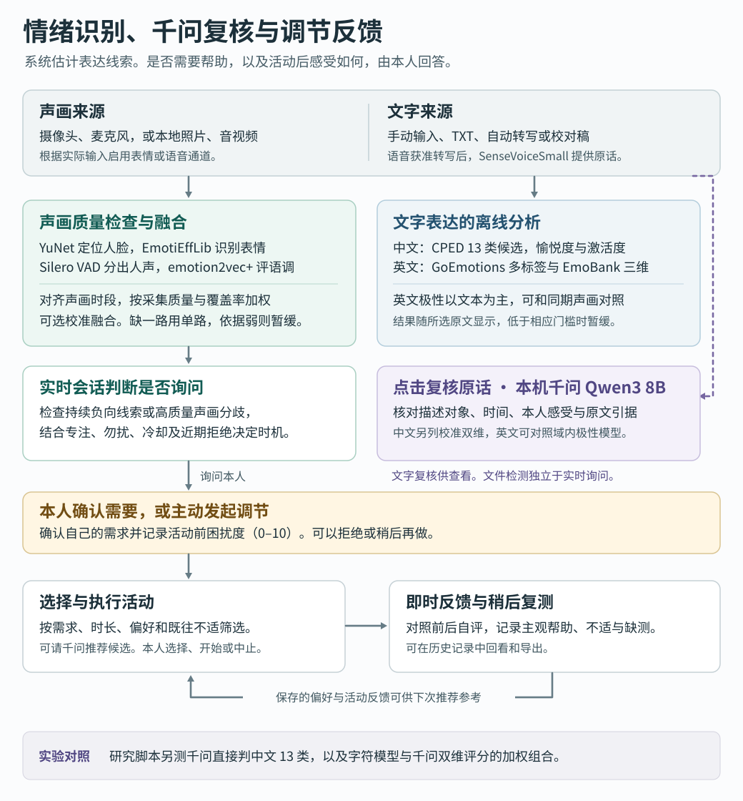
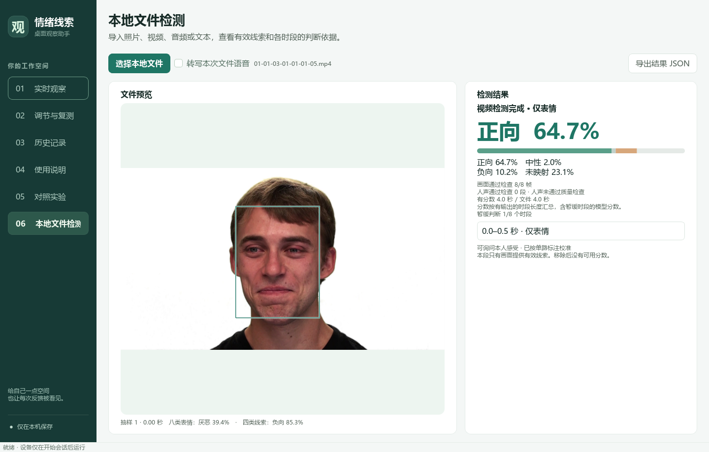
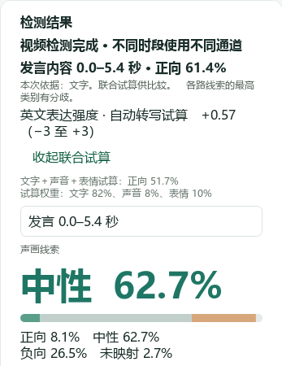
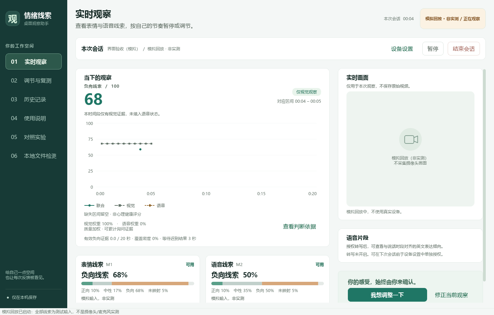
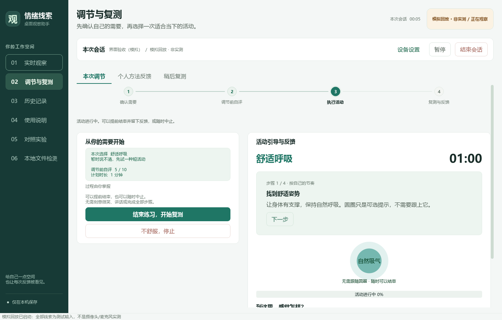
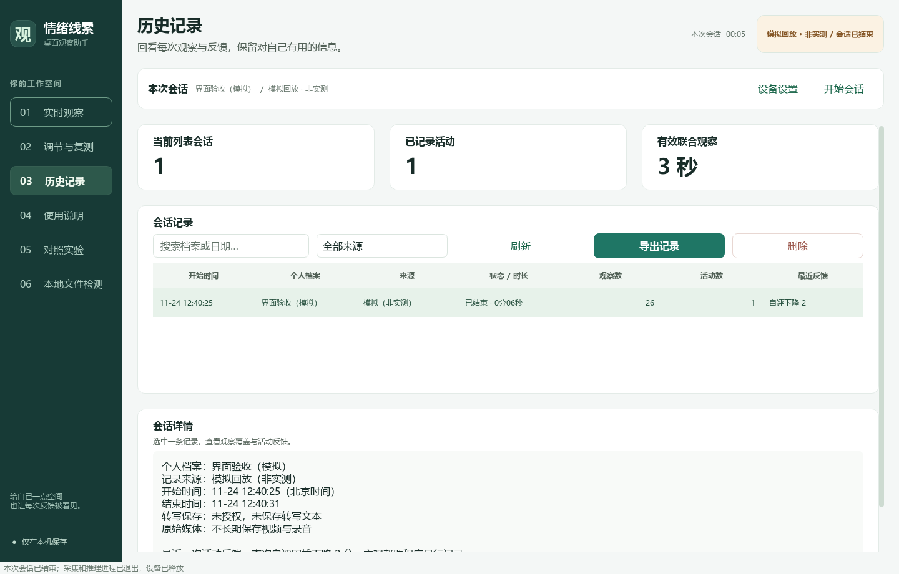

# 桌面情绪线索助手

一个在个人电脑上运行的情感分析与自主调节助手。它从摄像头、麦克风、本地文件或手动输入中分析表达线索，允许用户核对“谁在什么时间表达了什么”。用户决定是否需要帮助、选择哪种活动，再用即时和稍后自评记录体验。[中文研究依据与实测](docs/RESEARCH_RATIONALE_ZH.md) · [研究问题与验证](docs/AI_ASSISTANT_STUDY.md) · [中期报告](docs/MIDTERM_REPORT.md) · [项目进展](docs/PROJECT_PROGRESS.md)

## 算法流程与千问实测



**千问最明确的收益在中文愉悦度。** 通过正式桌面复核入口分析 Chinese EmoBank 的 160 句，159 句获得双维评分。对这 159 句，愉悦度 MAE 从离线字符模型的 **1.1118 降至 0.7888**，Pearson 从 **0.3426 升至 0.7651**。对中文激活度，离线模型的误差更低。在本次新测的 240 条 GoEmotions 英文评论上，原英文模型、千问和域内监督模型的准确率分别为 **44.58%、57.50%、71.67%**。千问对负向判断更好，域内模型在中性和正向上占优。中文 CPED 的 13 类比较也未显示千问相对离线首选有显著优势。程序让用户按需复核原话，并保留各自的读数。[官方数据集对照、桌面入口与完整指标](docs/QWEN_BENCHMARK.md)

## 本版更新

- **直接识别中文。** 在「本地文件检测」选择「输入文字」，也可读取 UTF-8 TXT 或勾选音视频转写。中文短段先离线估计愉悦度和激活度（1–9），再按 13 类中文对白模型尝试给出一个表达候选，依据弱时暂缓。点击「本地大模型复核」可核对说话对象、时点、原文和大模型的评分。两种估计均保留来源。[模型对照与适用条件](docs/RESEARCH_RATIONALE_ZH.md)
- **英文与声画的量化。** 英文发言可同时命中多种情绪，并显示愉悦度、激活度和掌控感线索（1–5，各有预测区间）。照片、音频和视频分别列出表情或语调最受支持的两类及分差。[实际界面与研究验证](docs/AFFECT_QUANTIFICATION.md)

- **本地大模型文字复核。** 实时转写、上传的音视频转写、校对稿和 TXT 都可以按需交给本机 Qwen3 复核。界面分别显示发言倾向、本人当前感受、时间与求助线索，并列出可核对的原文。[启用与使用](#本地大模型文字复核)
- **公开数据研究。** 使用 Google Research 的 GoEmotions 官方训练和测试拆分，比较原有英文分类器、本机 Qwen 和同领域监督模型。先导与复验分别报告判对、判错、暂缓和各类 F1。[实验设计与结果](docs/GOEMOTIONS_EVALUATION.md)
- **按本人需要推荐活动。** 确认需求并填写自评后，可以让本机 AI 从时间允许、本人愿意尝试的活动中推荐一到两种。系统记录最终采纳还是手动改选，反馈页和历史页用同一刻度展示活动前、刚结束和稍后三次自评。[调节测试与反馈示例](docs/AI_ASSISTANT_STUDY.md#调节推荐与反馈验证)
- **缺失条件下的识别。** 实时和本地文件使用同一时段融合策略。只剩一个有效通道时可使用针对该通道的校准；分数、实际参与通道和移除某一路后的变化均可检查。本地支持照片、视频、音频及短文本。[升级方法、逐条件结果和局限](docs/MISSING_MODALITIES.md)
- **一句话表达了什么？** 开启转写后，可以在实时页和文件页按发言时段对照文字、声音和表情。英文内容倾向默认采用文本判断，可展开联合试算查看分数、权重与分歧。调节活动由本人确认。[使用方法和三路对照结果](docs/CONTENT_FUSION.md)
- **英文发言的强度有多大？** 实时转写、上传视频或音频、英文 TXT 均支持 −3 至 +3 的表达强度估计。附件 2 的对照逐项列出局部丢词与多路连续缺段时的判对数、暂缓数、MAE 和 Pearson。[缺失对照与强度验证](docs/ATTACHMENT2_GAPS_AND_INTENSITY.md)
- **两组对照实验：** 已使用真实音视频和独立人工评分运行四种识别策略；桌面端新增「对照实验」，可让同一参与者在两场会话中依次体验两种调节策略。识别成绩和真人调节结果分别统计，见下方「对照实验与结果」。
- **复测结果怎样读：** 调节前后分别保存自评和模型观察。两次观察没有足够的可比证据时，界面说明原因，不把缺失数据算成「没有变化」。
- **什么时候会询问：** 专注、勿扰和近期已拒绝的状态会影响主动提示；希望现在开始时，仍可点击「我想调整一下」。
- **哪些数据会影响下一次：** 主动开启学习并明确确认的日常观察可用于建立个人参考；可以查看依据、暂停或重置。系统默认使用质量加权融合，有独立标注数据时可按[校准说明](docs/CALIBRATION.md)训练和评估可选策略。

## 在桌面中看结果

[观看本地文件检测与反馈演示（MP4）](docs/images/progress/desktop-walkthrough.mp4)。视频从选择本地文件开始，展示声画检测、逐时段检查、英文转写校对和结果导出，末段演示独立的模拟调节会话。

**本地文件检测。** 下图为实际检测的 RAVDESS 视频。8 帧抽样画面通过检查，人声没有通过质量门槛，程序采用视觉线索，整段正向得分为 64.7%。左侧是单帧，右侧是整段汇总。视频来自 Livingstone 和 Russo（2018），截帧及界面标注沿用素材许可。[RAVDESS 数据来源](https://zenodo.org/records/1188976) · [CC BY-NC-SA 4.0](https://creativecommons.org/licenses/by-nc-sa/4.0/)



**有英文发言的视频。** 下图显示一段真实视频中 0.000–5.399 秒发言的结果。文本分类为正向 61.4%，逐发言强度为 +0.57，文字结合同期声画的候选分数为正向 51.7%。同一文件在新版“全部发言时段”下的自动强度为 +0.55。逐发言视图和整段文件视图使用各自的评分方法。[图中逐发言输出](docs/images/progress/file-intensity-example.json) · [新版整段结果与导出核验](docs/results/asr-file-ui.json)



<details>
<summary>查看实时观察、调节活动和历史记录三个页面</summary>

**实时观察。** 观察当前时段的表情、语音和融合结果，检查证据质量，或主动发起调节。



**调节与复测。** 用户确认后可选择活动，按步骤练习，反馈当前是否合适，并在结束后填写自评。



**历史记录。** 查看已保存会话的来源、覆盖和反馈。三张页面图使用隔离环境中的模拟会话，图中的评分变化属于脚本输入。



</details>

## 安装与启动

开发与验证环境为 **Windows x64、Python 3.12**。默认的声画和转写模型使用 CPU，可选大模型由独立的本机 Ollama 服务运行。请先安装 Git 和 Python 3.12 x64，再在 PowerShell 中执行：

```powershell
git clone https://github.com/dianxingaoshou/emotion-assistant.git
cd emotion-assistant
powershell -NoProfile -ExecutionPolicy Bypass -File .\setup.ps1
```

脚本在项目内创建 `.venv`、安装锁定依赖，并下载约 2 GiB 的默认声画和转写权重。完成后双击 **`start.cmd`** 启动，日常使用无需激活环境或重新安装。可选的大模型另行准备。

只体验模拟流程或运行离屏软件回归时，可在安装时跳过模型权重：

```powershell
powershell -NoProfile -ExecutionPolicy Bypass -File .\setup.ps1 -SkipModels
.\.venv\Scripts\python.exe scripts/verify.py
```

`-SkipModels` 只跳过权重下载，仍安装锁定依赖。没有 Python Launcher 时可追加 `-PythonExe 'D:\python\python.exe'` 指定已有 Python 3.12；默认使用清华 PyPI 镜像，也可追加 `-IndexUrl https://pypi.org/simple`。后续需要真实推理时运行 `.\.venv\Scripts\python.exe scripts/download_models.py --all`，详见 [模型说明](docs/MODELS.md)。

## 本地大模型文字复核

复核使用 Ollama 的 `qwen3:8b`，只向本机 `127.0.0.1:11434` 发送点击时选中的文字。项目的 Python 环境无需安装 GPU 版 PyTorch。可以安装 [Ollama for Windows](https://docs.ollama.com/windows)，或将其官方 Windows 便携版解压到项目的 `.runtime/ollama/`。首次在项目根目录启动服务并准备模型：

```powershell
.\scripts\start_text_review.ps1 -PullModel
```

首次下载模型约 5.2 GB。以后运行 `.\scripts\start_text_review.ps1` 即可启动或复用服务。脚本启动便携版时将权重放在项目忽略的 `models/ollama/`。已有 Ollama 服务使用它自己的模型目录。

- **实时会话**：开启转写，选择一段已转写的发言，点「本地大模型复核」。复核在后台进行，结果仅在本次会话显示。
- **本地文件**：打开 UTF-8 TXT，或开启「转写本次文件语音」后导入音视频。在文件结果中选择整段、一次发言或已确认的校对稿，再点击对应的大模型复核按钮。成功结果跟随对应文字导出。
- **读结果**：例如“这部电影很糟”表达了负向评价，说话人当下的感受仍可显示为“证据不足”。复核结果供核对，原有分类和强度分数独立保留。服务不可用、超时或引文校验失败会显示原因。每次最多复核 16 KiB 的文字。

同一服务也用于活动推荐。在「调节与复测」确认需求，填写调节前困扰度，选择目标和可用时间后点「用本机 AI 推荐活动」。这一步仅发送本次结构化输入和可用活动。自己选择、改选、暂不需要和结束活动都由本人操作。

有效英文文字会额外显示一个仅用 GoEmotions 官方训练集拟合的轻量模型作参照，两种方法有分歧时，界面提示核对原话。在同一组 180 条留出评论上，原英文模型、Qwen、域内监督模型分别判对 76、110、116 条。满足界面“一致”条件的 90 条中有 75 条正确。[实验范围与逐类结果](docs/AI_ASSISTANT_STUDY.md#识别实验)

## 使用流程

**分析本地文件。** 打开左侧“本地文件检测”，点击“选择本地文件”。照片展示人脸框和表情，音频分析有效人声，视频按时间戳结合这两路证据。右侧可选择具体时段，看哪一路参与、是否暂缓，以及移除某一路后同一类别的分数。没有摄像头、麦克风也可以使用。已有环境如果缺少新版解码库，请在项目根目录执行 `.\.venv\Scripts\python.exe -m pip install -r requirements-base.txt`。

**分析发言。** 先勾选“转写本次文件语音”，再选择音视频。中文可按时段查看表达候选、愉悦度与激活度，在整段结果点“校对整段转写”可修正漏词和错词。英文另提供发言极性、−3 至 +3 的连续强度以及同期声画联合试算。直接输入文字或选择 UTF-8 短文本（上限 16 KiB）也可分析，中文模型每次评估 512 字以内的短段。导出 JSON 保留来源、原文及用户确认的校对内容。文件结果独立于实时会话历史。

**使用摄像头实时观察。** 开始会话后设备设置自动收起，点击“设备设置”可查看；暂停与结束按钮始终保留。模型卡片显示各自的观察区间，技术信息收在“详情”中。历史页支持按来源筛选和搜索档案、日期。

实时页可切换“允许主动询问”“专注中”和“勿扰”，随时都可以自己发起调节。在会话设置中勾选“学习个人参考”后，可把一次观察明确标记为自己的日常状态。点击“个人参考”查看样本依据、暂停学习或重置。使用说明页的融合策略选项在下一场会话生效。操作与复验见 [可信融合与反馈调节](docs/RELIABLE_LOOP.md)。

调节页进一步拆分为“本次调节／个人方法反馈／稍后复测”：八类活动按当前需要、可用时间和个人反馈给出推荐理由，执行时显示步骤，完成后保存即时结果与可选延迟结果。设计约束见 [调节界面设计](docs/REGULATION_UI_DESIGN.md)，机制与复现方法见 [调节闭环说明](docs/REGULATION_LOOP.md)。

核心审查补丁已与原工程增量合并：原始近均匀预测留作证据但不参与判断，自动询问按 20 秒有效区间并集累计，并保留 3 秒有限等待和迟到修订；声学与转写分开运行。界面新增预测诊断与端到端耗时、有效证据时长、独立前后各 30 秒辅助观察、跳过和保存失败重试。完整接口映射与验证边界见 [补丁集成说明](docs/REVIEW_INTEGRATION.md)。

1. 填写个人档案名称，选择“真实设备采集”。
2. 选择摄像头和需要使用的麦克风；麦克风默认关闭。限本人主动使用的单人环境，不选择“立体声混音”等系统回录设备。
3. 勾选自愿采集并开始会话。需要发言内容分析时，另行勾选“保存语音转写（可选）”，默认关闭。
4. 实时页查看两种模型、输入质量、对应时间段的融合结果与趋势；可修正当前观察、暂停或结束。
5. 点击“我想调整一下”，确认后选择当前需要、时间与调节前困扰度，再自主选择一种方法。按步骤练习，可反馈“目前合适／没变化／不舒服”、换方法或随时结束；不适会立即停止引导。
6. 点击“结束练习，开始复测”，分别填写后自评和主观帮助程度，可记录下一步行动、自愿开启稍后复测。待复测记录关闭重启后仍保留；“个人方法反馈”可查看样本数并设置偏好。
7. 结束会话，在“历史记录”查看覆盖时长、活动反馈，导出完整 JSON 或删除本地记录。

无设备时可选择“模拟回放（非实测）”体验同一操作流程。模拟会话有独立标识，模型线索及脚本自评分数均为测试输入，不计作真实采集或实验成绩。

## 对照实验与结果

**真实视频自动转写后，强度预测为何退化？** 原有 43 段视频中，自动强度首次归档的 Pearson 为 0.038。固定在 41 段共同有效的视频，只改分段汇总使 Pearson 提升 0.025；固定整段评分，换用官方稿则提升 0.300。依据这项对照，短英文文件加入了针对错词训练的字符回归。相同的 42 段有效原视频上，旧方法本轮复跑为 0.031，正式文件入口为 **0.094**，MAE 从 **0.574** 降至 **0.549**。相关仍弱，两个配对改善区间均跨零。[实验设计、结果与复现](docs/ASR_INTENSITY_STUDY.md)

**局部丢词或同时缺失多路时还能判对多少？** 在附件 2 的同一批 727 段测试样本上比较了缺失的模态、比例和位置。桌面英文文本强度模型在完整转写上 MAE 为 0.787，Pearson 为 0.492；删去开头一半词语后，718 段仍有强度估计，MAE 为 0.826，Pearson 为 0.391。[逐条件判对、暂缓和强度指标](docs/ATTACHMENT2_GAPS_AND_INTENSITY.md)

**加入声音和表情，能提高英文发言内容判断的准确率吗？** 在 E 题 19 个留出来源的 43 段视频上，逐发言文本判断正确 19 段，联合候选正确 18 段，单靠声画线索对应到内容标签正确 11 段。多数类基线正确 27 段。联合候选的三类 Macro-F1 从文本的 0.3086 升至 0.3214，但有判断的片段从 39 减至 34。开发集预设启用条件未满足，当前默认使用文本判断。[数据、实验口径和缺失对照](docs/CONTENT_FUSION.md)

**缺失时还能判断到什么程度？** 62 条留出原视频各跑 12 种连续缺失条件：缺声音时准确率由 57.80% 升至 82.26%，缺画面时由 97.58% 略降至 97.04%。另用 E 题附件 1 全部 100 段真实视频验证文件入口，有分数的片段由 12 增至 94；关闭转写时，声画最高分与整段英文语义标签一致的只有 25 段。连续缺失、真实上传和英文转写各有独立的分母与基线。[完整实验方法与数据](docs/MISSING_MODALITIES.md)

**识别：同一段音视频，只看脸、只听声音和两种融合谁更准？** 用本项目的实际模型离线处理了 [RAVDESS](https://zenodo.org/records/1188976) 的 192 段同步音视频，来自 24 位演员。每段的参考答案来自 10 位观察者的[实际评分](https://doi.org/10.1371/journal.pone.0196391.s008)。拟合、选阈值、测试各用不同的 8 位演员。测试 64 段，其中 1 段评分平票、1 段无可用视觉；下表四种方法比较同一批剩余 **62 段**。错误数一列分别取各方法最有把握的 43 段，使覆盖率相同。

| 方法 | 四类 Macro-F1 ↑ | Brier 概率误差 ↓ | 相同覆盖下的错误数 ↓ |
| --- | ---: | ---: | ---: |
| 仅视觉 | 0.4447 | 0.6309 | 17/43 |
| 仅声学 | 0.9838 | **0.0444** | 0/43 |
| 默认质量加权融合 | 0.9364 | 0.1965 | 1/43 |
| 完整校准融合 | 0.9838 | 0.1520 | 0/43 |

相对默认融合，校准融合的 Macro-F1 高 0.0474（按演员配对重抽的 95% 区间 0.0000 至 0.1089），Brier 低 0.0445（差值区间 −0.0882 至 −0.0034）。**本批片段中，校准融合与仅声学的 F1 持平，概率误差则是仅声学最低。** 这项实验没有证明融合总优于单模态。数据是英语表演语音；也不能排除基础声学模型训练时接触过 RAVDESS。[方法、局限和复现命令](docs/RECOGNITION_EXPERIMENT.md) · [机器可读的汇总](docs/results/ravdess-recognition.json)

**调节：自适应策略是否比基础策略少打扰、更有用？** 「对照实验」会为每个自愿参与的代号随机安排基础→自适应或相反顺序，实际切换主动提示和推荐排序。独立记录“此刻不想收到提示”和“是否接受活动”，汇总每小时不想要的提示、接受率、活动完成率、即时及稍后困扰度变化，显示有效人数和缺失数。已用隔离数据库和模拟界面验证完整两场流程、导出和退出；**尚无真人对照结果**。参与者使用同一代号与同一台电脑、在相近日常场景做两场，无需制造负面情绪。[真人操作步骤、指标分母及导出方式](docs/CROSSOVER_STUDY.md)

## 完成范围与验证边界

已实现采集进程、Silero 语音分段、统一会话时间戳、表情与声学模型、本地文件检测、中英文转写和文字分析，以及缺失和冲突处理。中文提供对白表达候选、愉悦度、激活度和可选的原文复核。调节流程支持用户确认和修正、八类分步活动、即时反馈、前后自评和可选稍后复测。历史记录可导出和删除。

开发机已完成独立环境检查、自动化回归、离屏界面操作、模拟闭环保存，以及官方样例的真实模型推理和独立进程退出检查。检查工具会在本机 `reports/` 生成结果；此目录不随 Git 上传。模型来源及固定版本在 [模型说明](docs/MODELS.md)。

**截至 2026 年 11 月 25 日**，开发机默认实验库的真人调节对照登记为 0 人、0 场。外接摄像头完整会话、实际拔插恢复和 60 分钟稳定性仍待现场验收。[阶段成果、适用场景与实验数据](docs/PROJECT_PROGRESS.md)

下一步先细化八类调节活动的推荐理由、过程反馈和复测设计，再接入外置 USB 摄像头，在目标电脑上调试采集、缺路与恢复，并开展真人配对测试。前两项完成后，有时间再做支架、收音与供电等硬件搭建。[下一阶段计划](docs/PROJECT_PROGRESS.md#六下一阶段的设计与实测计划) · [现场验收步骤](docs/PHASE1.md)

## 环境隔离

使用项目专用 Python **3.12** `.venv`；开发机已验证的版本为 3.12.6。所有项目命令直接调用该解释器，不修改系统 PATH、不全局装包、不修改第三方安装代码。推理默认 CPU，无需配置 CUDA。

| 位置 | 内容 |
| --- | --- |
| `emotion_assistant/` | 界面、采集、模型适配、融合、活动控制和数据库代码；纳入 Git |
| `scripts/`、`tests/` | 安装下载、自检、验收工具与自动化测试；纳入 Git |
| `.venv/` | 本项目独立依赖；仅保留在本机 |
| `models/` | 下载后的模型权重与本机 SHA256 清单；仅保留在本机 |
| `.runtime/` | 缓存、临时文件、测试素材和本机备份；可能包含私有内容，不上传 |
| `data/` | 用户主动开始的真实或模拟会话 SQLite 数据库；不上传 |
| `reports/` | 自检、测试结果、截图和会话导出；不上传 |
| `docs/` | 架构、模型来源和验收说明；纳入 Git |

基础依赖记录在 `requirements-base.txt`，模型依赖在 `requirements-models.txt`，实验训练所用的 scikit-learn、threadpoolctl 等版本在 `requirements-lock.txt` 中锁定。仓库附带本项目拟合的中英文小型模型和单路校准参数。表情、声学和转写的第三方大型权重由下载脚本按固定版本获取并核验 SHA256，使用和再分发条件以各官方模型卡及许可证为准。推理使用本机模型，缓存保存在 `.runtime/cache/`。

## 自检与复验

```powershell
.\.venv\Scripts\python.exe scripts/doctor.py
.\.venv\Scripts\python.exe scripts/verify.py
.\.venv\Scripts\python.exe scripts/regulation_smoke.py
.\.venv\Scripts\python.exe scripts/review_ui_smoke.py
.\.venv\Scripts\python.exe scripts/model_smoke.py
```

`doctor` 仅枚举设备，不打开摄像头或录音。`verify` 运行回归、界面启动及明确标记的模拟闭环，不采集真人数据。`model_smoke` 使用已有官方样例验证真实模型；若样例不存在，可显式加 `--download-samples` 下载。报告中的单次推理耗时只证明当次运行，不是正式性能基准。

## 用 Git 维护

`main` 保存可运行版本，功能修改在独立分支提交，再通过 Pull Request 合并。日常操作见 [Git 维护流程](docs/GIT_WORKFLOW.md)，提交要求见 [CONTRIBUTING.md](CONTRIBUTING.md)。

仓库跟踪源码、测试、文档、依赖清单和下载脚本。`.gitignore` 排除环境、权重、缓存、数据库和运行报告；Git 不备份个人会话，相关数据应另行安全备份。自动检查使用离屏模拟流程，不访问摄像头、麦克风或下载大模型。

## 记录与使用边界

原始视频、原始录音不长期保存；语音回调仅写入有界内存缓冲，模型在独立进程运行。关闭后停止并回收采集/推理进程。转写授权在模型调用和数据库写入两处检查。

分数描述可观察线索。应用分别保存主观感受、模态变化和有效覆盖。个人推荐展示反馈依据与样本数，真实与模拟历史分开统计。项目使用手动个人档案。目标人群的概率校准效果、误提示率与活动效果仍需独立标注或真人试验验证。
