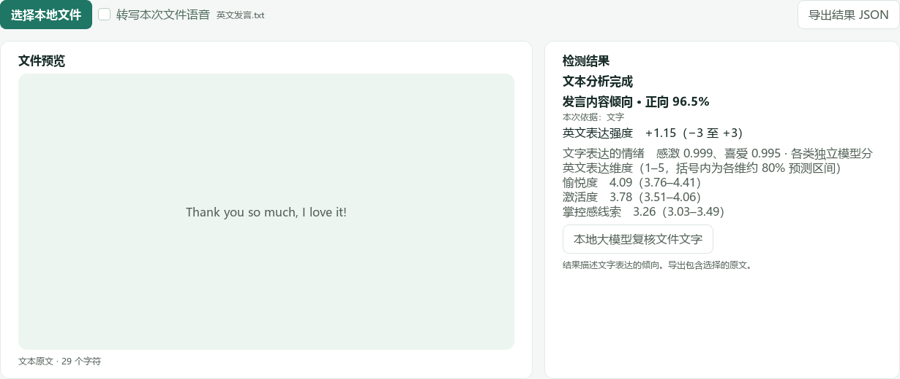

# 从正负倾向到可核对的情绪量化

中文现已可在手动输入、文件和实时转写入口直接读取本地字符模型的双维估计和 CPED 类别候选。下文保留首次接入 Qwen 时的量表校准结果。新增的中文监督模型与 Qwen 在另一批 160 句上的对照见[中文科研依据与实验](RESEARCH_RATIONALE_ZH.md)。

同样是正向表达，“我终于能安静地歇一会儿了”和“我激动得跳了起来”传递的激活程度不同。助手现在分别回答三个问题：原话可能表达哪些情绪？表达听起来有多愉快、平静或激动？表情与语气各自支持哪些候选？三类结果保留各自的输入、单位和适用条件。

## 近期研究怎样影响实现

| 原始研究 | 项目采用的做法 |
| --- | --- |
| SemEval 2025 Task 11 分别评测多标签情绪及逐情绪强度，同一句话可有多个标签。[任务论文](https://aclanthology.org/2025.semeval-1.327/) | 英文为每种情绪独立评分与设阈值，允许“感激”和“喜爱”同时出现。类别分只用于决定哪些标签值得展示。 |
| SemEval 2026 Task 3 为给定评价对象预测愉悦度、激活度；ROCLING 2025 在中文文段上用两个维度的 MAE 与 Pearson 分别评价。[SemEval 2026 论文](https://aclanthology.org/2026.semeval-1.452/) · [ROCLING 任务定义](https://rocling-sigai.github.io/task2025/) | 中文短段附原文依据，分别评估表达的愉悦度与激活度。量化对象为选中的整段文字；对特定产品属性的独立评分尚未实现。 |
| NRC VAD v2 对英语词和多词表达收集愉悦度、激活度和支配感标注。EmoBank 在句子层面提供读者、作者视角标注及其加权值。[VAD v2 原论文](https://aclanthology.org/2025.ijcnlp-long.107/) · [EmoBank 官方标注说明](https://github.com/JULIELab/EmoBank/blob/248ce2a43e165a66d31aeaed83cff9641d6654e0/corpus/README.md) | 用英文句级人工评分训练三个连续维度。每一维分别给出预测区间，并验证在留出句子上的覆盖率。 |
| MER 2026 将细粒度描述及人对不同情绪描述的偏好列为独立任务。[组织者论文](https://arxiv.org/abs/2604.19417) | 表情与语调分别列前两类及差距，保留“未知”和暂缓。用户可结合原片段判断哪种解释合适。 |

## 在程序中看什么

- **英文文字。** 上传 UTF-8 TXT 或允许转写音视频后，文件页显示实际选中来源的细类与维度。实时转写同样显示。三维依次为愉悦度（不愉快到愉快）、激活度（平静到激动）、掌控感线索（感到受制到感到能掌控），刻度均为 1–5。桌面量化模型在本地运行。三维估计适用于不超过 80 个英文词的短段，过长时可选择单次发言。
- **中文文字。** 在实时或文件页选中 512 字以内的中文短段，先可查看离线双维读数和对白类别候选。点击本地大模型复核后，Qwen3 8B 独立阅读原话，给出 1–9 的愉悦度与激活度，程序检查引用是否逐字出现在输入中。中文和英文沿用各自人工数据的刻度，活动前后另由本人给出 0–10 困扰度自评。
- **表情和语调。** 照片看表情，音频看语调，视频和实时有哪一路有效就显示哪一路。每路的分数是该模型内部对类别的相对支持度，前两名差距用百分点表示。缺少有效脸部或人声时该路暂缓；表演者可能以惊讶的语调说出内容中性的句子。

真实文件页输入 “Thank you so much, I love it!” 同时得到“感激 0.999、喜爱 0.995”；愉悦度 4.09、激活度 3.78、掌控感线索 3.26。此句愉悦度的预测区间约为 3.76–4.41。类别分、句级维度与本人实际感受是三个不同的测量对象。[实际导出与校对验证](results/affect-ui-verification.json)



## 英文细类与连续评分

**细类。** 使用 Google Research 的 GoEmotions 官方训练、开发、测试拆分。对 27 种情绪及中性分别拟合词与相邻词对的逻辑回归；阈值按开发集各类 F1 选择。以下分母均为完整测试集 5,427 条。宏 F1 对 28 类等权，micro-F1 汇总所有标签的命中、漏报与错报。[原始数据论文](https://aclanthology.org/2020.acl-main.372/) · [每类指标和覆盖](results/goemotions-fine-emotions.json)

| 策略 | 宏 F1 | micro-F1 | 覆盖率 | 标签集合完全正确 |
| --- | ---: | ---: | ---: | ---: |
| 同一模型，各类固定 0.5 阈值 | 0.3075 | 0.4652 | 56.81% | 1,779 |
| 各类使用自己的开发集阈值 | 0.4475 | 0.5292 | 96.52% | 1,680 |

新版提高了跨类别的召回，每条平均报 1.55 个标签，人工平均为 1.17 个。它也会多报，标签集合完全吻合的条数有所下降。感激的 F1 为 0.914，而测试集中只有 11 个正例的“如释重负”F1 为 0.133。若中性和具体情绪都超过阈值，界面提醒核对原话。

**三维。** 使用 EmoBank 官方 8,062 句训练、1,000 句开发、1,000 句测试。比较方法一是把原桌面三类分数经训练换算成三维，方法二是直接从词、词对、字符片段等特征回归人工维度。表内比较同一批满足桌面词汇要求的 958 句（覆盖 95.8%）。MAE 越小越好，Pearson 衡量预测能否跟随人工评分的高低变化。[数据、门控前后及去重结果](results/emobank-vad.json)

| 维度 | 原三极性换算 MAE | 直接回归 MAE | 原三极性换算 Pearson | 直接回归 Pearson |
| --- | ---: | ---: | ---: | ---: |
| 愉悦度 | 0.2392 | 0.2071 | 0.2613 | 0.5438 |
| 激活度 | 0.1867 | 0.1746 | 0.0331 | 0.3913 |
| 掌控感线索 | 0.1553 | 0.1502 | 0.1013 | 0.3015 |

区间用开发集误差分别校准，目标每一维覆盖 80% 的人工分。留出集实际覆盖为 79.23%、79.12%、78.81%。这个比例描述一批相似句子上区间的表现；掌控感尤其难从文字推断。再排除和训练文本逐字相同的句子后，剩余 945 句的三项相关系数分别为 0.537、0.384、0.296。

## 中文维度

使用作者发布的 Chinese EmoBank 句级 CVAS 文件，人工分别对愉悦度与激活度给 1–9 分。固定哈希选择的首批 96 个句子中，原始 Qwen 评分有 95 条通过逐字引用等校验。在这 95 条上，愉悦度 MAE 为 1.125，Pearson 为 0.735；激活度 MAE 为 1.271，Pearson 为 0.308。同一批上，始终报其余语料平均值的 MAE 为 1.158、0.975，说明原始激活度给分存在明显偏差。语料主要为繁体中文，构造的简体演示句只用于核验界面。[作者语料说明](https://github.com/NYCU-NLP/Chinese-EmoBank) · [首轮逐维结果](results/chinese-cvas-dimensions.json)

针对这个问题，固定提示词，从同一哈希序列另取 192 句，仅用其中有效的 188 句为两维分别拟合“截距 + 斜率 × 原始等级”。在查看最后 160 句的人机误差前冻结参数。首轮、校准、最终确认三组句子没有重叠。界面同时显示校准分与原始等级，导出包含引文、模型与校准版本。这个校准把打分尺度对齐到该句库的人工均分。

| 独立确认的 159 个有效句子（共 160） | 固定报校准集均值 MAE | Qwen 原始 MAE | 校准后 MAE | 原始及校准 Pearson |
| --- | ---: | ---: | ---: | ---: |
| 中文愉悦度 | 1.1949 | 0.9640 | **0.7882** | 0.7342 |
| 中文激活度 | 0.9897 | 1.0648 | **0.9683** | 0.1848 |

160 句中有 159 句获得有效评分，覆盖率为 99.38%。若在评测时为唯一暂缓的句子填入校准集均值，全 160 句的愉悦度 MAE 为 0.7863，激活度为 0.9856。实际界面对该句显示暂缓。线性校准改善了数值误差，两维的排序和相关系数保持原值。**中文激活度对不同句子的排序仍然较弱**，相对固定报校准集平均值，MAE 仅改善 0.0215，配对自助抽样的 95% 区间为 −0.0173 至 0.0640，仍不足以证明优于均值。此处评估的是双维评分模块，正常界面还需先通过所选文字的语义复核。模型预训练是否见过公开数据无法核实。[独立校准与确认结果](results/chinese-cvas-calibration.json)

在实际文件页复核“我今天非常开心，听到这个好消息时兴奋地跳了起来。”时，模型对愉悦度和激活度的原始等级为 9 和 7。依照校准后的量表，界面分别显示 6.86 和 5.77，并保留原始等级供核对。这个例子展示了校准如何影响读数，表中的误差来自独立确认集。[文件页实测记录](results/affect-ui-verification.json)

## 声画的前两类意味着什么

从项目原有的留出演员中取 8 人、64 段 RAVDESS 视频，全部经真实文件入口分析。每路仅在自己的模型类别内按有效时长与质量汇总。为两路分别使用官方 S5 中十位观察者对无声画面、纯音频的投票，以唯一众数作对照；投票并列不强定真值，模型暂缓保留在分母内。[RAVDESS 官方发布](https://zenodo.org/records/1188976) · [抽样、投票和逐片结果](results/native-expression-profiles.json)

| 模态 | 有唯一人工参考 | 模型暂缓 | 第一候选命中 | 人工参考落在前两候选 |
| --- | ---: | ---: | ---: | ---: |
| 表情 | 58 | 0 | 32/58（55.17%） | 42/58（72.41%） |
| 语调 | 60 | 16 | 29/60（48.33%） | 36/60（60.00%） |

前两候选覆盖衡量给用户展示两种解释时是否包含观察者选择。它与只允许一个答案的准确率分开报告。这批视频来自表演语料，只涵盖四种设定的表达；自然对话、中文使用者的自报情绪，以及依据这些分数选择活动的真人效果仍需独立验证。

我们还直接对照了观察者给出的 1–5 表达强烈程度。模型最高类别分与人评强度的 Pearson 在表情上为 0.176（64 对），在语调上为 0.042（47 对）。因此即使语调模型给某类 99% 的相对分数，界面也只把它用于类别排序。

## 复现入口

正式中英文字符或词语模型可离线使用。重新训练及评测使用项目的 Python 环境，输出写入 `reports/`。项目提供拟合后的权重与校准参数，官方 CVAS 原文从本机研究缓存中读取。声画对照复用项目原有 RAVDESS 视频和 S5 评分表。

```powershell
.\.venv\Scripts\python.exe scripts/evaluate_fine_emotions.py --download
.\.venv\Scripts\python.exe scripts/evaluate_affect_dimensions.py --download
.\scripts\start_text_review.ps1
.\.venv\Scripts\python.exe scripts/evaluate_chinese_affect.py --download
.\.venv\Scripts\python.exe scripts/calibrate_chinese_affect.py
.\.venv\Scripts\python.exe scripts/evaluate_expression_profiles.py
```
