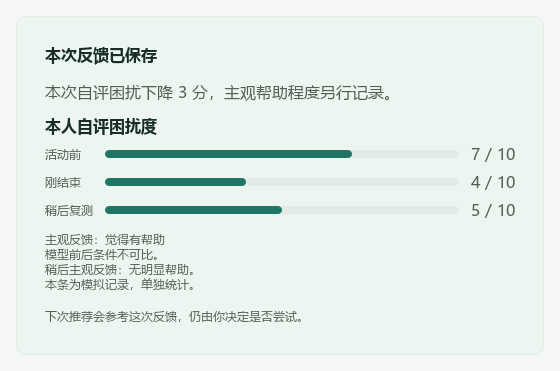

# 情感分析与自主调节助手的研究验证

当前版本在中英文官方数据上的逐项对照、较强的监督参照和算法流程图见[千问发布评测](QWEN_BENCHMARK.md)。

中文识别的近期论文、CPED 对白分类、Chinese EmoBank 同批有无大模型的维度对照及语境测试已单列成文。[中文科研依据与实验](RESEARCH_RATIONALE_ZH.md)

发言倾向实验之外，项目现有独立的多标签分类、愉悦度与激活度等连续量表，以及表情与语调各自的细类验证。[多维识别报告](AFFECT_QUANTIFICATION.md)

这套桌面助手服务于能亲自确认感受和需求的人。它回答三个可以分别检验的问题：一句话表达了什么？本人希望获得哪类支持？活动后，本人报告了什么变化？

| 环节 | 系统使用的证据 | 验证目标 |
| --- | --- | --- |
| 识别 | 同一时段的表情、声音和自愿提供的文字，逐字可核对的引文 | 用公开人工标签检验文字倾向，用受控语句核查对象、时间和当前感受 |
| 调节 | 本人确认的需求、前自评、可用时长、活动偏好和既往不适 | 模型能否在合格的活动中给出选择，用户能否拒绝、改选或中止 |
| 反馈 | 本人填写的活动前、刚结束及稍后困扰度，另记主观帮助和不适 | 能否区分即时变化、延迟变化、缺测与不适。活动效果需要真人数据 |

## 识别实验

主要文字对照来自 Google Research 的 GoEmotions 英文评论。原始标注为 27 种情绪加中性。这里使用官方极性分组评估三类发言倾向，固定测试样本、模型与提示词，同时报告暂缓、各类错误和覆盖率。对照包括项目原有英文分类器、本机 Qwen3 8B，以及仅使用 GoEmotions 官方训练拆分训练的轻量分类器。[先导与独立复验](GOEMOTIONS_EVALUATION.md) · [GoEmotions 原论文](https://aclanthology.org/2020.acl-main.372/)

先导组每类 20 条，共 60 条；冻结模型后的另一组每类 60 条，共 180 条，与先导组没有重复 ID。下表三种方法都读取同一组 180 条原文。暂缓也计入整组准确率的分母。

| 独立复验方法 | 判对 | 判错 | 暂缓 | 整组准确率 | 宏 F1 |
| --- | ---: | ---: | ---: | ---: | ---: |
| 原桌面英文分类器 | 76 | 98 | 6 | 42.22% | 0.4162 |
| Qwen3 8B 文字复核 | 110 | 63 | 7 | 61.11% | 0.6178 |
| GoEmotions 域内 TF-IDF + 逻辑回归，取最高分类 | 116 | 64 | 0 | 64.44% | 0.6455 |

Qwen 比原分类器多判对 34 条，提升 18.89 个百分点。面对中性评论，Qwen 仍把 60 条中的 22 条判为负向。域内监督模型的整体命中数最高，Qwen 与它的双侧精确配对检验 p = 0.5614。桌面会在有效英文输入上并列显示 Qwen 和监督模型对发言的判断。在 180 条中，90 条符合界面的“一致”条件，其中 75 条正确，15 条错误。该组命中率 83.33%，覆盖全部样本的 50%；“一致”仍需核对原话。其余 80 条有分歧，4 条缺少有效英文参照，6 条大模型暂缓。[大模型逐类与配对结果](results/goemotions-text-review-replication.json) · [域内模型与一致样本统计](results/goemotions-linear.json)

**一句话的评价对象会改变系统的判断。** 在真实桌面 TXT 入口，“This movie is terrible.” 的发言倾向为负向，评价对象为电影，本人当前感受显示“证据不足”。“刚才确实很烦，但现在好多了。”被识别为涉及过去与现在，感受在好转，本人此刻属于哪一种倾向仍待确认。这两句话参与过开发调试。另行冻结的 8 条中英文用例中，6 条的所有预定字段都符合预期，本人当前感受 6/8，求助或拒绝 2/4。本人拒绝帮助必须由界面操作优先决定。[独立用例与逐项错误](results/semantic-review-challenge.json)

**真实视频走桌面入口。** RAVDESS 演员 06 的公开片段 `01-01-08-01-01-01-06.mp4` 中，SenseVoice 在 0.896–3.104 秒转写出 “Kids are talking by the door.”。Qwen 将这句话判断为中性陈述，对说话人当前感受暂缓。原数据中的表演类别为惊讶，两种标注描述不同层面的证据。文件页分别完成自动转写片段、手工校对稿的复核与 JSON 导出。[两种来源的真实输出](results/ai-text-video.json) · [RAVDESS 官方发布](https://zenodo.org/records/1188976)

既有视频语料仍用于检查跨域表现。对原留出集按固定哈希每类选 10 段，输入相同的官方英文转写，原分类器判对 15/30，Qwen 判对 18/30，均无暂缓。负、中、正各类命中分别从 5、3、7 变为 7、6、5。这是原文极性实验，无法据此推出自动转写强度的 Pearson 有所提升。[原文倾向实测](results/ai-text-cross-domain.json) · [复现脚本](../scripts/evaluate_text_review.py) · [视频强度实验](ASR_INTENSITY_STUDY.md)

## 调节推荐与反馈验证

**多轮调节的程序实测。** 在开发用的 6 个中文场景中，经桌面使用的处理函数完成 13 轮。4 轮明确指令由本地规则立即识别，另 9 轮实际调用本机 Qwen3:8B。13 轮的处理来源和请求动作均符合案例预期。本机已加载模型的 9 轮耗时为 0.563–1.196 秒。初稿在 4 个场景的 8 轮中匹配 7 轮，未答出回忆问题；倾听模式的界面走查还发现模型有时会主动提出解决方案。最终版本约束了倾听回复，并在明确回问前文时校验引用是否能在本人先前的消息中找到。两次回问都能引用具体细节，一次找回“上次忘记翻到最后一张幻灯片”，另一次采用了使用者纠正后的“青梨号”。这组用例参与过开发，只能说明这些操作可以复现。[初稿记录](results/regulation-chat-pilot.json) · [最终逐轮记录](results/regulation-chat.json) · [复现脚本](../scripts/evaluate_regulation_chat.py)

本人在「调节与复测」确认需求并填写前自评后，可以点「用本机 AI 推荐活动」。程序先过滤时长不符、设为回避或有不适记录的活动，再让模型从可选列表里挑选一到两种。理由取自活动说明、需求匹配和本人偏好。用户点选后仍需亲自开始，也可以改选、拒绝或中止。现有固定交叉对照试验继续使用原来的分组协议。

在预先设定的 8 种情境下，7 种有合格活动，7 次真实模型调用均给出合格建议，且每次至少含一项与所选目标匹配的活动，共涉及 7 种活动。剩下 1 种设为全部回避，系统没有请求模型。另用桌面入口演练了「采纳任务拆解」和「看过建议后手动改选舒适呼吸」，数据库和导出 JSON 正确区分了两种选择来源。这些是软件行为与约束测试，未测量真人调节效果。[八种情境的逐项结果](results/ai-activity-offers.json) · [桌面操作验收](results/ai-activity-ui.json) · [复现脚本](../scripts/evaluate_activity_offers.py)

下图为运行中反馈组件的截图，使用明确标记的模拟数据。困扰度从活动前 7 分、刚结束 4 分，到稍后 5 分。三个条形共用 0–10 刻度，缺测、待填写和已跳过分别显示；主观帮助和不适另行记录。历史页可以再次查看选中会话最近一次已保存活动的这些分数。

## 下一步怎样检验真人体验

### 本轮多轮对话试用办法

**先做一次操作验收。** 在自己的电脑上启动普通会话，进入「调节与复测」，自愿选择一个短活动，打开「调节对话」。分三次独立地试，每次都从一个已开始的活动出发。第一次发“停一下”，看活动计时和引导是否停止。第二次发“换一种”，看是否退出原方法并提供不同的可选活动。第三次发“我只想聊聊”，再用自己的话说一件小事，看回复是否承接上文、是否仍在推荐练习。也试一次在千问回复尚未返回时发送停止。记录实际发生的动作、是否需要再说一次、是否有旧回复突然跳回。操作验收可用模拟模式，结果只评价软件行为。

**再做真实体验对照。** 选本人原本就想休息或调节的时刻。每位自愿参与者使用两次，在不同日、相近日常场景下各体验一个条件。A 使用现有一次性 AI 推荐和普通活动按钮，B 使用同一活动库并开放多轮聊天。开始前随机决定 AB 或 BA 顺序，同一人使用相同的时间预算和复测间隔。使用普通会话，由组织者登记条件；程序已有的固定策略交叉试验有自己的分组，两份试验独立。只聊天、拒绝、换法和提前结束都是有效记录。

| 每次要记什么 | 填写方式 |
| --- | --- |
| 开始前 | 匿名参与编号、日期、A/B、顺序、可用分钟数，以及本人当前困扰度（0–10）。 |
| 使用过程中 | 是否给出或查看建议、是否采纳；表达暂停、换法或倾听时，登记想要的动作、实际动作、是否需要重复。另记退出、不适或模型不可用。 |
| 结束时 | 在相同测量时点填写困扰度（0–10）、“助手有没有按我的意思调整”（是／部分／否）、打扰程度（0–10）。如果没有进行活动，可在登记表记录会话评分。 |
| 结束后 10 分钟 | 再填一次当前困扰度；错过就记缺测，同时保留该次会话的其他数据。 |

组织者收集上述匿名字段即可；不用收集摄像、录音或聊天原文。主要指标预先定为“开始前困扰度 − 结束时困扰度”，在同一个人内比较 B 和 A。分别公布两种条件的参与人数、完整配对数、缺测和退出数、指定动作执行率、打扰程度及 10 分钟后的变化。小规模初试适合发现交互故障；判断普遍收益要扩充独立参与者并报告配对差值的置信区间。**目前没有这项真人对照的效果数据。**

### 其他研究安排

1. 单独登记 AI 调节对照方案。邀请自愿参加者在多次真实使用中体验常规推荐和 AI 推荐，随机分配顺序，保持两种条件的可选活动、显示时机和时长一致。分开记录是否提供、是否查看、是否采纳及最终实际选择，两组均保留拒绝权。
2. 预先指定主要指标为每次活动前困扰度减去即时后测困扰度。次要指标包括固定延迟后的变化、采纳率、退出或不适比例、复测完成率及提示打扰感。两组分别报告缺失比例和分母，按参与者配对分析并报告不确定性。
3. 中文日常对话、复杂否定和求助表达另做真人自愿标注；文本内容由标注者评估，当前感受由当事人自报。外接摄像头和麦克风分别检查遮挡、噪声和同一时段覆盖；在这些实测通过后再评估硬件搭建。

上述设计参考即时自适应干预研究对决策时机、可选活动、个体条件和近期结果的区分。[设计框架原文](https://academic.oup.com/abm/article/52/6/446/4733473)
