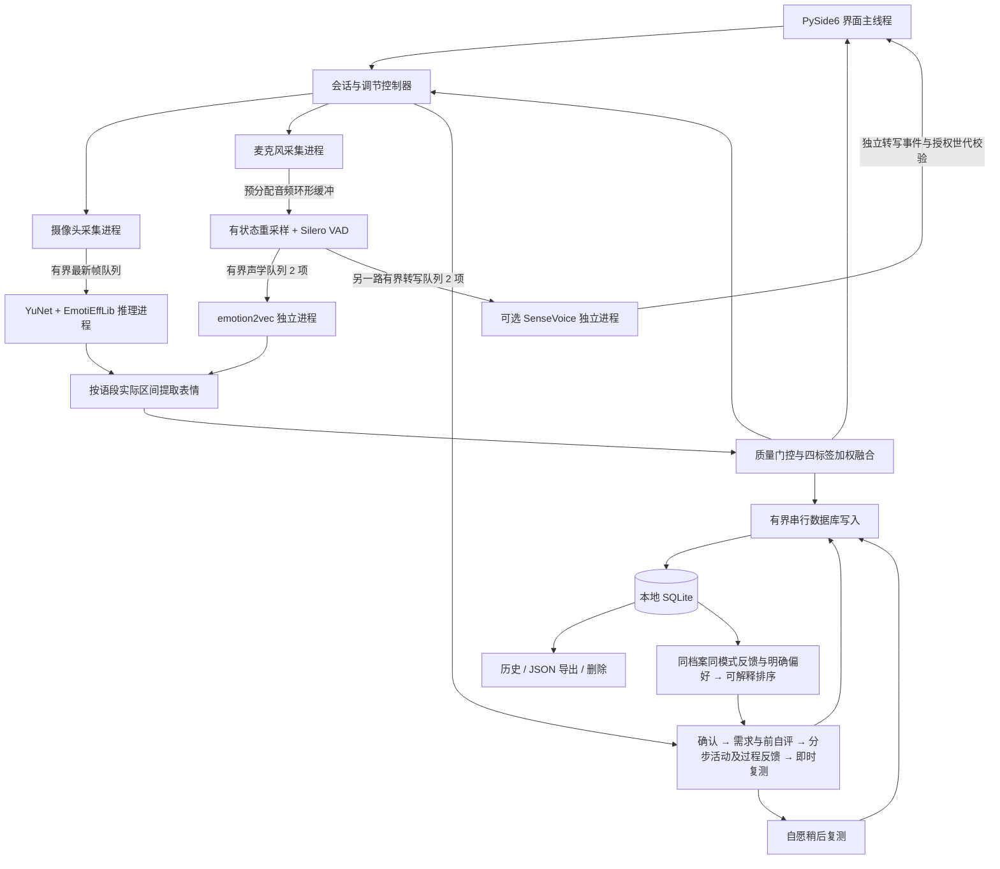
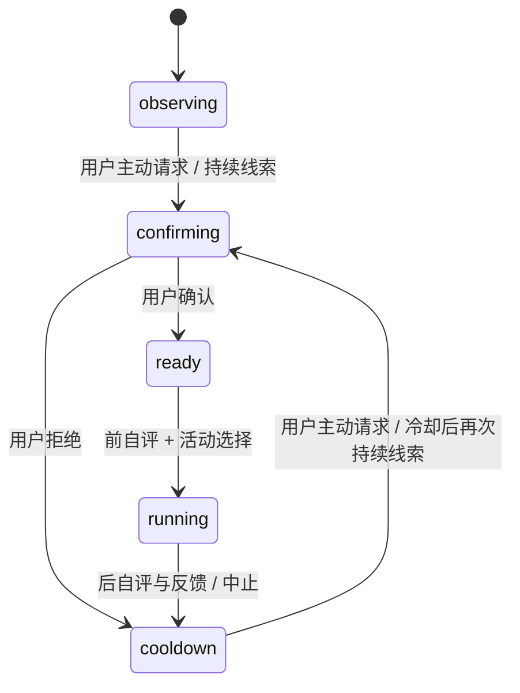

# 第一阶段架构与数据约定

主进程处理短时融合、状态转移与界面更新。设备采集、语音分段、视觉模型、声学模型和可选转写运行于可终止的子进程；SQLite 使用单独写入工作线程。视频帧队列最多 2 帧，视觉推理队列 1 帧；语段、声学和转写待处理队列各 2 段，结果队列 64 条，数据库待写入最多 256 条，其中高频观察最多占 192 个槽，保留关键反馈容量。队列超限明确记录缺口，不能静默填入中性。

## 时间与协同

以父进程 `time.monotonic()` 起点建立会话秒数。摄像头帧标记采集时刻；音频将 PortAudio ADC 时间通过 `inputBufferAdcTime - currentTime` 映射到同一时钟。音频采用有状态 soxr 重采样到 16 kHz，Silero 每次输入 512 样本，静音约 0.6 秒结束，连续语音约 8 秒切段。

每次视觉观察代表相邻采样区间，初始频率为 2 Hz。某语段结果到达后只读取其起止时间内的视觉记录；迟到结果落在历史时间，不替代当前表情。暂停时清理缓存并提升世代号，恢复后拒绝旧帧、旧音段和跨暂停区间。

观察字段包含 `session_id,event_id,modality,t_start,t_end,processed_at,scores,raw_scores,quality,valid,reason,model_version,latency_ms`，推理进程另记 `end_to_end_ms`。真实会话的 `processed_at` 为会话相对秒；模型独立烟测另有 UTC 处理时刻。会话创建及事件日志使用 UTC，界面显示北京时间。

保留模型原始分布，映射到 `positive,neutral,negative,uncertain`。惊讶、other、unknown 等质量不确定信息保留在第四类。最低质量初始值 0.2；通过门控后使用 `q_v p_v` 与 `q_a p_a` 的加权平均。视觉的区间覆盖率会影响其质量；相对权重与整体输入质量分别显示。两类方向相反且分数较高时标记冲突，由用户确认。

## 闭环与复测

主动询问按区间并集累计至少 20 秒有效负向证据，并要求覆盖密度至少 0.8，空白不计时、重复不叠加，明显非负向与冲突证据打断累计。默认 3 秒有限等待接收通常迟到结果；音频待融合表最多保留 64 项，迟到视觉用相同音频事件 ID 修订原融合行和提示账本。拒绝、修正或活动结束后，主动提示冷却 20 分钟。参数属于待验证的交互设定，超出等待预算的结果不能撤回已发生的提示。

前后困扰度为 0–10 整数，`delta = pre - post`。数值评价记录在 `numeric_evaluation`，综合 `evaluation` 优先保留不适；缺少后测时数值变化为空。确认后与练习结束后分别开始独立 30 秒观察窗，只有覆盖充分、模态及模型版本和融合配置相同、无交叉来源时才比较；活动中的观察不充当后测。模型变化、主观变化和可比性分开保存。软件不播放引导音频。

八类活动与候选排序集中在 `regulation.py`。活动记录增量保存步骤、过程反馈、换方法链、需求、推荐依据、即时结果和可选延迟复测；中止不会补出后测。延迟任务属于原活动记录，数据库保留后可在重启时加载；重复提交不会重复写入自评。推荐异步读取并校验档案、模式与请求世代，避免旧请求覆盖当前选择。

表包括 `users,sessions,observations,utterances,self_reports,interventions,events,activity_preferences`。新表采用非破坏性建表，旧活动记录继续兼容。效果历史按档案和真实／模拟模式隔离；用户主动设置的偏好属于档案设置。转写默认关闭，数据库递归过滤转写字段并设置隐私触发器；会话删除级联清除相关记录。覆盖时长使用有效区间并集，双模态覆盖为视觉与语音区间交集，不重复累加重叠窗口。完整闭环规则及内容依据见 [REGULATION_LOOP.md](REGULATION_LOOP.md)。

## 异常与退出

没有权重或输入质量不合格时输出 `valid=false,scores=null`。视觉单次推理看门狗 10 秒，声学 40 秒，首次加载 180 秒；超时终止对应模型进程并保留其他功能。设备读取失败在后台尝试重连。过期视觉或语音显示无可用新证据，历史曲线保留缺口。

停止时先关闭监测线程，再给进程有限退出时间，仍阻塞则终止并回收，最后关闭队列。退出也会中止未完成活动、结束会话并等待已排队数据库写入。
