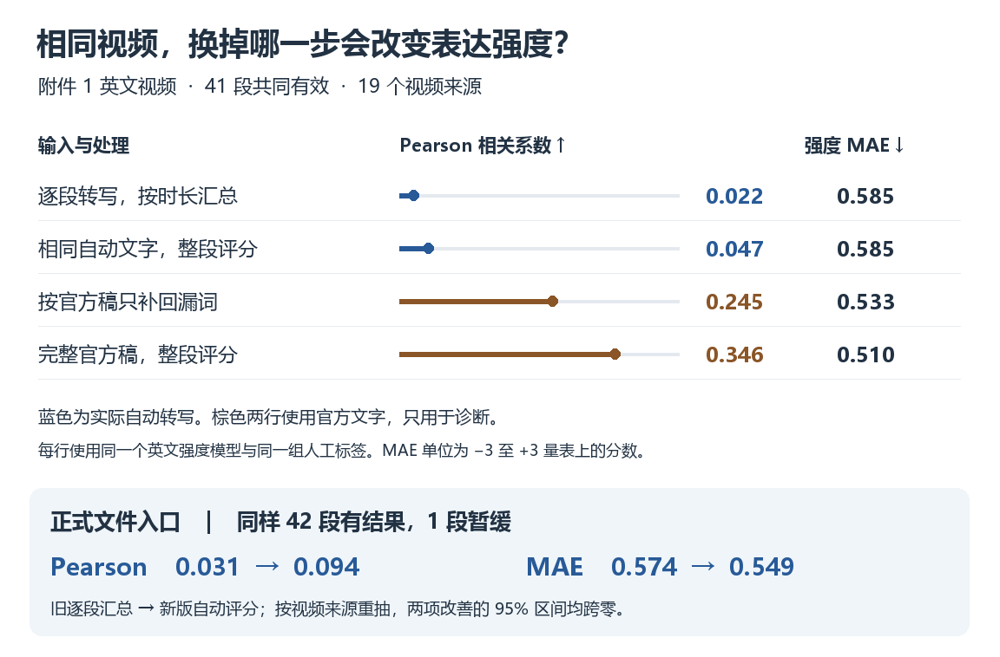

# 真实视频发言强度：转写与分段的配对对照

上一轮用 E 题附件 1 的 43 段英文原视频验收本地文件入口。42 段给出表达强度，在这 42 段上 MAE 为 0.578、Pearson 为 0.038。改用官方文字后，MAE 为 0.502、Pearson 为 0.347。这次同时改变了输入文字和汇总方法，仅凭这两个端点无法确定优先该改哪一步。[原始实测及逐片结果](results/file-intensity.json)

## 怎样区分两种误差

每段视频只有一个人工标注的整段强度，范围为 −3 至 +3。以下归因对照按视频配对，固定原英文词回归器与人工标签。随后在独立的开发组选择评分方法，再评价更新后的文件入口。

1. **固定文字，改变汇总。** 旧方法对可用发言分别评分，再按时长加权。对照方法把同一次自动转写得到的词按发言顺序合在一起，直接评分。两者的差异衡量切段后分别评分和汇总的影响，包括短段在证据门槛处被舍弃的影响。
2. **固定整段评分，改变文字。** 同一模型分别读取自动转写和官方文字。两者的差异量化转写文本对强度的影响。词级编辑把错误分为删除、替换和插入，另行检查仅修复漏词的结果。官方文字只用于对照，文件入口推理时无法读取它。
3. **固定比较样本。** 每项方法报告有效数。配对差值在各方法共同给分的片段上计算，以来源为单位重抽，保留同一视频来源内片段的相关性。MAE 的单位为强度分，越低越好；Pearson 衡量预测与人工强度的线性关联。

## 主要损失在哪里

历史 0.038 来自 42 段有效视频。本次对原片重新解码，并按文件固定随机种子，逐段旧方法仍对同样的 42 段给分，Pearson 为 **0.031**，MAE 为 **0.574**。其中 4 段与历史数值有变化，覆盖相同。直接合并转写时又有 1 段混合文字触发英文占比门槛，因此下表统一比较 **41 段、19 个来源**。右栏另列每种方法独立运行在全部 43 段上的覆盖。[历史归档](results/file-intensity.json) · [本次配对复算](results/asr-attribution.json)

| 同一段视频的文字与处理方法 | Pearson ↑，同 41 段 | MAE ↓，同 41 段 | 可给分 / 全部 |
| --- | ---: | ---: | ---: |
| 逐发言自动转写，预测后按时长加权 | 0.022 | 0.585 | 42 / 43 |
| 保留同一份自动文字，整段评分 | 0.047 | 0.585 | 41 / 43 |
| 用官方稿只补回自动转写漏掉的词，整段评分 | 0.245 | 0.533 | 43 / 43 |
| 官方完整文字，按自动边界近似分段并按时长加权 | 0.352 | 0.509 | 42 / 43 |
| 官方完整文字，整段评分 | 0.346 | 0.510 | 43 / 43 |



在 43 段视频中，27 段只得到一段转写，15 段有多段，1 段没有有效文字。对照官方稿的 816 个词，最短词级编辑路径包含 **102 个删除、141 个替换、46 个插入**，总词错率为 **35.4%**。补词实验保留了自动转写中的替换和插入。人工稿在此提供已知答案，实际无人校对的视频无法直接取得这项收益。

按 19 个视频来源配对重抽 4,000 次，只改汇总方式使 Pearson 上升 **0.025**（95% 区间 −0.034 至 +0.066）。整段评分时，把自动稿换成官方稿使 Pearson 上升 **0.300**（+0.059 至 +0.705），MAE 降低 **0.075** 分。两种改动的 Pearson 增益之差为 **+0.275**（+0.018 至 +0.701）。只补漏词就带来 **+0.199** 的 Pearson 变化和 **−0.051** 分的 MAE 变化。在这批片段上，优先处理进入回归器的文字更有依据。官方文字的代理分段通过词对齐估算，不能据此定位个别漏词的真实发生时刻。[完整对照、分段数与配对区间](results/asr-attribution.json)

对混合文字的 1 段保留原分值后，原来有效的全部 42 段都可比较，旧汇总、合并自动稿、换官方稿的 Pearson 依次为 **0.031、0.056、0.347**。逐一移除 19 个来源再算，换成官方文字相对只换汇总的额外 Pearson 增益为 +0.155 至 +0.398，各次方向一致。

## 如何选择改动

沿用已登记的两个来源组。57 段、18 个来源用于选策略；对另外 43 段、19 个来源先做误差归因，候选方法固定后才评价其预测。开发时另拟合词模型，从训练材料中排除附件 1 的来源与重复文字。最终评价与桌面程序使用同一份正式词模型。这 43 段在以往报告中已用过，结果仍需在新来源上复验。

启用门槛在评价候选前确定。在旧方法有结果的全部开发片段上，Pearson 至少提升 0.020，MAE 最多增加 0.005 分，并保留所有旧有覆盖。54/57 段可比较。第一轮三个方法均未过门槛。第二轮针对错词，增加了字符特征，仍使用同一门槛。两轮开发合计比较以下五种候选。[选择门槛、训练参数、逐片对照](results/asr-intensity-upgrade.json)

| 开发组方法 | Pearson ↑ | MAE ↓ | 通过门槛 |
| --- | ---: | ---: | --- |
| 原方法，逐段按时长汇总 | 0.4430 | 0.5958 | 基线 |
| 合并原自动转写 | 0.4600 | 0.5948 | 否 |
| 使用完整短音轨重新做一次英文转写 | 0.4508 | 0.5944 | 否 |
| 首次转写和重听结果中，取英文词数更多的一份 | 0.4615 | 0.5926 | 否 |
| **首次转写整段评分，词模型与字符模型平均** | **0.4650** | **0.5907** | **是** |
| 在上一方法上，对首次和重听两份分数再取平均 | 0.4621 | 0.5912 | 否 |

开发组中，完整音轨重听把词错率从 17.53% 降到 16.37%，但它对强度预测的改善未达门槛。53/57 段有资格使用整段英文评分。重新读取这 57 个原文件的实际语言标签后，开发资格及候选排名逐片复核一致。

选中的方法用词内连续 3–5 个字符作为额外特征，使一些词形差异仍可共享特征。辅助模型只用附件 2 训练集，排除附件 1 的 37 个来源及相同的归一化转写，剩余 **3,374 段、1,512 个来源**。每段保留原文，再生成一份固定随机种子的扰动副本（各词有 12% 概率删除，保留且命中同音词表的词有 8% 概率替换），共 6,748 条，拟合岭回归。文件端将原词回归和字符回归的分数等权平均。自动识别本身只运行原来的一遍，词错率仍为 **35.4%**。已经漏掉的原词只能通过重新识别或人工校对找回。

## 同一批原视频改进了多少

| 自动文件强度，原来有效的同 42 段 | 有效 / 全部 | Pearson ↑ | MAE ↓ |
| --- | ---: | ---: | ---: |
| 上一轮历史归档 | 42 / 43 | 0.038 | 0.578 |
| 本轮重新识别，旧方法 | 42 / 43 | 0.031 | 0.574 |
| 缓存转写，只按文字识别英文后应用新方法 | 42 / 43 | 0.086 | 0.553 |
| **实际桌面文件入口，应用新方法并检查识别器的语言标签** | **42 / 43** | **0.094** | **0.549** |
| 固定输出训练中位数 0 | 42 / 42 | 无法计算 | 0.619 |

实际文件入口从原始 MP4 重新做了音视频解码、分段和识别，旧方法的 43 个结果（含暂缓）全部重现。使用缓存文字重放候选时，38 段使用新方法。桌面还检查逐段识别器语言标签，两段虽输出拉丁字母，其标签分别混有粤语和日语，均回退至原值。最终 **36 段使用新评分、6 段沿用原评分、1 段暂缓**。与同一次原方法相比，**Pearson +0.063**（按来源重抽的 95% 区间 −0.053 至 +0.217），**MAE −0.025 分**（−0.056 至 +0.003）。这批样本的两个点估计都有改善，两个区间均跨过零，**0.094 的相关仍很弱**。桌面继续使用“自动转写试算”标记。[正式文件入口逐片实测](results/asr-file-end-to-end.json) · [开发选择与缓存逐片结果](results/asr-intensity-upgrade.json)

## 在桌面中查看

在“本地文件检测”勾选“转写本次文件语音”，再打开音频或视频。在发言选择器中查看整段汇总或原始时段。新方法适用于音轨时长为 0.2–30 秒、有足够英文转写且语言检查通过的文件。更长文件沿用逐发言时长汇总。新方法只影响文件的整段表达强度，实时发言、TXT、英文极性、调节前后自评沿用各自原来的模型和尺度。

在整段结果下选择“校对英文转写”，对照音频修正后确认。界面同时显示原自动结果与校对后的整段分数。JSON 分别保存自动结果 `content_summary.intensity` 和手动确认的数据 `reviewed_transcript`；新方法生效时，旧值也保存在 `content_summary.segment_weighted_intensity`。两段真实 MP4 的 Qt 操作与导出检查均通过。例如其中一段有 1 个漏词，原逐段 +0.25，新版自动 +0.29，使用官方稿模拟校对后单列 +0.22。该例检验界面与导出；尚未收集真人校对准确率或编辑时间。[桌面文件页验收记录](results/asr-file-ui.json)

## 如何复现

使用项目的 Python 3.12 环境和已安装的本地模型。将 `$dataset` 指向同时包含附件 1 原视频、`label-100.xlsx` 和附件 2 `label.xlsx` 的目录。转写和训练缓存保存在本机，公开 JSON 中的逐片记录使用脱敏 ID。

```powershell
$dataset = '本机的E题数据根目录'
$python = '.\.venv\Scripts\python.exe'
& $python scripts/extract_asr_intensity.py --data $dataset
& $python scripts/extract_asr_context.py --data $dataset
& $python scripts/fit_asr_character_intensity.py --data $dataset
& $python scripts/benchmark_asr_attribution.py --out reports/asr-attribution.json
& $python scripts/benchmark_asr_intensity_upgrade.py --stage select
& $python scripts/benchmark_asr_intensity_upgrade.py --stage evaluate --out reports/asr-intensity-upgrade.json
& $python scripts/benchmark_file_intensity.py --current --data $dataset --out reports/asr-file-end-to-end.json
& $python scripts/benchmark_asr_intensity_upgrade.py --stage audit --out reports/asr-intensity-upgrade.json --file-results reports/asr-file-end-to-end.json
```

归因和文件实测按原片哈希固定随机种子。首次历史归档未固定相同种子，表内另列。运行时无需官方稿和人工标签，复算误差、词错率与来源区间时才使用它们。

本轮综合验收通过 405 项测试，0 失败、0 跳过。三个桌面脚本分别通过 47、63、97 个检查点，五项真实本地模型检查全部通过。另用原始视频两次运行正式的 43 段验收，得到相同的 MAE 和 Pearson。[软件验收摘要](results/asr-validation.json)
