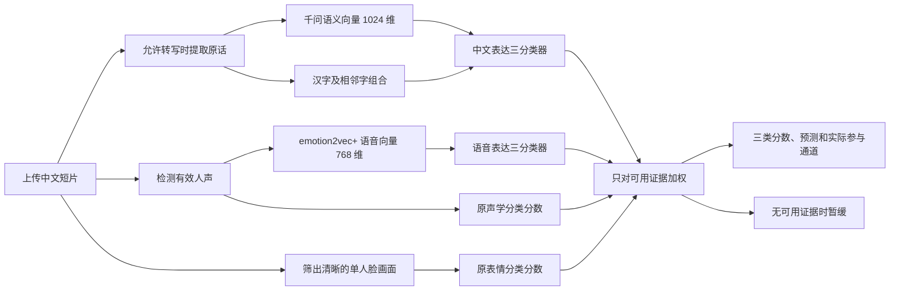

# 中文短视频里，大模型能否提高情感识别准确率？

本文记录第一代固定权重实验。后续自适应版本对相同片段逐段重测，报告列出中性误判原因、两代指标及桌面选项。[自适应权重复验](CHSIMS_ADAPTIVE.md)

实验判断一段中文发言整体表达的负向、中性或正向倾向，参考答案采用 CH-SIMS 原版的人工多模态标注。语气、表情和台词可以不一致。说话者当下是否需要调节，仍由本人确认。[CH-SIMS 原始论文](https://aclanthology.org/2020.acl-main.343/)

## 原来的 48 段，谁判得更准？

| 方法 | 判对 / 48 | 准确率 | Macro-F1 | 正向召回率 |
|---|---:|---:|---:|---:|
| 始终预测训练集最多的负向类 | 26 | 54.17% | 0.2342 | 0/14（0%） |
| 上版质量加权投票 | 22 | 45.83% | 0.3543 | 1/14（7.14%） |
| 上版 Qwen3:8B 冲突复核 | 21 | 43.75% | 0.2978 | 0/14（0%） |
| 新训练的字符分类器＋原声画分数 | 27 | 56.25% | 0.5012 | 4/14（28.57%） |
| 再加入语音向量，不用千问 | **31** | **64.58%** | **0.5392** | **6/14（42.86%）** |
| 再接入千问语义向量 | 30 | 62.50% | 0.5135 | 5/14（35.71%） |

六种方法都对 48 段给了结果。从已发布的质量投票到新系统，多判对 8 段，准确率高 16.67 个百分点。**不能把这 8 段都归功于千问**：同样使用中文标注和语音向量，允许两个版本各自用验证集选权重，千问纠正 3 段、新错 4 段，净少判对 1 段。按片段的精确配对检验 p = 1.000，按作品重采样估计的准确率差异 95% 区间为 −14.0 至 +8.2 个百分点。只比较千问与旧投票，纠正 12 段、新错 4 段，精确配对 p = 0.0768。[逐片预测、混淆矩阵、权重与配对区间](results/chsims-foundation-fusion.json)

若把两个版本的融合权重都钉在新系统选出的值，仅切换字符分类器和含千问向量的文字分类器，主对照从 **28/48 → 30/48**，Macro-F1 从 **0.4252 → 0.5135**，正向召回从 **4/14 → 5/14**。这个对照说明，千问能够改变判断，融合时给文字多少权重也会改变结论。

## 同样的 48 段，缺一路会怎样？

每格依次为**准确率 / Macro-F1 / 正向召回数**。前两项以 48 段计算，各行正向样本均为 14 段。

| 可用输入 | 上版质量投票 | 同训练、去千问 | 新融合 | 新融合判对 / 判错 / 暂缓 |
|---|---|---|---|---:|
| 保留实际可用输入 | 45.83% / 0.3543 / 1 | 64.58% / 0.5392 / 6 | 62.50% / 0.5135 / 5 | 30 / 18 / 0 |
| 缺文字，保留声音、画面 | 35.42% / 0.3786 / 4 | 64.58% / 0.5691 / 6 | 64.58% / 0.5691 / 6 | 31 / 17 / 0 |
| 缺声音，保留已有转写、画面 | 43.75% / 0.3415 / 1 | 54.17% / 0.3540 / 4 | 54.17% / 0.3525 / 4 | 26 / 22 / 0 |
| 缺画面，保留文字、声音 | 41.67% / 0.2932 / 0 | 66.67% / 0.5937 / 5 | 66.67% / 0.5804 / 6 | 32 / 16 / 0 |
| 无音轨、无转写，仅画面 | 上版未单列 | 39.58% / 0.2992 / 3 | 39.58% / 0.2992 / 3 | 19 / 20 / 9 |

**没文字时，改进来自声音。** 千问的两个文本输入都关闭后，新融合仍判对 31 段；上版判对 17 段，暂缓 8 段。仅剩画面时，两种新方法结果完全一致，9 段因缺少有效表情而暂缓。缺画面时新系统比完整输入多判对 2 段，说明在这批素材上，合格表情有时仍会把表达方向推错。

## 另取 48 段，结论能否重复？

补验组有 30 段负向、9 段中性和 9 段正向。下表每格依次为准确率、Macro-F1、正向召回数（分母 9）。

| 条件 | 同训练、去千问 | 接入千问 | 新融合判对 / 判错 / 暂缓 |
|---|---|---|---:|
| 保留实际可用输入 | 60.42% / 0.3810 / 3 | **70.83% / 0.4945 / 5** | 34 / 14 / 0 |
| 缺文字 | 66.67% / 0.5564 / 4 | 66.67% / 0.5564 / 4 | 32 / 16 / 0 |
| 缺声音，保留已有转写 | 58.33% / 0.2979 / 1 | 68.75% / 0.4949 / 6 | 33 / 15 / 0 |
| 缺画面 | 58.33% / 0.4198 / 3 | 72.92% / 0.5606 / 6 | 35 / 13 / 0 |
| 仅画面 | 50.00% / 0.3354 / 2 | 50.00% / 0.3354 / 2 | 24 / 13 / 11 |

完整输入下，千问比同训练去千问模型多判对 5 段，无新增错误，精确配对 p = 0.0625。排除与训练台词重复的 1 段，判对数仍从 28/47 提高到 33/47。**补验的 9 段中性全部被新系统判成负向**，因此单看 70.83% 的准确率会高估它区分三种表达的能力。两组均实际使用了 48/48 条千问语义向量和 48/48 条语音向量。后续应优先验证中性与弱正向的分界，并在不重叠的影视来源和自然中文对话上复验。

在主对照的真实片段 `video_0023/0002` 中，人工标注为负向。语音向量支持正向，文字和表情支持负向；三者实际权重分别是 47.4%、47.4%、5.2%，新系统把原来的正向改对。另一段 `video_0020/0012` 的人工标注为正向，语音支持正向、文字支持负向，各占 50%；最后负向 40.24%、正向 40.07%，系统以很小的分差改错。对接近持平的片段，能向用户展示分歧比只展示一个类别更有价值。[两段实测分数及各路投票](results/chsims-foundation-fusion.json)

## 模型怎样参与一次预测



千问在给出类别**之前**参与计算。SenseVoiceSmall 把获准使用的语音转成文字。冻结的 Qwen3-Embedding-0.6B 把整句压缩成 1,024 个数，训练好的分类器结合这些数和字符特征估计三类分数。声音也保留 emotion2vec+ 分类前的 768 维表示，由另一分类器学习哪些声音模式与中文影视表达标签有关。原声学和表情分数仍然进入融合。两个编码器都在本机运行，训练只更新下游分类器和融合权重。[Qwen3-Embedding 技术说明](https://qwenlm.github.io/blog/qwen3-embedding/) · [emotion2vec 原始论文](https://aclanthology.org/2024.findings-acl.931/)

训练时用验证集选每路的基础权重。推理时移除缺失的输入，对原声画分数再计入采集质量、有效覆盖和可映射分数的占比，最后把可用路的权重归一化。返回的 JSON 给出每路的实际权重及其首选类别。千问服务离线时，有中文原话仍可使用单独训练的字符分类器。完全没有可用输入时返回暂缓。

声音有两种有效时长要求。原声学类别分数要求至少 2 秒人声。新语音向量可使用 Silero 切出的较短发言，仍检查 16 kHz 单声道、至少 0.2 秒、音量、削波及时间戳。因此有的短句只有语音向量，没有旧声学分数。分类器在同一模态下分别加权这两种证据，移除声音时两者一起移除。

## 怎样检验收益来自哪里

| 对照方法 | 同一片段进入分类器的信息 | 可以回答的问题 |
|---|---|---|
| 上版质量加权投票 | 上版按发言对齐得到的文字、语音和表情分数 | 相对已发布算法，用户看到的判断是否改善？ |
| 上版千问冲突复核 | 分歧时由 Qwen3:8B 读转写与局部分数 | 原来让千问复核一句话能达到什么成绩？ |
| 同数据、同容量、去千问 | 两组各 1,024 维的字符特征、语音向量、原声画分数 | 在监督训练、分类器容量和语音模型相同的条件下，文本大模型还带来多少增益？ |
| 新融合 | 第一组字符特征、1,024 维千问语义向量、语音向量、原声画分数 | 完整文件入口的实际表现如何？ |

文字分类器用官方训练集全部 1,368 条字幕训练，在官方验证集 456 条字幕上选正则化强度和类别权重。按片段 ID 的固定哈希从同一官方划分中另取 256 段训练原视频和 128 段验证原视频，用于训练语音分类器及选择融合权重。128 段视频验证及两组 48 段视频评测均使用实际转写。模型不读取测试字幕、片名、演员、总体标签或人工单模态标签进行推理。

256 段中有 255 段取得有效语音向量并进入语音分类器训练。在 456 句验证字幕上，等容量字符分类器判对 252 句，加入千问语义向量后判对 303 句，Macro-F1 从 0.4473 升到 0.5638。128 段验证原视频上，两套融合分别判对 82 段和 89 段。验证集选出的新融合基础权重依次为文字 1、语音向量 1、原声学分数 0.5、表情分数 1.5；等容量去千问对照的文字权重为 0.25，其余相同。这些是识别前的系数，每段实际权重会因质量和缺失重新计算。

主对照固定使用上版的 48 段原视频，26 个影视来源，人工参考为 26 段负向、8 段中性、14 段正向。另用事先固定的哈希，从官方测试集剩余片段中取 48 段补验，单独计分。视频编号互不重复，官方划分允许同一作品出现在训练与测试两侧，跨作品泛化还需按作品留出评估。[上版 48 段的结果](CHSIMS_CONFLICT.md)

复验前已核对两次主对照的文件指纹和实际转写，均为 48/48 一致。在整段内，48 段取得转写，36 段有通过质量检查的声学分类分数，39 段有通过检查的表情分数，30 段同时有这两种声画分数。上版报告的 24 段要求三路在同一发言时段都能给出方向，统计口径更严格。主对照全部 26 个来源在官方训练集中也有其他片段，但规范化后没有与训练、验证集完全相同的主对照台词。补验 48 段涉及 31 个来源，其中 17 个与主对照重合；补验有一条台词与训练台词相同。

准确率的分母始终包括全部视频。Macro-F1 分别计算三个类别的 F1 后取算术平均。正向召回率表示人工标为正向的视频中有多少被正确识别，暂缓也计入漏判。遮蔽文字会同时移除转写和字符、语义向量；遮蔽声音会同时移除原声学分数和语音向量，实验允许保留已取得的转写；遮蔽画面会移除表情分数。真实文件若无音轨，也无独立文字输入，实际对应“仅画面”。

## 在桌面复现

桌面文件入口已从原始 MP4 重新解码并预测主对照全部 48 段，判对 30 段。逐片对照实验脚本，48/48 的预测、参与模型和三类分数完全一致，类别分数最大绝对差为 0。另用 `video_0001/0027` 分别关闭转写、移除视频轨、移除音轨，桌面实际只使用预期的通道，三次判断都与相应遮蔽实验一致。项目隔离环境的 **595 项回归测试**全部通过（0 失败、0 错误、0 跳过），另通过 47 项桌面流程、63 项调节流程和 97 项界面检查。后三组检查使用模拟输入。[真实文件入口复验记录](results/chsims-foundation-entry.json)

第一轮曾因千问未胜过同训练对照而暂留本地。后续用训练与验证材料开发的自适应版通过了主组配对判据，作为可选策略与固定权重并列。[两代算法的同批复测](CHSIMS_ADAPTIVE.md)

在 PowerShell 中运行以下命令准备本地语义编码器。项目原有的 SenseVoiceSmall、emotion2vec+、Silero 和视觉模型也需就绪。[本地模型准备](MODELS.md)

```powershell
.\scripts\start_text_review.ps1 -PullEmbedding
```

到「本地文件」勾选「中文短片融合识别」，如需文字再勾选「转写本次文件语音」，随后选择音频或视频。30 秒以内、时长明确的文件会在检测结果中显示整段三类分数和参与通道，可随结果导出 JSON。更长文件仍走原有分段检测。实时页的「中文发言融合识别」使用获准转写和同期声画分数；摄像头模式尚未复验这些指标，实时进程也未向界面传输原始语音向量。

以下命令从官方原视频重新计算本轮各模型的结果。上版投票和 Qwen3:8B 冲突复核按片段编号、参考标签及视频指纹匹配已发布的逐片预测。原视频、字幕、逐句向量与下载的编码器留在本地；报告可核查每个片段的 ID、标签、预测与参与依据。[上版复现实验](CHSIMS_CONFLICT.md)

```powershell
$py = '.\.venv\Scripts\python.exe'
& $py scripts/prepare_chsims_foundation.py --download --extract
& $py scripts/prepare_chsims_foundation.py --audit --download --extract
& $py scripts/extract_foundation_embeddings.py text
& $py scripts/extract_foundation_embeddings.py text-asr --include-audit
& $py scripts/extract_foundation_embeddings.py audio --include-audit
& $py scripts/fit_chsims_foundation.py
& $py scripts/evaluate_chsims_foundation.py
& $py scripts/verify_chsims_foundation_entry.py
```
