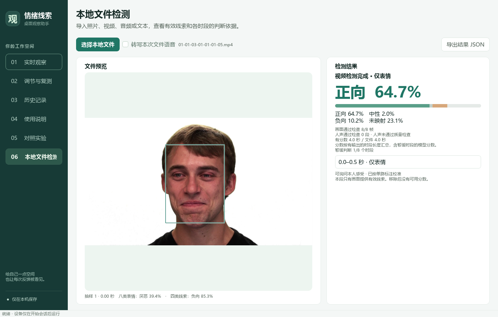
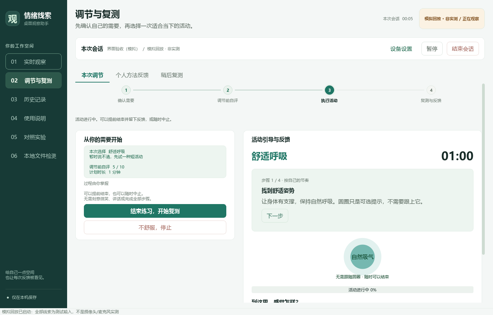

# 桌面情绪线索助手中期报告

**报告日期　2026 年 11 月 27 日**

桌面原型已能在 Windows 上运行。它能从摄像头、麦克风或本地文件提取表情、声音和文字线索，并指出哪些时段有足够证据。用户确认需要调节后，可选择活动、记录感受并复测。最明确的阶段性收益出现在声音局部缺失的实验中，四类识别准确率从 **57.80% 提高到 82.26%**。调节流程已通过软件验收，其在日常使用中能否减少打扰、帮助用户，仍需真人对照验证。

## 一、项目任务

项目面向个人在桌面学习或工作时的两个问题。第一，摄像头可能被遮挡，麦克风可能收不到清晰人声，系统还能从哪些证据作出判断？第二，即使观察到负向线索，此刻是否想要帮助、哪种活动合适、做完是否有变化，都需要由用户回答。

目前支持实时观察，也支持导入照片、视频、音频和短文本。界面分别呈现**声画里观察到了什么、这句话表达了什么、本人感觉如何**。英文发言支持正向／中性／负向分类和 −3 至 +3 的表达强度，中文文字可生成待本人确认的语境提示。转写由用户主动开启，活动后的自评独立保存。[文件与实时入口](MISSING_MODALITIES.md) · [发言内容的输出范围](CONTENT_FUSION.md)

## 二、挑战与解决方案

| 遇到的挑战 | 实现方法 | 设计依据 |
| --- | --- | --- |
| 一句话有起止时间，一帧表情只代表一个瞬间，转写还可能晚到 | 以一段有效发言为单位，将转写和声学结果匹配到原发言，画面只取时间上重叠的部分。文件使用媒体显示时间戳。 | 可以回到同一句话查看文字、声音和表情，避免拿上一句话的声音解释下一句话的画面。当前实现精度为发言时段级。 |
| 缺声、缺画和声画冲突需要不同的处理 | 根据质量和有效覆盖决定哪些通道参与。只有一路有效时可使用该路的校准参数，证据不足时暂缓并显示原因。逐一移除通道后，用原判断函数重算分数。 | 用户能核对某个结论依赖哪路输入，以及失去这一路会怎样。 |
| 英文转写漏词会改变倾向和强度，增加声画也未必更准 | 文件端对符合条件的短英文音视频复用第一次转写，用词和字符两种特征估计整段强度。内容分类默认采用英文文本，同期声画保留为可展开的联合试算。 | 同一批 43 段视频，默认文本判对 19 段，三路候选判对 18 段。保留两种结果，允许使用者看到分歧。 |
| 设备覆盖改变，可能制造活动后“有所改善”的假象 | 本人确认后才进入八类活动的选择流程，可换方法、随时停止或稍后复测。比较前后模型观察时，只用可比通道并固定权重，同时保留本人自评。 | 受控例中，视觉与声音的负向分数保持 0.80 和 0.40。只改变覆盖时长，直接汇总会出现 0.70 → 0.60 的下降。固定权重后，前后都是 0.60。 |

**合理性**来自问题和证据的一一对应。表情和声音描述外显线索，文字对应发言内容，调节需求由本人确认。**先进性**体现在用质量、时间覆盖和实测误差决定融合方式，并允许证据不足时暂缓。**本项目的新颖之处**是把这套证据检查延伸到了活动之后。用户可以追查触发提示的输入，也可以查看前后两次观察是否可比。即使设备条件改变，系统仍能单独保留本人报告的体验。[时间对齐与缺失策略](MISSING_MODALITIES.md) · [内容融合对照](CONTENT_FUSION.md) · [调节复测方法](RELIABLE_LOOP.md)

## 三、阶段进展与实验结果

外显线索识别使用 RAVDESS 演员音视频与观察者评分。发言内容实验使用研究生数学建模竞赛 E 题《复杂场景下多模态情感识别的数学建模与算法设计》的英文材料。附件 1 提供原视频，可验证实际文件入口，附件 2 的带标注数据可构造相同位置的缺段。

| 验证问题 | 样本与对照 | 实测结果 |
| --- | --- | --- |
| 完整声画能否改善外显线索识别？ | 共 24 位演员、192 段，拟合、选参数与测试使用不同演员。取有合格双路证据和明确人工标签的同一批 62 段比较。 | 默认质量加权融合判错 4 段，四类 Macro-F1 为 0.9364。实验中的校准融合判错 1 段，Macro-F1 为 0.9838。仅用声音也是 0.9838。基础声学模型可能接触过该语料。[识别对照](RECOGNITION_EXPERIMENT.md) |
| 音视频连续缺一段时能否继续判断？ | 在同 62 段原片的开头、中间或末尾移去 25% 或 50% 的声音或画面，每种模态各有 372 次配对测量。 | 单路校准升级后，缺声时四类准确率从 57.80% 升至 82.26%，缺画时从 97.58% 略降至 97.04%。收益取决于保留下来的通道。[缺段方法与结果](MISSING_MODALITIES.md) |
| 文字、声音和画面同时缺段时，系统会判断还是暂缓？ | 在 E 题附件 2 的 727 段有标签样本上，使用比赛预提取特征进行 48 组对照。 | 按“判对／判错／暂缓”计，完整输入为 372／281／74，三路同时缺中间一半为 351／288／88，三路错位各缺一半为 332／295／100，三路全缺为 0／0／727。日常上传视频缺少英文文字时，仍可查看有效声画，英文强度暂缓。[逐条件统计](ATTACHMENT2_GAPS_AND_INTENSITY.md) |
| 真实上传视频的英文表达强度有多准？ | E 题附件 1 的 43 段英文原视频来自 19 个来源，从本地文件入口自动转写。新旧方法均有 42 段给分、1 段暂缓，在相同的 42 段上比较。 | 本轮复算的旧方法 Pearson 为 0.031、MAE 为 0.574，新版正式入口 **Pearson 为 0.094、MAE 为 0.549**。MAE 表示平均相差多少强度分，Pearson 衡量与人工标注的线性关联。两项改进的 95% 区间均包含零，自动结果仍标为试算。[配对实验](ASR_INTENSITY_STUDY.md) · [正式入口逐片结果](results/asr-file-end-to-end.json) |

为什么优先改文字处理？在各方法都能给分的 41 段视频上，保留同一份转写，只改分段汇总，Pearson 提高 0.025。保持整段评分方式，把自动转写换成官方文字，Pearson 提高 0.300。这个对照说明，在这批视频上，文字误差的影响更大。新版自动文件入口的相关性仍弱，后续需要用新来源视频复验。[转写与汇总的误差对照](ASR_INTENSITY_STUDY.md)

**程序与性能。** 11 月 27 日重新运行软件验收，405 项测试全部通过，失败、错误和跳过均为 0。项目另有 5 项已通过的真实模型样例检查。Windows 上使用 Ryzen 7 9700X，预热后用 32 段材料计时，单帧视觉推理 P95 为 44.9 毫秒，预切语音的声学推理 P95 为 244.3 毫秒。该计时只覆盖模型模块，现场采集到界面显示的总延迟留待设备联调。[验收入口](../scripts/verify.py) · [既有验收记录](results/asr-validation.json) · [耗时与测量环境](images/progress/cpu-latency.json)

### 桌面原型展示

**图 1　真实本地视频检测。** 此例中 8 个抽样画面均通过质量检查，人声未达到有效门槛。程序依据可用画面给出整段正向线索分数 64.7%。左侧单帧和右侧整段覆盖的时间不同。原视频出自 Steven R. Livingstone、Frank A. Russo（2018），截图、检测框及标注沿用原素材许可。[原始数据](https://zenodo.org/records/1188976) · [CC BY-NC-SA 4.0](https://creativecommons.org/licenses/by-nc-sa/4.0/)

**图 2　调节与反馈。** [观看或下载 24.8 秒桌面演示（MP4）](images/progress/simulated-loop.mp4)。这段无声录像用模拟输入走完“观察 → 本人确认 → 活动 → 复测 → 历史记录”。脚本前后均填写 5 分，历史页如实保留了零变化。11 月 27 日只读核对开发机默认实验库，真人调节对照登记为 **0 人、0 场、0 个完整配对**。调节效果尚待真人评价。[交叉实验方案及统计口径](CROSSOVER_STUDY.md)

## 四、未来计划与验收

| 顺序 | 下一步工作 | 完成时提供的证据 |
| --- | --- | --- |
| 1 | 完善情绪调节设计。按用户当前需要、可用时间和上次反馈细化八类活动的推荐理由，走查接受、拒绝、换法、不适中止和缺少后测。 | 每种路径给出可复现的操作记录，核对界面、历史和导出中的活动、自评与缺失原因。 |
| 2 | 在目标电脑接入外置 USB 摄像头和麦克风。依次测试正常发言、静音、遮脸、弱光、背景噪声、设备拔插与恢复，再连续运行 60 分钟。 | 提交设备与环境配置、有效覆盖、暂缓原因、端到端延迟 P50/P95、丢帧或丢段、CPU 和内存记录，附异常复现与修复后复测结果。[设备测试步骤](PHASE1.md) |
| 3 | 设备稳定后，开展自愿参加的真人交叉实验。同一人用同一设备、在相近日常任务中按随机顺序体验基础和自适应两种策略，各一场。另用新来源英文视频复验强度排序。 | 真人实验以每小时明确不想收到的提示数为主指标，另报接受率、完成率、即时及延迟自评变化、有效配对人数和缺失数。视频复验继续报告覆盖数、MAE 和 Pearson。[参与与统计办法](CROSSOVER_STUDY.md) |
| 4 | 时间允许时搭建桌面硬件原型，根据实测问题确定摄像头支架、麦克风位置、供电与走线。 | 提供实物照片或演示录像，在相同场景下比较搭建前后的覆盖率和延迟。 |
