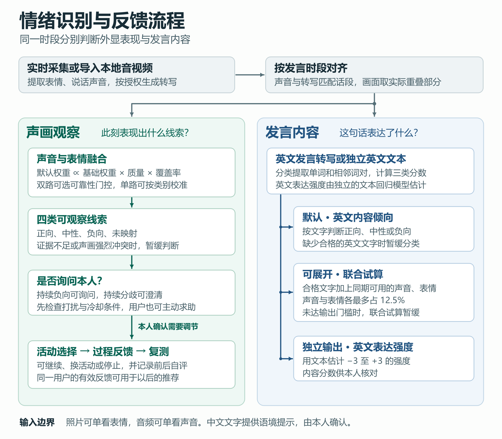
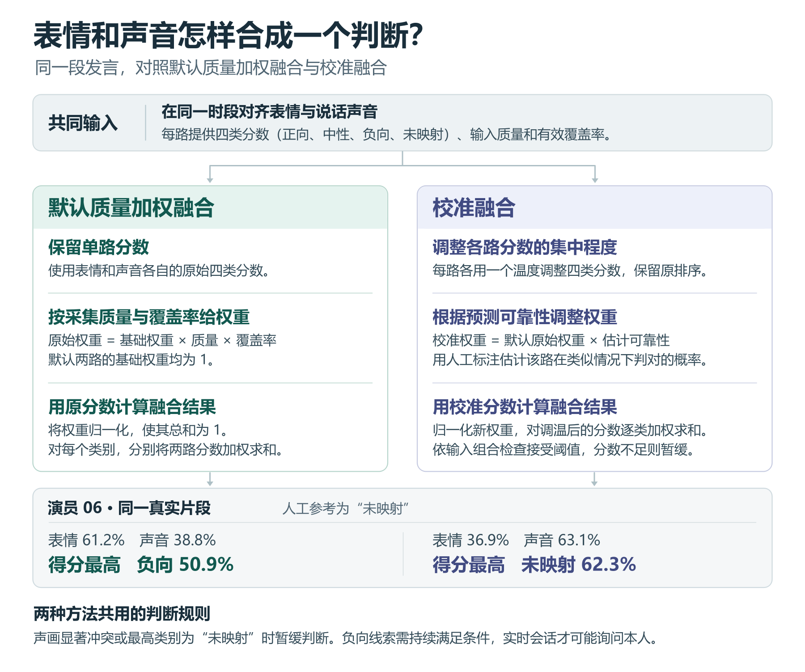
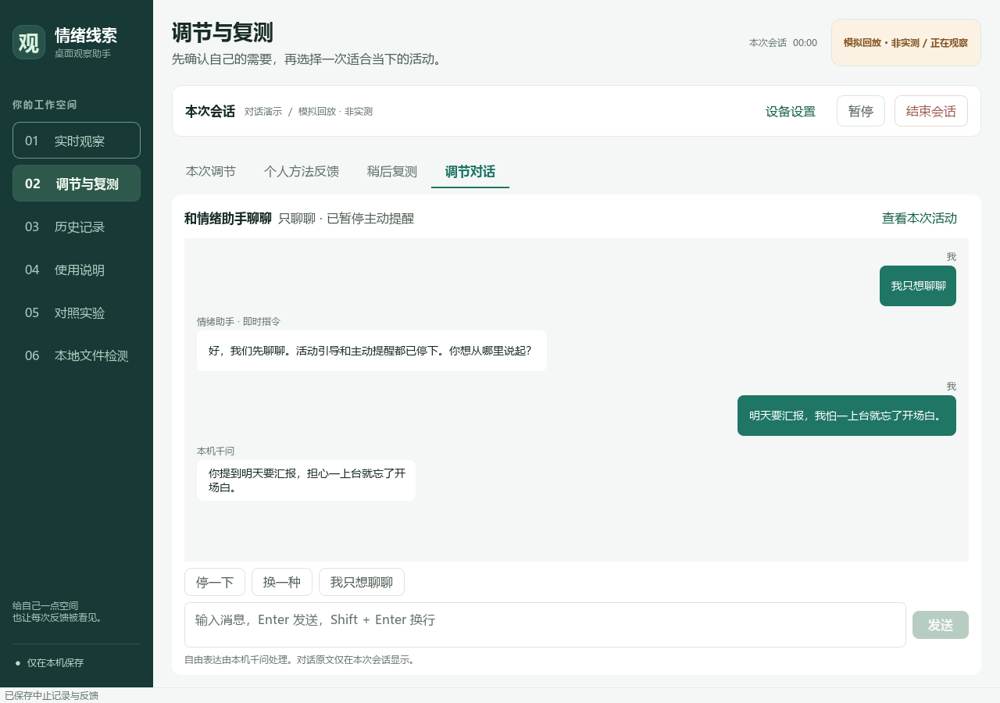
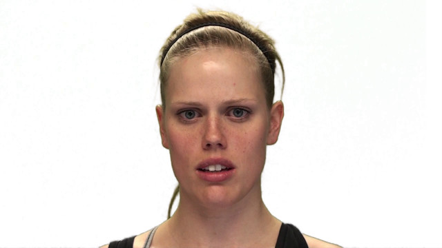
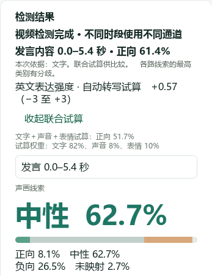
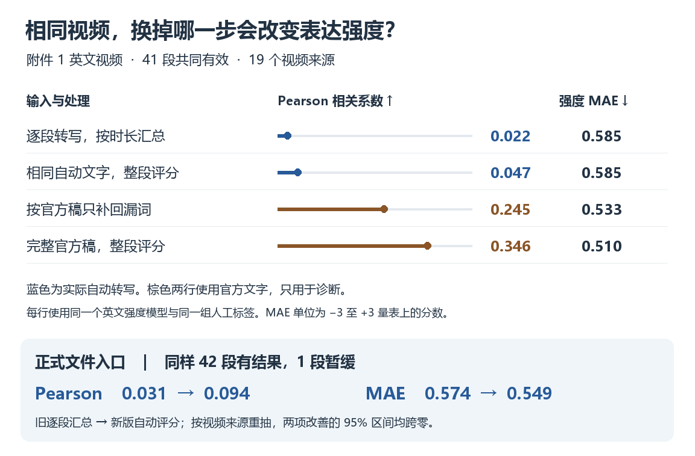

# 桌面情绪线索助手中期报告

## 系统总览与官方语料对照

**中文短片识别已经比较了两代融合。** 千问编码发言语义，emotion2vec+ 编码说话声音。固定权重版在主组、补验组分别判对 30/48、34/48。新版先用按影视来源留出的训练预测校正各路的类别偏差，再根据当段分数和分歧调权。在主组，新版千问与同训练去千问的准确率为 **56.25% 对 50.00%**，Macro-F1 为 **0.5121 对 0.4568**，正向召回为 **6/14 对 5/14**；补验准确率为 **64.58% 对 66.67%**。新版千问找回 4/9 段原先全部误判的中性，但两组真实负向的识别率都降低。固定权重仍为默认，用户可查看自适应结果。[新一轮完整对照](CHSIMS_ADAPTIVE.md) · [九段中性与四次冲突误判](CHSIMS_ERROR_ANALYSIS.md) · [原模型算法图](CHSIMS_FOUNDATION.md)

**用户现在可以在聊天框里改变调节流程。** 当用户说“停一下”，程序停止引导；说“换一种”，它查找另一个合格活动并等待本人确认；说“我只想聊聊”，它进入倾听模式。千问理解更自由的表述，并参考本次对话回应。识别端新增同一发言时段的线索复核，原文、声音或表情的方向不一致时，可以查看分歧、引用和核对问题。[真人试用与对照步骤](AI_ASSISTANT_STUDY.md#本轮多轮对话试用办法)

本地模型先分析可用线索，千问按需复核所选发言。在 Chinese EmoBank 的 160 句中，正式桌面入口对 159 句给出双维分数。与离线模型相比，愉悦度 MAE 减少 0.3230 分（95% 配对区间 0.2099 至 0.4327），激活度没有取得同样的改善。在另取的 240 条 GoEmotions 评论上，原英文模型、千问和域内监督模型分别判对 107、138 和 172 条。中文 CPED 单句 13 类的千问试验尚不足以取代离线候选。[官方语料、各方法分母和配对结果](QWEN_BENCHMARK.md)

**中文研究与验证。** 现可手动输入中文、上传 TXT 或分析中文转写。字符模型提供离线参照，本机 Qwen 提供带引文的语境和双维复核。中文对白细类、不同主体与时点、愉悦度和激活度分别对照测量。研究依据、结果分母、模型未能解决的情形，以及检验真人调节效果的方法见[中文情绪助手的研究依据与实测](RESEARCH_RATIONALE_ZH.md)。

**量化研究补充。** 目前系统还可区分同时出现的多种英文情绪，估计中英文发言的愉悦度和激活度，英文另给掌控感线索。各模态结果保留自己的尺度，详见[新增实测与近年研究依据](AFFECT_QUANTIFICATION.md)。

**11 月 27 日研究更新。** 本地 Qwen3 已接入文字复核与用户主动请求的活动推荐，并增加 GoEmotions 官方语料的独立文字对照、推荐约束测试以及三时点自评图。下文保留中期阶段的识别与闭环实验，新增问题、证据和真人测试方案见[情感助手研究验证](AI_ASSISTANT_STUDY.md)。

**项目主题　面向目标用户的情绪识别、辅助调节与反馈复测**

**报告日期　2026 年 11 月 27 日**

本项目要帮助在电脑前学习或工作的用户**察觉自己的情绪变化，并在需要时找到适合自己的调节方式**。在本人同意的实时会话中，助手从表情和声音识别外显情绪线索。开启转写后，还可用英文文字判断这句话表达的倾向，并查看同期声音、表情是否改变了判断。持续出现负向声画线索时，助手可询问本人是否需要帮助。用户确认后选择活动，练习中的反馈决定继续、换法或停止，练习后的反馈用于评价这次体验，也影响下一次向同一用户推荐什么。

中期已完成可运行的 Windows 原型。在同一批 62 段有人工标签的表演音视频中，默认声画融合判对 **58 段（93.55%）**，实验中的校准融合判对 **61 段（98.39%）**。调节部分已用模拟会话验证从本人确认到复测和下次推荐的流程。真人使用后困扰是否减轻、帮助能否持续，是下一阶段要回答的问题。[识别与调节反馈流程图](#从情绪识别到调节反馈) · [项目使用的模型](#项目使用的模型) · [识别算法设计与取舍](#情绪识别算法的设计思路与取舍) · [识别实验、对照图与人物实例](#情绪识别实验与准确率对照) · [调节反馈验证](#调节反馈已验证到哪一步)

## 一、项目任务

目标用户是正在使用助手、可以亲自确认感受的人。例如，一位学生做题时持续皱眉，可能因为遇到了困难，也可能只是在专心思考。系统能观察到表情，却仍需本人说明此刻的状态。若学生确认是任务卡住了，可以选择“任务拆解”，把卡点写下来并确定下一步。如果学生并不想被打扰，可以拒绝提示并继续自己的任务。

### 从情绪识别到调节反馈

*图中“是否询问本人”及后续活动仅适用于实时会话。本地文件检测支持照片、视频、音频和短文本，可以校对英文转写并导出结果。这些记录只关联到导入的素材。* [查看矢量原图](images/progress/emotion-recognition-flow.svg) · [本地文件检测说明](MISSING_MODALITIES.md)

**左侧看一个人怎样说、当时有什么表情。** 程序先找出有人说话的时段，再把原始语音片段交给 emotion2vec。声学分数反映语调、节奏和轻重音等说话方式，计算时不读取转写文字。表情模型分析同一时段看得清的人脸，再按质量和覆盖率融合声画分数。即使关闭转写，这条路径仍然可用。[声音与表情模型](../emotion_assistant/models.py) · [融合权重的计算示例](#情绪识别算法的设计思路与取舍)

**右侧看这句话表达了什么。** 例如，同一句 “I'm fine” 可以说得轻快，也可以说得低沉。两次转写若完全相同，英文文字分类器给出的分数相同，声学分数却可能不同。开启转写后，SenseVoice 将语音转成文字，程序把文字关联回原发言。有合格英文文字时，默认按文字判断内容倾向，用户也可展开同期声画的联合试算。这些分数供本人核对。是否需要帮助，由本人确认。[本地视频实测截图、三路权重与对照结果](#文字参与情绪识别的条件与实验对照)

### 项目使用的模型

识别表情使用 **EmotiEffLib**，分析说话声音使用 **emotion2vec+ seed**，判断英文文字的情感倾向使用**多项逻辑回归**。项目在本地运行预训练的视觉和语音模型，再用标注数据拟合英文分类、强度回归和声画校准所需的参数。

| 任务 | 模型或方法 | 输入与输出 |
| --- | --- | --- |
| 找脸与识别表情 | **YuNet**（2023mar）定位人脸，**EmotiEffLib**（`enet_b0_8_best_afew`）识别表情 | 从照片或视频帧找到脸，对通过质量检查的人脸输出八类表情分数，再归并为正向、中性、负向、未映射。惊讶保留为未映射。[视觉模型实现](../emotion_assistant/models.py) |
| 找出发言时段 | **Silero VAD**（语音活动检测） | 从 16 kHz 单声道音频中找出有人说话的时段，供声学识别和可选转写使用。[语音分段实现](../emotion_assistant/capture.py) |
| 判断说话声音的情绪线索 | **emotion2vec+ seed**（`emotion2vec_plus_seed`） | 直接分析语音片段，将声学情绪分数映射到与表情相同的四类。即使关闭转写，仍可从说话方式获得线索。[声学模型实现](../emotion_assistant/models.py) |
| 把语音转成文字 | **SenseVoiceSmall** | 用户开启转写后，将同一发言片段转成文字，保留对应时段，供内容分析和本人校对。[转写实现](../emotion_assistant/models.py) |
| 判断英文内容倾向 | **TF–IDF 特征 + 多项逻辑回归** | 从英文转写或导入的英文文本中提取单词和相邻词对，输出正向、中性、负向三个分数。文字证据不足时暂缓。[分类器训练代码](../scripts/fit_english_polarity.py) |
| 估计英文表达强度 | **TF–IDF 特征 + 岭回归（Ridge）** | 用连续强度标注训练，给出 −3 至 +3 的估计。符合条件的短英文音视频还结合词级和字符级两个回归模型，对整段转写评分。[词级模型](../scripts/fit_english_intensity.py) · [字符级模型](../scripts/fit_asr_character_intensity.py) |
| 提取中文语境 | **中文语境规则**（`zh-context-rules-v1`） | 从中文文字中标记说的是谁、是否描述当下、是否在引用他人，并提取明确表达的感受或需要，由本人确认。[规则实现](../emotion_assistant/semantic_context.py) |
| 估计中文短片整体表达 | **Qwen3-Embedding-0.6B、emotion2vec+、多项逻辑回归** | 在本地对自动转写和人声分别提取向量，用官方中文训练标签学习三类分数，再与原声学和表情分数融合。缺少某一路时，重新分配可用路的权重。[算法图与同片对照](CHSIMS_FOUNDATION.md) |
| 融合表情与声音 | **默认质量加权**，可选**温度缩放 + 逻辑回归可靠性估计** | 默认按输入质量和有效覆盖率加权。启用完整校准且参数匹配时，温度缩放调整四类分数，可靠性模型逐段估计每路判对的可能性，进而调整声画权重。[校准模型与真实片段对照](#默认质量加权融合与校准融合) |

逻辑回归在这些模块中有不同的训练目标。英文分类器学习“这句话表达哪个类别”，中文短片分类器学习“这段话的语义或说话声音支持哪类整体表达”，声画可靠性模型学习“这一路的最高类别是否与人工标注一致”。参数在会话中固定，输入的质量、覆盖率和可用通道会改变每段的融合权重。[中文短片训练代码](../scripts/fit_chsims_foundation.py) · [可靠性模型训练代码](../scripts/calibrate_fusion.py)

### 一次调节怎样形成反馈闭环

| 环节 | 系统在什么条件下做什么 | 用户的回答怎样改变下一步 |
| --- | --- | --- |
| 识别与询问 | 默认在最近 60 秒内检查声画线索。一段持续负向观察中，合格证据须累计至少 20 秒，且占该段跨度的至少 80%。系统还会检查证据是否足够新、此时是否允许打扰。持续的高质量声画分歧可触发澄清。 | 本人可以修正观察、接受或拒绝询问。接受后进入调节，拒绝后进入冷却，勿扰时仍可主动点“我想调整一下”。 |
| 选择活动 | 本人确认后，填写当前需要、可用时间和活动前困扰度（0–10 分）。系统从八种活动中给出候选和理由。 | “身体紧绷”和“任务卡住”对应的候选可以不同。本人决定采用舒适呼吸、任务拆解或其他合适的方法。 |
| 练习中反馈 | 分步引导时保留“目前合适”“暂时没变化”“不舒服，停止”三个入口。 | 觉得合适可以继续，暂时没变化可以继续或换方法，报告不适会立即结束本次引导并记录原因。 |
| 复测与下次推荐 | 结束后分别记录困扰度和主观帮助程度，本人可自愿安排稍后复测。前后评分相同时差值为 0，缺少任一次评分时差值留空。明确报告不适时优先显示不适反馈。 | 下一次推荐参考同一档案、同一采集模式下的有效反馈。本人明确回避或曾报告不适的方法会暂不推荐，历史反馈少时主要按本次需要、时间和偏好给出选项。 |

练习过程、即时自评和稍后反馈都记录在同一次活动下。后文用三条模拟会话展示了稍后反馈写回、不适后调整推荐以及跳过后测时的实际结果。[调节反馈验收记录](#调节反馈已验证到哪一步) · [调节流程与推荐规则](REGULATION_LOOP.md) · [询问条件](../emotion_assistant/evidence.py)

## 二、挑战与解决方案

| 遇到的挑战 | 实现方法 | 设计依据 |
| --- | --- | --- |
| 一句话有起止时间，一帧表情只代表一个瞬间，转写还可能晚到 | 以一段有效发言为单位，将转写和声学结果匹配到原发言，画面只取时间上重叠的部分。文件使用媒体显示时间戳。 | 可以回到同一句话查看文字、声音和表情，避免拿上一句话的声音解释下一句话的画面。当前实现精度为发言时段级。 |
| 缺声、缺画和声画冲突需要不同的处理 | 根据质量和有效覆盖决定哪些通道参与。只有一路有效时可使用该路的校准参数，证据不足时暂缓并显示原因。逐一移除通道后，用原判断函数重算分数。 | 用户能核对某个结论依赖哪路输入，以及失去这一路会怎样。 |
| 英文转写漏词会改变倾向和强度，增加声画也未必更准 | 文件端对符合条件的短英文音视频复用第一次转写，用词和字符两种特征估计整段强度。内容分类默认采用英文文本，同期声画保留为可展开的联合试算。 | 用开发集决定哪种方法作为默认，再用不同来源的留出视频检验。用户仍可查看文字与声画之间的分歧。 |
| 设备覆盖改变，可能制造活动后“有所改善”的假象 | 比较活动前后的模型观察时，只用两次可比的通道并固定权重，同时单独保留本人自评。 | 受控例中，视觉与声音的负向分数保持 0.80 和 0.40。只改变覆盖时长，直接汇总会出现 0.70 → 0.60 的下降。固定权重后，前后都是 0.60。 |

**合理性**来自决策依据的分工。模型描述可观察的线索，本人确认当前需要、选择是否开始活动，并评价自己的体验。**先进性**体现在按质量和时间覆盖选择可用证据，复测时再检查两次观察能否比较。**本项目的新颖之处**是让同一次反馈既改变当下的引导，也影响以后的选择。例如，练习中报告不适会立即停止当前引导，该方法也会从以后为此人推荐的候选中暂时排除。本人给出的体验与设备观察分别保留，两者出现分歧时仍可以回看各自的依据。[缺失与时间对齐](MISSING_MODALITIES.md) · [反馈如何参与推荐](REGULATION_LOOP.md) · [可比复测方法](RELIABLE_LOOP.md)

### 情绪识别算法的设计思路与取舍

**先决定哪些证据可以放在一起。** 对每次发言，把同期声音和实际重叠的有效画面投到同一时间段。重叠的画面区间只计算一次覆盖时长，避免重复抽帧放大视觉权重。表情模型和声学模型分别输出正向、中性、负向、未映射四类分数。授权转写的文字对应同一发言，另行估计“这句话表达了什么”。同一段视频可以同时得到声画观察、英文内容主判断和可展开的联合试算。[时段对齐实现](../emotion_assistant/core.py) · [文字参与的条件、真实样例与对照数据](#文字参与情绪识别的条件与实验对照)

#### 默认质量加权融合与校准融合

两种方法共用同一组表情和声音预测。默认方法按**这段信号采得有多好、覆盖了多久**分配权重。完整校准还利用标注样本估计**模型在类似条件下有多容易判对**。画面足够清楚时，表情模型仍可能把惊讶判成负向，这两项依据就会给出不同的权重。[矢量流程图](images/progress/fusion-methods-comparison.svg) · [演员 06 的逐片对照](#演员-06-的同一段发言为什么改变了判断)

**默认质量加权怎样算？** 对通过检查的每一路，先算 `基础权重 × 输入质量 × 有效覆盖率`，再除以各路权重之和。对每个类别，用归一化后的权重把声画分数相加。默认两路基础权重都是 1。视觉质量参考人脸大小、清晰度和亮度，声学质量参考语段时长、音量和削波程度。举例说，两路质量都是 0.8，画面只覆盖半段、声音覆盖整段，则未归一化的权重为 0.4 和 0.8，最终画面占三分之一、声音占三分之二。这是计算示例。[质量计算](../emotion_assistant/models.py) · [权重与决策实现](../emotion_assistant/fusion_policy.py)

**完整校准怎样算？** 第一步为表情和声音分别拟合一个温度参数，调整各自四类分数的集中程度，保留每一路内部的类别排序。第二步估计各路可靠性，把上面的原始权重乘以该路可靠性，再归一化。用新权重对调温后的分数加权求和，就得到四类融合分数。第三步检查能否采用最高类。双路、仅视觉和仅声学分别在独立的验证演员组上选择接受阈值。两种方法遇到强烈声画冲突均可暂缓，最高类为“未映射”时也会暂缓给出方向性判断。[温度与可靠性拟合](../scripts/calibrate_fusion.py) · [分数、权重与接受规则](../emotion_assistant/fusion_policy.py)

| 设计选择 | 优点和适用场景 | 局限及处理方式 |
| --- | --- | --- |
| **默认质量加权** | 无需为融合器另备标注，缺帧或声音质量降低时可直接降低相应通道的影响。权重能用输入质量、有效时长复算。默认和完整校准都保留冲突检查。 | 画面清晰只能说明脸看得清，仍可能把中性表情判成负向。只剩一路时，归一化权重必为 1，继续调权重无法改变该路的类别排序。 |
| **可选的完整校准融合** | 每路的温度参数调整四类分数的集中程度。带正则的逻辑回归根据质量、覆盖率、前两类分差、预测熵及声画分歧等，估计该路最高类别与人工标注一致的可靠性。将原权重乘这个可靠性后重新归一化。 | 需要与当前任务和模型版本匹配的标注参数。拟合和选接受阈值使用不同的演员组，留出的测试演员只用于评价。桌面完整双路默认仍用质量加权，选择完整校准且参数匹配才启用此策略。[校准实现与启用条件](CALIBRATION.md) |
| **缺失时的单路校准** | 仅余表情或声音时，用该路四类分数的对数做类别相关的线性变换，转回概率后与原分数混合。这样只用一路也能纠正类别间的偏差。 | 实时与文件入口默认启用匹配的随附单路参数。没有匹配参数时保留原分数，两路均无合格输入时暂缓。若启用且匹配用户配置的完整校准，则优先使用完整校准。[单路校准实现](../emotion_assistant/single_cue.py) · [真实缺失对照](MISSING_MODALITIES.md) |

**本项目在识别侧的设计贡献**是把证据缺失作为正常输入来处理，并让用户能追查判断。两路有效时可按拟合的可靠性分配权重，一路有效时可直接修正剩余通道的类别分数。给出结论后，系统固定时间段和原先得分最高的类别，分别去掉声音或画面，用同一判断函数重算该类分数。移除最后一路后，界面明确显示已无可用分数。用户由此可以看出某个判断依赖哪路输入。负向候选还须经过持续证据和打扰条件检查，才可能触发询问。[移除通道后的重算](../emotion_assistant/fusion_explanation.py) · [询问与复测条件](RELIABLE_LOOP.md)

## 三、阶段进展与实验结果

### 中文视频中的线索分歧与多轮调节

从 CH-SIMS 原版官方测试集的 457 条中按片段编号的固定哈希取 48 段，覆盖 26 个来源。以桌面文件入口从原始声画取得 68 条自动转写。三类倾向的参考答案取自人工整段标签。下面四种结果使用相同的视频、转写和时段，原视频模式下都对 48 段给出了判断。

| 研究条件 | 判对 / 判错 / 暂缓 | 全部准确率 | Macro-F1 |
| --- | ---: | ---: | ---: |
| 离线文字愉悦度映射为三类 | 20 / 28 / 0 | 41.67% | 0.2932 |
| 同样触发复核，千问只见原话与文字线索 | 19 / 29 / 0 | 39.58% | 0.2849 |
| 同一基线，所有触发分歧的话段均请求千问复核 | 21 / 27 / 0 | 43.75% | 0.2978 |
| 按质量和覆盖率投票的多路参照 | 22 / 26 / 0 | 45.83% | 0.3543 |

在 31 段触发复核的视频中，千问纠正 6 段并把原本正确的 5 段改错，配对检验 p=1.000。在人工分路标注存在分歧的 25 段中，判对数反而从 8 降到 6。研究样本偏负向，始终预测训练集多数类“负向”也能判对 26/48，但 Macro-F1 仅为 0.2342。**这批结果支持让使用者查看分歧与原话；尚不足以支持千问自动替代原判断。** [逐片对照、软件遮蔽与复现方法](CHSIMS_CONFLICT.md)

调节端在 6 个开发场景的 13 轮中文对话中，4 次明确指令直接在本机处理，9 轮调用千问，13 轮均得到预定的动作和处理来源。两次上下文追问都能从之前的发言找回细节。真人是否觉得更少被打扰、前后自评是否改善，留待一次性推荐与多轮对话的配对试用。[多轮实测逐项记录](results/regulation-chat.json) · [真人登记与指标](AI_ASSISTANT_STUDY.md#本轮多轮对话试用办法)

上图是桌面程序运行截图，发言来自功能回放。

本次发布在项目隔离环境通过 **580 项回归测试**（失败、错误、跳过均为 0），并通过 47 项桌面流程、63 项调节流程及 97 项界面检查。正式窗口在模拟活动中调用真实本机千问，验证“只想聊聊”会中止活动、暂停主动提醒，并继续接收用户消息。[截图复现脚本](../scripts/capture_regulation_chat.py)

### 调节反馈已验证到哪一步

闭环验收通过真实桌面界面输入预设反馈，共通过 **63 个检查点**。其中三条操作记录直接检验了反馈是否改变系统行为。[验收脚本](../scripts/regulation_smoke.py) · [归档检查数](results/asr-validation.json)

- **做完活动还能追踪感受。** 模拟用户完成“给想法命名”，活动前、结束时、稍后分别填 6、4、5 分，稍后选择“无明显帮助”。重启程序后，稍后反馈仍写回同一次活动，用户可以看到结束后困扰有所回升，也能看到独立的帮助程度评价。
- **报告不适会改变下一次选择。** 在“舒适呼吸”中选择“不舒服，停止”，程序立即结束引导、记录不适，并在同一模拟档案随后生成的推荐中暂不推荐该方法。
- **缺少反馈时保留未知。** 在“价值微行动”结束后跳过困扰度后测，程序将结果记为“无法评价”，前后差值留空。

这些数字来自测试脚本的预设输入。11 月 27 日核对开发机默认实验库时，真人调节对照为 **0 人、0 场、0 个完整配对**。当前可以演示反馈确实改变了流程和推荐，实际使用者是否觉得有帮助，仍待真人交叉实验。[调节闭环短片（24.8 秒，模拟会话）](images/progress/simulated-loop.mp4) · [真人对照方案](CROSSOVER_STUDY.md)

### 情绪识别实验与准确率对照

#### 实验一　只看表情、只听声音、两路融合，各判对多少？

使用 RAVDESS 的 192 段英语表演音视频，24 位演员分为三组，拟合、选参数和测试各用不同的 8 人。每段的参考答案来自 10 位观察者看完整声画后的投票，分为正向、中性、负向和未映射四类。“未映射”包括惊讶等难以归入前三类的观察标签。64 段测试视频中，1 段投票平局，1 段缺少合格画面，四种方法在剩余的**同一批 62 段**上比较。整段得分最高的类别与人工参考一致，就计为判对。Macro-F1 给四类同等权重，Brier 衡量类别概率的误差。[标注与划分方法](RECOGNITION_EXPERIMENT.md) · [原始混淆矩阵和评分](results/ravdess-recognition.json)

| 同一批 62 段的指标 | 默认质量加权融合 | 完整校准融合 | 仅视觉（表情） | 仅声学（声音） |
| --- | ---: | ---: | ---: | ---: |
| 判对 / 总数 | **58 / 62** | **61 / 62** | 30 / 62 | 61 / 62 |
| 判错（段） | 4 | 1 | 32 | 1 |
| 准确率 ↑ | **93.55%** | **98.39%** | 48.39% | 98.39% |
| 四类 Macro-F1 ↑ | 0.9364 | 0.9838 | 0.4447 | 0.9838 |
| Brier 误差 ↓ | 0.1965 | **0.1520** | 0.6309 | 0.0444 |

**图 1　完整输入与局部缺失的准确率。** 左图中，校准融合比默认融合多判对 3 段，提高 **4.84 个百分点**，与仅声学的正确数相同。右图是另一组对照，检验某一路连续缺段时的单路校准升级，分母和策略见实验二。两图评估的是观察者对外显情绪线索的分类。测试演员只有 8 位，基础声学模型可能接触过这一语料，日常桌面用户的识别准确率仍待现场测量。

**图 2　校准后少错了哪些类别？** 纵轴是人工参考类别，横轴是模型输出。默认融合将 2 段未映射判为负向，另将 2 段中性分别判为正向和负向。校准后只剩 1 段中性判为正向。这种误差与助手何时询问用户有关，实时提示还要另外检查证据质量、持续时间和用户的打扰设置。[四类逐项计数](results/ravdess-recognition.json)

#### 演员 06 的同一段发言为什么改变了判断

测试片段 `01-01-08-01-01-01-06` 是上面两段从“负向”改判为“未映射”的样本之一。10 位观察者观看完整声画后，10 票都归入“未映射”。该类保留了惊讶等无法直接归为正向、中性或负向的表现。下图取自这段原视频。表中的模型分数与人工投票都对应整段。[逐片分数、权重及人工票数](results/ravdess-actor06-fusion-example.json)

*画面取自原视频 1.635 秒处，接近片段中点。原视频出自 Steven R. Livingstone 和 Frank A. Russo（2018）的 RAVDESS，本项目截取并缩放此帧用于标识样本。* [原始数据集](https://zenodo.org/records/1188976) · [图像许可 CC BY-NC-SA 4.0](https://creativecommons.org/licenses/by-nc-sa/4.0/)

| 同一片段的计算过程 | 默认质量加权融合 | 完整校准融合 |
| --- | ---: | ---: |
| 用于融合的表情负向分数 | 83.13% | 60.05%（调温后） |
| 用于融合的声音未映射分数 | 99.99% | 90.47%（调温后） |
| 表情 / 声音的融合权重 | **61.22% / 38.78%** | **36.85% / 63.15%** |
| 融合后的负向 / 未映射分数 | **50.89%** / 42.04% | 25.41% / **62.31%** |
| 最高类与程序处置 | 负向，列为候选 | 未映射，与人工参考一致，暂缓判断 |

**为什么会翻转？** 两路有效覆盖率都是 100%，画面的工程质量（0.364）高于声音（0.231）。默认融合因此给画面更大的权重，表情的高负向分数把负向推到了第一位。完整校准将表情的可靠性估为 0.314、声音估为 0.849。分别乘回工程权重后，声音占比升至 63.15%。同时，调温将表情的负向分数从 83.13% 降到 60.05%。两项改动合在一起，声音支持的“未映射”成为最高类。

**为什么实验计作判对，程序却暂缓？** 实验按最高类与人工参考是否一致计分。本段的“未映射”得分 62.31%，高于校准双路的接受阈值 36.03%。程序给出的暂缓原因是最高类为“未映射”，即没有足够依据给正、中、负方向。默认方法给出的负向候选也需另过持续证据检查，本段的 50.89% 低于实时负向门槛 65%。[本段决策与阈值记录](results/ravdess-actor06-fusion-example.json) · [持续证据规则](../emotion_assistant/evidence.py)

#### 改善来自调整类别分数，还是调整通道权重？

为分开检验这两处改动，复用实验一的同一批 62 段、同一组模型输出和已拟合参数。只开启温度缩放时，保持默认声画权重不变。只开启可靠性门控时，保持各路原始四类分数不变。四组均取融合后得分最高的类别计算准确率，并用 Brier 检查整个四类分布与人工标签相差多远。完成实验一后可运行 `scripts/benchmark_ravdess_calibration_components.py` 复算下表。[复算脚本](../scripts/benchmark_ravdess_calibration_components.py) · [消融实验结果](results/ravdess-calibration-ablation.json)

| 声画融合的组成 | 判对 / 总数 | 准确率 | Macro-F1 ↑ | Brier ↓ |
| --- | ---: | ---: | ---: | ---: |
| 默认质量加权 | 58/62 | 93.55% | 0.9364 | 0.1965 |
| 默认权重＋温度缩放 | 61/62 | 98.39% | 0.9838 | 0.2237 |
| 默认权重×可靠性门控 | 61/62 | 98.39% | 0.9838 | **0.1146** |
| 温度缩放＋可靠性门控 | 61/62 | 98.39% | 0.9838 | 0.1520 |

两种组件单独启用都多判对了 3 段，合用后正确数仍为 61。**区别在于分数质量**。单独调温虽然纠正了最高类别，Brier 却从 0.1965 升至 0.2237。按通道可靠性重新分配权重，则降至 0.1146，是这四种融合方案中最低的。本批数据支持可靠性加权改善四类概率分数，同时也说明完整组合仍有优化空间。完整方案相对默认的 Brier 差为 −0.0445，按测试演员配对重抽的 95% 区间为 [−0.0882, −0.0034]。这些结果来自既有留出集，下一批独立来源可用于检验门控单独使用时能否保持优势。[配对区间与语料范围](RECOGNITION_EXPERIMENT.md)

#### 人物实拍　同一个表情，模型和观察者怎样判断？

下面固定取测试视频中点附近的一帧，用人脸检测器定位面部，再把八类表情分数归并为四类。这里的人工参考来自 10 位观察者观看**完整无声片段**后的投票。面板中的百分数是当前帧的模型分数，准确率则要跨样本统计。[取帧时间、模型输出与原始票数](images/progress/face-cases.json)

**图 3　判断一致。** 演员 05 在 2.002 秒的单帧“高兴”得分为 58.0%，四类结果为正向。观看完整无声片段的 10 人中有 9 人选了高兴。

**图 4　判断分歧。** 演员 06 在 1.668 秒的单帧中，八类里最高的单项是中性（29.2%），多项负向分数合计为 52.6%，四类输出因此为负向。观察者中有 6 人选中性、4 人选负向。按同样规则，59 段具备合格中点帧和唯一人工参考，单帧与整段无声参考一致的有 **27/59（45.76%）**。这也说明为什么助手保留时段依据，并让用户亲自确认是否需要调节。

图 3、图 4 的人物画面取自 Steven R. Livingstone、Frank A. Russo（2018）的 RAVDESS。本项目完成取帧、人脸框与评分标注，改编画面沿用 CC BY-NC-SA 4.0。[原始音视频](https://zenodo.org/records/1188976) · [观察者评分](https://doi.org/10.1371/journal.pone.0196391.s008) · [图片许可](https://creativecommons.org/licenses/by-nc-sa/4.0/)

#### 实验二　声音或画面连续缺失，哪种情况改善最多？

在同 62 段原视频的开头、中间、末尾分别移去 25% 或 50% 的声音或画面。每一路有 6 种缺段条件，共 62 × 6 = 372 次测量。升级前后使用同一批剩余证据。[缺段构造与评价方法](MISSING_MODALITIES.md) · [分条件混淆矩阵](results/continuous-gaps.json)

| 连续缺失的输入 | 单路校准升级前 | 单路校准升级后 | 准确率变化 |
| --- | ---: | ---: | ---: |
| 声音 | 215/372（57.80%） | 306/372（82.26%） | **+24.46 个百分点** |
| 画面 | 363/372（97.58%） | 361/372（97.04%） | −0.54 个百分点 |

如图 1 右侧所示，**单路校准的收益集中在声音缺段、需要依赖表情时**，多判对了 91 次。画面缺段时，原有声学判断已较强，升级后少判对 2 次。两类条件合计 744 次重复测量，有分数的时间覆盖在升级前后均为 98.70%。在这项单路升级对照中，输入完整时双路策略保持一致，前后均为 58/62。实验一中 58→61 段的提升来自另外测试的可选完整校准。[单路升级的完整输入对照](results/missing-modality-benchmark.json) · [缺段时的覆盖与准确率](results/continuous-gaps.json)

#### 实验三　文字、声音和画面都缺一段时，会判断还是暂缓？

在研究生数学建模竞赛 E 题附件 2 的 727 段有标签英文样本上，使用比赛预提取的对齐特征构造 48 组条件。下面列出代表结果。每行的准确率均以全部 727 段为分母，暂缓计入总数。[48 组完整统计](results/attachment2-gaps.json) · [缺段位置与模型说明](ATTACHMENT2_GAPS_AND_INTENSITY.md)

| 输入条件 | 判对 | 判错 | 暂缓 | 全体准确率 |
| --- | ---: | ---: | ---: | ---: |
| 完整输入 | 372 | 281 | 74 | 51.17% |
| 三路同时缺中间一半 | 351 | 288 | 88 | 48.28% |
| 三路错位各缺一半 | 332 | 295 | 100 | 45.67% |
| 三路全缺 | 0 | 0 | 727 | 0.00% |

**图 5　缺口的位置会影响还能判断多少。** 从三路同时缺中间一半改成缺口错位，判对数又少了 19 段，暂缓多了 12 段。三路全缺时 727 段全部暂缓。桌面文件入口从原始媒体解码，缺少可用英文转写时，仍可看合格声画线索，英文内容与强度则暂缓。

#### 实验四　上传英文视频后，内容方向和强度有多准？

##### 文字参与情绪识别的条件与实验对照

一个人可以笑着说出批评。助手因此对同一次发言分别回答“说话时表现出什么线索”和“这句话表达了什么倾向”。前者的人工参考是观察者对声画表现的判断，后者的人工参考是整段发言的语义标签。

| 输入与问题 | 程序怎样使用这些证据 |
| --- | --- |
| **观察人的外显表现** | 同一时段有合格的声音和表情就融合两路，只有一路合格就用该路，两路均无有效证据则暂缓。开启转写后仍可独立查看这项观察。声画判断若要触发询问，还须满足持续时间和打扰条件。 |
| **判断英文发言内容** | 开启转写后，程序提取英文单词和相邻词对，用 TF–IDF 特征和线性分类器估计正向、中性、负向。合格文字给出默认主结果。直接导入英文 TXT 也可获得文本判断。没有足够英文文字时，内容分类暂缓。中文可提供说话对象、当下感受和需要等语境提示，交由本人确认。 |
| **检查三路线索是否一致** | 有合格英文文字时，将转写和声音匹配到原发言，画面只取与它重叠的部分。文字、声音、表情都有效时，可查看三路联合试算。如果声画中只有一路合格，试算使用文字和该路。仅有文字时只给文本结果。 |

试算先把合格声画分数映射到三种内容倾向。每个声画通道最多占 12.5%，实际权重随质量、覆盖和可映射类别的分数占比降低，其余权重给文字。候选最高类别得分低于 0.40 时暂缓。实时会话可勾选「保存语音转写（可选）」，本地文件页则在导入前勾选「转写本次文件语音」，选中发言时段后点「查看联合试算」。内容分数供本人核对，调节活动仍由本人确认。[文本分类实现](../emotion_assistant/english_polarity.py) · [发言对齐](../emotion_assistant/content_timeline.py) · [联合试算实现](../emotion_assistant/content_fusion.py)

**为什么没有把三路设为默认？** E 题附件 1 共 100 段英文原视频。先用 57 段、18 个来源选择策略，预先要求联合候选的三类 Macro-F1 至少提高 0.01，同时准确率和覆盖率均不能下降。按来源等权计算，每个来源对指标影响相同。开发阶段使用从训练材料中排除了附件 1 来源和重复文字的英文模型。策略在评估其余 43 段前确定。[预设选择规则和输入划分](CONTENT_FUSION.md) · [复算脚本](../scripts/benchmark_content_fusion.py)

| 开发集，57 段、18 个来源 | 全体准确率 ↑ | 给出判断的覆盖率 ↑ | 三类 Macro-F1 ↑ |
| --- | ---: | ---: | ---: |
| 自动转写文本 | 62.61% | 93.15% | 0.5968 |
| 文字＋可用的同期声画 | 57.05% | 92.50% | 0.5614 |

加入声画后，三项开发指标均下降，程序由此选定**文字作为英文内容的默认结果，联合候选保留供比较**。下表用另外 19 个来源、43 段留出视频核验。各方法用同一次特征提取，输入为实际转写，以整段人工标签计分。这里每段等权，暂缓也计入准确率分母。[完整结果、混淆矩阵及逐片对照](results/content-fusion.json)

| 留出集，判断同一批视频的发言倾向 | 判对 / 全部 | 给出判断 / 暂缓（段） | 全体准确率 | 三类 Macro-F1 |
| --- | ---: | ---: | ---: | ---: |
| 仅用声画映射到内容倾向（实验对照） | 11/43 | 41 / 2 | 25.58% | 0.1940 |
| 自动转写文本（当前默认） | 19/43 | 39 / 4 | 44.19% | 0.3086 |
| 文字＋可用的同期声画（联合候选） | 18/43 | 34 / 9 | 41.86% | 0.3214 |
| 恒猜训练集多数类“正向” | 27/43 | 43 / 0 | 62.79% | 0.2571 |

留出集上，联合候选的 Macro-F1 略高，但比文本少判对 1 段、多暂缓 5 段。正向样本较多，恒猜正向的准确率最高，三类 Macro-F1 则低于文本方案。**严格看三路同时有效的情况**，43 段中只有 17 段至少有一个发言时段同时具备合格文字、声音和表情。在这 17 段上，两种方法都判对 12 段，文字给出 16 个判断，联合候选给出 14 个。实验一的 58/62（默认声画）和 61/62（校准声画）衡量 RAVDESS 表演的**四类外显线索**。上表把各路输入放到**同一项英文三类语义任务**上比较，因而能检验增加声画对内容判断的作用。[声画外显线索标注](RECOGNITION_EXPERIMENT.md) · [三路有效子集](results/content-fusion.json)

**文件页实测。** 图中 0.000–5.399 秒的发言，文字主结果为正向 61.4%。加入同期声音和表情后，界面显示文字占 82%、声音占 8%、表情占 10%，正向分数变为 51.7%，最高类别仍为正向。这些百分数描述同一次发言的模型输出。旁边的 **+0.57** 是单独根据英文文字估计的表达强度。[截图对应的逐段分数与权重](images/progress/file-intensity-example.json)

##### 英文表达强度的独立评价

同一批原视频还评估了 **−3 至 +3 的表达强度**。这项回归使用英文文字独立给分。新旧方法均有 42 段给分、1 段暂缓。在共同给分的 42 段上，旧方法的 MAE 为 0.574、Pearson 为 0.031，新版正式文件入口的 **MAE 为 0.549、Pearson 为 0.094**。MAE 衡量预测与人工标注平均相差多少强度分，Pearson 衡量两者的线性关联。两个改进量的 95% 区间均包含零，自动估计仍标为试算。[正式文件入口逐片实测](results/asr-file-end-to-end.json)

**图 6　误差更多来自转写还是分段？** 图上方比较各诊断方法共同给分的 41 段。保持自动转写不变，只改汇总方式，Pearson 提高 0.025。保持整段评分方式，把自动稿换成官方稿，Pearson 提高 0.300。文字质量在这批素材上影响更大。图下方给出正式文件入口在上述 42 段上的升级结果。[配对诊断和区间估计](ASR_INTENSITY_STUDY.md)

**程序与性能。** 上一版千问文字复核通过 527 项回归，英文文件强度版本通过 405 项回归和 5 项真实模型样例检查。Windows 上使用 Ryzen 7 9700X，预热后用 32 段材料计时，单帧视觉推理 P95 为 44.9 毫秒，预切语音声学推理 P95 为 244.3 毫秒。该计时只覆盖模型模块，现场采集到界面显示的总延迟留待设备联调。[文字复核版验收](results/qwen-release-validation.json) · [既有验收记录](results/asr-validation.json) · [耗时与测量环境](images/progress/cpu-latency.json)

### 桌面原型展示

[观看完整桌面演示（MP4，约 1 分 24 秒）](images/progress/desktop-walkthrough.mp4)。录屏保留实际界面与模型输出，缩短了推理等待时间。英文样例预览保留原声，其余操作配有中文字幕。

| 从哪里看 | 可以核对什么 |
| --- | --- |
| 00:00　导入真人表演视频 | 从「本地文件检测」选择 MP4，查看人脸框、整段分数，再切到一个暂缓的时段检查原因。 |
| 00:18　检查和校对英文发言 | 先听自制样例的合成语音，再看程序检测。转写将原稿的人名 *Mae’s* 写成了同音的 *May’s*。对照原稿校对后，自动强度 +0.63 和校对文本强度 +0.49 分别保留，并可导出 JSON。两种分数使用不同评分方法，此样例用于核对功能。 |
| 00:56　本人反馈与复测 | 切换到独立的模拟实时会话，演示本人确认、选择活动、给出过程反馈、填写自评以及查看历史。 |

文件页可手动导出对素材的检测和校对结果。只有当用户本人开启会话并确认活动时，才会形成个人调节记录。

**图 7　真实本地视频检测。** 此例中 8 个抽样画面均通过质量检查，人声未达到有效门槛。程序依据可用画面给出整段正向线索分数 64.7%，其中 2.5–3.0 秒的时段暂缓判断。左侧单帧和右侧整段覆盖的时间不同。演示第一段及本图中的人物素材来自 Steven R. Livingstone、Frank A. Russo（2018）的 RAVDESS，录屏、截图、检测框及标注均为本项目所作改编，相关画面沿用原素材许可。[原始音视频](https://zenodo.org/records/1188976) · [CC BY-NC-SA 4.0](https://creativecommons.org/licenses/by-nc-sa/4.0/)

**图 8　调节与反馈。** 用户可以在练习中直接表达是否合适。演示录像的模拟用户前后均填写 5 分，历史页保留了零变化。[观看 24.8 秒模拟调节演示（MP4）](images/progress/simulated-loop.mp4)

## 四、未来计划与验收

| 顺序 | 下一步工作 | 完成时提供的证据 |
| --- | --- | --- |
| 1 | 试用多轮对话。先检查三条指令和等待回复时的中断，再让同一位参与者体验一次性推荐与多轮助手。 | 登记实际动作、意图符合程度、打扰感和前后自评，分别报告完整配对、退出和缺测。[操作与登记表](AI_ASSISTANT_STUDY.md#本轮多轮对话试用办法) |
| 2 | 在目标电脑接入外置 USB 摄像头和麦克风。依次测试正常发言、静音、遮脸、弱光、背景噪声、设备拔插与恢复，再连续运行 60 分钟。 | 提交设备与环境配置、有效覆盖、暂缓原因、端到端延迟 P50/P95、丢帧或丢段、CPU 和内存记录，附异常复现与修复后复测结果。[设备测试步骤](PHASE1.md) |
| 3 | 设备稳定后，开展自愿参加的真人交叉实验。同一人用同一设备、在相近日常任务中按随机顺序体验基础和自适应两种调节策略，各一场。另用新来源英文视频复验强度排序。 | 用每小时明确不想收到的提示数衡量打扰，用接受率和完成率衡量活动是否用得起来。比较同一人在两种策略下的即时与延迟困扰度变化，分别报告有效配对人数和缺失数。两组都能做活动，所得差异用于比较策略。视频复验另报覆盖数、MAE 和 Pearson。[参与与统计办法](CROSSOVER_STUDY.md) |
| 4 | 时间允许时搭建桌面硬件原型，根据实测问题确定摄像头支架、麦克风位置、供电与走线。 | 提供实物照片或演示录像，在相同场景下比较搭建前后的覆盖率和延迟。 |
