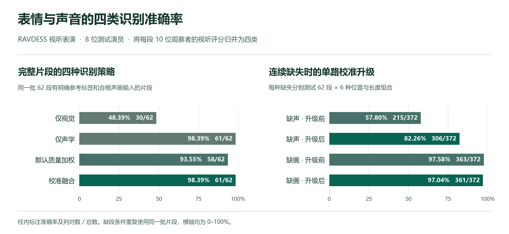
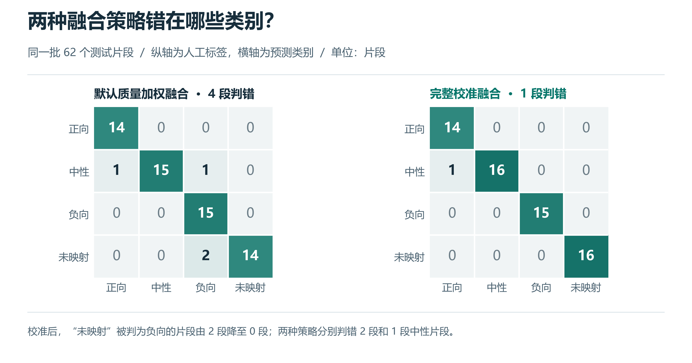

# 桌面情绪线索助手中期报告

**项目主题　面向目标用户的情绪识别、辅助调节与反馈复测**

**报告日期　2026 年 11 月 27 日**

本项目要帮助在电脑前学习或工作的用户**察觉自己的情绪变化，并在需要时找到适合自己的调节方式**。在本人同意的实时会话中，助手从表情和声音识别情绪线索，经授权还可结合发言内容供本人核对。如果持续出现负向线索，助手可询问是否需要帮助。用户确认后选择活动，练习中的反馈决定继续、换法或停止，练习后的反馈用于评价这次体验，也影响下一次向同一用户推荐什么。

中期已完成可运行的 Windows 原型。在同一批 62 段有人工标签的表演音视频中，默认声画融合判对 **58 段（93.55%）**，实验中的校准融合判对 **61 段（98.39%）**。调节部分已用模拟会话验证从本人确认到复测和下次推荐的流程。真人使用后困扰是否减轻、帮助能否持续，是下一阶段要回答的问题。[识别算法设计与取舍](#情绪识别算法的设计思路与取舍) · [识别实验、对照图与人物实例](#情绪识别实验与准确率对照) · [调节反馈验证](#调节反馈已验证到哪一步)

## 一、项目任务

目标用户是正在使用助手、可以亲自确认感受的人。例如，一位学生做题时持续皱眉，可能因为遇到了困难，也可能只是在专心思考。系统能观察到表情，却仍需本人说明此刻的状态。若学生确认是任务卡住了，可以选择“任务拆解”，把卡点写下来并确定下一步。如果学生并不想被打扰，可以拒绝提示并继续自己的任务。

### 一次调节怎样形成反馈闭环

| 环节 | 系统在什么条件下做什么 | 用户的回答怎样改变下一步 |
| --- | --- | --- |
| 识别与询问 | 按时段检查表情与声音。持续负向线索满足质量、时长和提示条件时，询问本人是否想调整。用户也可主动点“我想调整一下”。 | 本人可以修正当前观察。接受后进入调节，拒绝后进入冷却，勿扰时可由本人主动发起。 |
| 选择活动 | 本人确认后，填写当前需要、可用时间和活动前困扰度（0–10 分）。系统从八种活动中给出候选和理由。 | “身体紧绷”和“任务卡住”对应的候选可以不同。本人决定采用舒适呼吸、任务拆解或其他合适的方法。 |
| 练习中反馈 | 分步引导时保留“目前合适”“暂时没变化”“不舒服，停止”三个入口。 | 觉得合适可以继续，暂时没变化可以继续或换方法，报告不适会立即结束本次引导并记录原因。 |
| 复测与下次推荐 | 结束后分别记录困扰度和主观帮助程度，本人可自愿安排稍后复测。前后评分相同时差值为 0，缺少任一次评分时差值留空。明确报告不适时优先显示不适反馈。 | 下一次推荐参考同一档案、同一采集模式下的有效反馈。本人明确回避或曾报告不适的方法会暂不推荐，历史反馈少时主要按本次需要、时间和偏好给出选项。 |

这里有两种使用入口。**实时会话**让同一个人完成识别、确认、活动和复测。**本地文件检测**可导入照片、视频、音频或短文本，检查素材里有哪些情绪线索，也可校对英文转写并导出结果。文件中的人物与当前操作者可能是不同的人，校对素材不会给片中人物写入个人调节记录。[调节流程与推荐规则](REGULATION_LOOP.md) · [识别与本人确认](CONTENT_FUSION.md) · [文件检测](MISSING_MODALITIES.md)

## 二、挑战与解决方案

| 遇到的挑战 | 实现方法 | 设计依据 |
| --- | --- | --- |
| 一句话有起止时间，一帧表情只代表一个瞬间，转写还可能晚到 | 以一段有效发言为单位，将转写和声学结果匹配到原发言，画面只取时间上重叠的部分。文件使用媒体显示时间戳。 | 可以回到同一句话查看文字、声音和表情，避免拿上一句话的声音解释下一句话的画面。当前实现精度为发言时段级。 |
| 缺声、缺画和声画冲突需要不同的处理 | 根据质量和有效覆盖决定哪些通道参与。只有一路有效时可使用该路的校准参数，证据不足时暂缓并显示原因。逐一移除通道后，用原判断函数重算分数。 | 用户能核对某个结论依赖哪路输入，以及失去这一路会怎样。 |
| 英文转写漏词会改变倾向和强度，增加声画也未必更准 | 文件端对符合条件的短英文音视频复用第一次转写，用词和字符两种特征估计整段强度。内容分类默认采用英文文本，同期声画保留为可展开的联合试算。 | 同一批 43 段视频，默认文本判对 19 段，三路候选判对 18 段。保留两种结果，允许使用者看到分歧。 |
| 设备覆盖改变，可能制造活动后“有所改善”的假象 | 比较活动前后的模型观察时，只用两次可比的通道并固定权重，同时单独保留本人自评。 | 受控例中，视觉与声音的负向分数保持 0.80 和 0.40。只改变覆盖时长，直接汇总会出现 0.70 → 0.60 的下降。固定权重后，前后都是 0.60。 |

**合理性**来自决策依据的分工。模型描述可观察的线索，本人确认当前需要、选择是否开始活动，并评价自己的体验。**先进性**体现在按质量和时间覆盖选择可用证据，复测时再检查两次观察能否比较。**本项目的新颖之处**是让同一次反馈既改变当下的引导，也影响以后的选择。例如，练习中报告不适会立即停止当前引导，该方法也会从以后为此人推荐的候选中暂时排除。本人给出的体验与设备观察分别保留，两者出现分歧时仍可以回看各自的依据。[缺失与时间对齐](MISSING_MODALITIES.md) · [反馈如何参与推荐](REGULATION_LOOP.md) · [可比复测方法](RELIABLE_LOOP.md)

### 情绪识别算法的设计思路与取舍

**先决定哪些证据可以放在一起。** 对每次发言，把同期声音和实际重叠的有效画面投到同一时间段。重叠的画面区间只计算一次覆盖时长，避免重复抽帧放大视觉权重。表情模型和声学模型分别输出正向、中性、负向、未映射四类分数。授权转写的文字对应同一发言，另行估计“这句话表达了什么”。英文内容是否值得加入声画由三类倾向对照检验，见实验四。[时段对齐实现](../emotion_assistant/core.py) · [发言内容融合规则](CONTENT_FUSION.md)

**默认质量加权怎样算？** 对通过检查的每一路，先算 `基础权重 × 输入质量 × 有效覆盖率`，再除以各路权重之和。对每个类别，用归一化后的权重把声画分数相加。默认两路基础权重都是 1。视觉质量参考人脸大小、清晰度和亮度，声学质量参考语段时长、音量和削波程度。举例说，两路质量都是 0.8，画面只覆盖半段、声音覆盖整段，则未归一化的权重为 0.4 和 0.8，最终画面占三分之一、声音占三分之二。这是计算示例。[质量计算](../emotion_assistant/models.py) · [权重与决策实现](../emotion_assistant/fusion_policy.py)

| 设计选择 | 优点和适用场景 | 局限及处理方式 |
| --- | --- | --- |
| **默认质量加权** | 无需为融合器另备标注，缺帧或声音质量降低时可直接降低相应通道的影响。权重能用输入质量、有效时长复算。默认和完整校准都保留冲突检查。 | 画面清晰只能说明脸看得清，仍可能把中性表情判成负向。只剩一路时，归一化权重必为 1，继续调权重无法改变该路的类别排序。 |
| **可选的完整校准融合** | 每路的温度参数调整四类分数的集中程度。带正则的逻辑回归根据质量、覆盖率、前两类分差、预测熵及声画分歧等，估计该路最高类别与人工标注一致的可靠性。将原权重乘这个可靠性后重新归一化。 | 需要与当前任务和模型版本匹配的标注参数。拟合和选接受阈值使用不同的演员组，留出的测试演员只用于评价。桌面完整双路默认仍用质量加权，选择完整校准且参数匹配才启用此策略。[校准实现与启用条件](CALIBRATION.md) |
| **缺失时的单路校准** | 仅余表情或声音时，用该路四类分数的对数做类别相关的线性变换，转回概率后与原分数混合。这样只用一路也能纠正类别间的偏差。 | 实时与文件入口默认启用匹配的随附单路参数。没有匹配参数时保留原分数，两路均无合格输入时暂缓。若启用且匹配用户配置的完整校准，则优先使用完整校准。[单路校准实现](../emotion_assistant/single_cue.py) · [真实缺失对照](MISSING_MODALITIES.md) |

**本项目在识别侧的设计贡献**是把证据缺失作为正常输入来处理，并让用户能追查判断。两路有效时可按拟合的可靠性分配权重，一路有效时可直接修正剩余通道的类别分数。给出结论后，系统固定时间段和原先得分最高的类别，分别去掉声音或画面，用同一判断函数重算该类分数。移除最后一路后，界面明确显示已无可用分数。用户由此可以看出某个判断依赖哪路输入。负向候选还须经过持续证据和打扰条件检查，才可能触发询问。[移除通道后的重算](../emotion_assistant/fusion_explanation.py) · [询问与复测条件](RELIABLE_LOOP.md)

## 三、阶段进展与实验结果

### 调节反馈已验证到哪一步

闭环验收通过真实桌面界面输入预设反馈，共通过 **63 个检查点**。其中三条操作记录直接检验了反馈是否改变系统行为。[验收脚本](../scripts/regulation_smoke.py) · [归档检查数](results/asr-validation.json)

- **做完活动还能追踪感受。** 模拟用户完成“给想法命名”，活动前、结束时、稍后分别填 6、4、5 分，稍后选择“无明显帮助”。重启程序后，稍后反馈仍写回同一次活动，用户可以看到结束后困扰有所回升，也能看到独立的帮助程度评价。
- **报告不适会改变下一次选择。** 在“舒适呼吸”中选择“不舒服，停止”，程序立即结束引导、记录不适，并在同一模拟档案随后生成的推荐中暂不推荐该方法。
- **缺少反馈时保留未知。** 在“价值微行动”结束后跳过困扰度后测，程序将结果记为“无法评价”，前后差值留空。

这些数字来自测试脚本的预设输入。11 月 27 日核对开发机默认实验库时，真人调节对照为 **0 人、0 场、0 个完整配对**。当前可以演示反馈确实改变了流程和推荐，实际使用者是否觉得有帮助，仍待真人交叉实验。[调节闭环短片（24.8 秒，模拟会话）](images/progress/simulated-loop.mp4) · [真人对照方案](CROSSOVER_STUDY.md)

### 情绪识别实验与准确率对照

#### 实验一　只看表情、只听声音、两路融合，各判对多少？

使用 RAVDESS 的 192 段英语表演音视频，24 位演员分为三组，拟合、选参数和测试各用不同的 8 人。每段的参考答案来自 10 位观察者看完整声画后的投票，分为正向、中性、负向和未映射四类。“未映射”包括惊讶等难以归入前三类的观察标签。64 段测试视频中，1 段投票平局，1 段缺少合格画面，四种方法在剩余的**同一批 62 段**上比较。整段得分最高的类别与人工参考一致，就计为判对。Macro-F1 给四类同等权重，Brier 衡量类别概率的误差。[标注与划分方法](RECOGNITION_EXPERIMENT.md) · [原始混淆矩阵和评分](results/ravdess-recognition.json)

| 识别方法 | 判对 / 总数 | 判错 | 准确率 ↑ | 四类 Macro-F1 ↑ | Brier 误差 ↓ |
| --- | ---: | ---: | ---: | ---: | ---: |
| 仅视觉（面部表情） | 30 / 62 | 32 | 48.39% | 0.4447 | 0.6309 |
| 仅声学（说话声音） | 61 / 62 | 1 | **98.39%** | 0.9838 | **0.0444** |
| 默认质量加权融合 | 58 / 62 | 4 | 93.55% | 0.9364 | 0.1965 |
| 校准融合 | 61 / 62 | 1 | **98.39%** | 0.9838 | 0.1520 |

**图 1　完整输入与局部缺失的准确率。** 左图中，校准融合比默认融合多判对 3 段，提高 **4.84 个百分点**，与仅声学的正确数相同。右图是另一组对照，检验某一路连续缺段时的单路校准升级，分母和策略见实验二。两图评估的是观察者对外显情绪线索的分类。测试演员只有 8 位，基础声学模型可能接触过这一语料，日常桌面用户的识别准确率仍待现场测量。

**图 2　校准后少错了哪些类别？** 纵轴是人工参考类别，横轴是模型输出。默认融合将 2 段未映射判为负向，另将 2 段中性分别判为正向和负向。校准后只剩 1 段中性判为正向。这种误差与助手何时询问用户有关，实时提示还要另外检查证据质量、持续时间和用户的打扰设置。[四类逐项计数](results/ravdess-recognition.json)

#### 改善来自调整类别分数，还是调整通道权重？

为分开检验这两处改动，复用实验一的同一批 62 段、同一组模型输出和已拟合参数。只开启温度缩放时，保持默认声画权重不变。只开启可靠性门控时，保持各路原始四类分数不变。四组均取融合后得分最高的类别计算准确率，并用 Brier 检查整个四类分布与人工标签相差多远。完成实验一后可运行 `scripts/benchmark_ravdess_calibration_components.py` 复算下表。[复算脚本](../scripts/benchmark_ravdess_calibration_components.py) · [消融实验结果](results/ravdess-calibration-ablation.json)

| 声画融合的组成 | 判对 / 总数 | 准确率 | Macro-F1 ↑ | Brier ↓ |
| --- | ---: | ---: | ---: | ---: |
| 默认质量加权 | 58/62 | 93.55% | 0.9364 | 0.1965 |
| 默认权重＋温度缩放 | 61/62 | 98.39% | 0.9838 | 0.2237 |
| 默认权重×可靠性门控 | 61/62 | 98.39% | 0.9838 | **0.1146** |
| 温度缩放＋可靠性门控 | 61/62 | 98.39% | 0.9838 | 0.1520 |

两种组件单独启用都多判对了 3 段，合用后正确数仍为 61。**区别在于分数质量**。单独调温虽然纠正了最高类别，Brier 却从 0.1965 升至 0.2237。按通道可靠性重新分配权重，则降至 0.1146，是这四种融合方案中最低的。本批数据支持可靠性加权改善四类概率分数，同时也说明完整组合仍有优化空间。完整方案相对默认的 Brier 差为 −0.0445，按测试演员配对重抽的 95% 区间为 [−0.0882, −0.0034]。这些结果来自既有留出集，下一批独立来源可用于检验门控单独使用时能否保持优势。[配对区间与语料范围](RECOGNITION_EXPERIMENT.md)

#### 人物实拍　同一个表情，模型和观察者怎样判断？

下面固定取测试视频中点附近的一帧，用人脸检测器定位面部，再把八类表情分数归并为四类。这里的人工参考来自 10 位观察者观看**完整无声片段**后的投票。面板中的百分数是当前帧的模型分数，准确率则要跨样本统计。[取帧时间、模型输出与原始票数](images/progress/face-cases.json)

**图 3　判断一致。** 演员 05 在 2.002 秒的单帧“高兴”得分为 58.0%，四类结果为正向。观看完整无声片段的 10 人中有 9 人选了高兴。

**图 4　判断分歧。** 演员 06 在 1.668 秒的单帧中，八类里最高的单项是中性（29.2%），多项负向分数合计为 52.6%，四类输出因此为负向。观察者中有 6 人选中性、4 人选负向。按同样规则，59 段具备合格中点帧和唯一人工参考，单帧与整段无声参考一致的有 **27/59（45.76%）**。这也说明为什么助手保留时段依据，并让用户亲自确认是否需要调节。

图 3、图 4 的人物画面取自 Steven R. Livingstone、Frank A. Russo（2018）的 RAVDESS。本项目完成取帧、人脸框与评分标注，改编画面沿用 CC BY-NC-SA 4.0。[原始音视频](https://zenodo.org/records/1188976) · [观察者评分](https://doi.org/10.1371/journal.pone.0196391.s008) · [图片许可](https://creativecommons.org/licenses/by-nc-sa/4.0/)

#### 实验二　声音或画面连续缺失，哪种情况改善最多？

在同 62 段原视频的开头、中间、末尾分别移去 25% 或 50% 的声音或画面。每一路有 6 种缺段条件，共 62 × 6 = 372 次测量。升级前后使用同一批剩余证据。[缺段构造与评价方法](MISSING_MODALITIES.md) · [分条件混淆矩阵](results/continuous-gaps.json)

| 连续缺失的输入 | 单路校准升级前 | 单路校准升级后 | 准确率变化 |
| --- | ---: | ---: | ---: |
| 声音 | 215/372（57.80%） | 306/372（82.26%） | **+24.46 个百分点** |
| 画面 | 363/372（97.58%） | 361/372（97.04%） | −0.54 个百分点 |

如图 1 右侧所示，**单路校准的收益集中在声音缺段、需要依赖表情时**，多判对了 91 次。画面缺段时，原有声学判断已较强，升级后少判对 2 次。两类条件合计 744 次重复测量，有分数的时间覆盖在升级前后均为 98.70%。在这项单路升级对照中，输入完整时双路策略保持一致，前后均为 58/62。实验一中 58→61 段的提升来自另外测试的可选完整校准。[单路升级的完整输入对照](results/missing-modality-benchmark.json) · [缺段时的覆盖与准确率](results/continuous-gaps.json)

#### 实验三　文字、声音和画面都缺一段时，会判断还是暂缓？

在研究生数学建模竞赛 E 题附件 2 的 727 段有标签英文样本上，使用比赛预提取的对齐特征构造 48 组条件。下面列出代表结果。每行的准确率均以全部 727 段为分母，暂缓计入总数。[48 组完整统计](results/attachment2-gaps.json) · [缺段位置与模型说明](ATTACHMENT2_GAPS_AND_INTENSITY.md)

| 输入条件 | 判对 | 判错 | 暂缓 | 全体准确率 |
| --- | ---: | ---: | ---: | ---: |
| 完整输入 | 372 | 281 | 74 | 51.17% |
| 三路同时缺中间一半 | 351 | 288 | 88 | 48.28% |
| 三路错位各缺一半 | 332 | 295 | 100 | 45.67% |
| 三路全缺 | 0 | 0 | 727 | 0.00% |

**图 5　缺口的位置会影响还能判断多少。** 从三路同时缺中间一半改成缺口错位，判对数又少了 19 段，暂缓多了 12 段。三路全缺时 727 段全部暂缓。桌面文件入口从原始媒体解码，缺少可用英文转写时，仍可看合格声画线索，英文内容与强度则暂缓。

#### 实验四　上传英文视频后，内容方向和强度有多准？

E 题附件 1 的 43 段英文原视频来自 19 个来源。以人工标注的整段发言倾向为标准，在相同 43 段上对照，暂缓保留在准确率分母内。[内容极性对照与逐片结果](results/content-fusion.json)

| 发言倾向判断方法 | 判对 / 全部 | 给出判断 | 全体准确率 | 三类 Macro-F1 |
| --- | ---: | ---: | ---: | ---: |
| 声画线索映射到内容倾向 | 11/43 | 41/43 | 25.58% | 0.1940 |
| 自动转写文本（当前默认） | 19/43 | 39/43 | 44.19% | 0.3086 |
| 文字与同期声画联合试算 | 18/43 | 34/43 | 41.86% | 0.3214 |
| 恒猜训练集多数类“正向” | 27/43 | 43/43 | 62.79% | 0.2571 |

这批视频的正向样本较多，恒猜正向拿到了最高准确率。联合试算的 Macro-F1 略高于仅文本，但在相同 43 段上少判对 1 段，且少给出 5 个判断，因此程序保留文本为默认结果。[桌面采用哪种方法的依据](CONTENT_FUSION.md)

同一批原视频还评估了 **−3 至 +3 的表达强度**。新旧方法均有 42 段给分、1 段暂缓。在共同给分的 42 段上，旧方法的 MAE 为 0.574、Pearson 为 0.031，新版正式文件入口的 **MAE 为 0.549、Pearson 为 0.094**。MAE 衡量预测与人工标注平均相差多少强度分，Pearson 衡量两者的线性关联。两个改进量的 95% 区间均包含零，自动估计仍标为试算。[正式文件入口逐片实测](results/asr-file-end-to-end.json)

**图 6　误差更多来自转写还是分段？** 图上方比较各诊断方法共同给分的 41 段。保持自动转写不变，只改汇总方式，Pearson 提高 0.025。保持整段评分方式，把自动稿换成官方稿，Pearson 提高 0.300。文字质量在这批素材上影响更大。图下方给出正式文件入口在上述 42 段上的升级结果。[配对诊断和区间估计](ASR_INTENSITY_STUDY.md)

**程序与性能。** 11 月 27 日重新运行软件验收，405 项测试全部通过，失败、错误和跳过均为 0。项目另有 5 项已通过的真实模型样例检查。Windows 上使用 Ryzen 7 9700X，预热后用 32 段材料计时，单帧视觉推理 P95 为 44.9 毫秒，预切语音的声学推理 P95 为 244.3 毫秒。该计时只覆盖模型模块，现场采集到界面显示的总延迟留待设备联调。[验收入口](../scripts/verify.py) · [既有验收记录](results/asr-validation.json) · [耗时与测量环境](images/progress/cpu-latency.json)

### 桌面原型展示

[观看完整桌面演示（MP4，约 1 分 24 秒）](images/progress/desktop-walkthrough.mp4)。录屏保留实际界面与模型输出，缩短了推理等待时间。英文样例预览保留原声，其余操作配有中文字幕。

| 从哪里看 | 可以核对什么 |
| --- | --- |
| 00:00　导入真人表演视频 | 从「本地文件检测」选择 MP4，查看人脸框、整段分数，再切到一个暂缓的时段检查原因。 |
| 00:18　检查和校对英文发言 | 先听自制样例的合成语音，再看程序检测。转写将原稿的人名 *Mae’s* 写成了同音的 *May’s*。对照原稿校对后，自动强度 +0.63 和校对文本强度 +0.49 分别保留，并可导出 JSON。两种分数使用不同评分方法，此样例用于核对功能。 |
| 00:56　本人反馈与复测 | 切换到独立的模拟实时会话，演示本人确认、选择活动、给出过程反馈、填写自评以及查看历史。 |

文件页可手动导出对素材的检测和校对结果。只有当用户本人开启会话并确认活动时，才会形成个人调节记录。

**图 7　真实本地视频检测。** 此例中 8 个抽样画面均通过质量检查，人声未达到有效门槛。程序依据可用画面给出整段正向线索分数 64.7%，其中 2.5–3.0 秒的时段暂缓判断。左侧单帧和右侧整段覆盖的时间不同。演示第一段及本图中的人物素材来自 Steven R. Livingstone、Frank A. Russo（2018）的 RAVDESS，录屏、截图、检测框及标注均为本项目所作改编，相关画面沿用原素材许可。[原始音视频](https://zenodo.org/records/1188976) · [CC BY-NC-SA 4.0](https://creativecommons.org/licenses/by-nc-sa/4.0/)

**图 8　调节与反馈。** 用户可以在练习中直接表达是否合适。演示录像的模拟用户前后均填写 5 分，历史页保留了零变化。[观看 24.8 秒模拟调节演示（MP4）](images/progress/simulated-loop.mp4)

## 四、未来计划与验收

| 顺序 | 下一步工作 | 完成时提供的证据 |
| --- | --- | --- |
| 1 | 完善情绪调节设计。按用户当前需要、可用时间和上次反馈细化八种活动的推荐理由，走查接受、拒绝、换法、不适中止和缺少后测。 | 每种路径给出可复现的操作记录，核对界面、历史和导出中的活动、自评与缺失原因。 |
| 2 | 在目标电脑接入外置 USB 摄像头和麦克风。依次测试正常发言、静音、遮脸、弱光、背景噪声、设备拔插与恢复，再连续运行 60 分钟。 | 提交设备与环境配置、有效覆盖、暂缓原因、端到端延迟 P50/P95、丢帧或丢段、CPU 和内存记录，附异常复现与修复后复测结果。[设备测试步骤](PHASE1.md) |
| 3 | 设备稳定后，开展自愿参加的真人交叉实验。同一人用同一设备、在相近日常任务中按随机顺序体验基础和自适应两种调节策略，各一场。另用新来源英文视频复验强度排序。 | 用每小时明确不想收到的提示数衡量打扰，用接受率和完成率衡量活动是否用得起来。比较同一人在两种策略下的即时与延迟困扰度变化，分别报告有效配对人数和缺失数。两组都能做活动，所得差异用于比较策略。视频复验另报覆盖数、MAE 和 Pearson。[参与与统计办法](CROSSOVER_STUDY.md) |
| 4 | 时间允许时搭建桌面硬件原型，根据实测问题确定摄像头支架、麦克风位置、供电与走线。 | 提供实物照片或演示录像，在相同场景下比较搭建前后的覆盖率和延迟。 |
