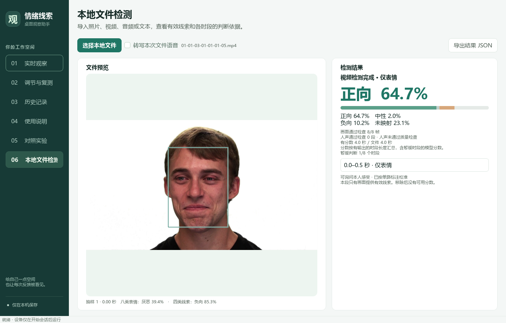
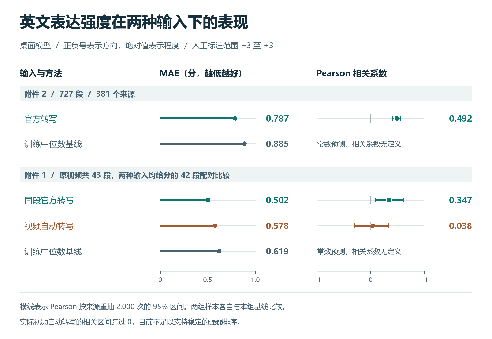
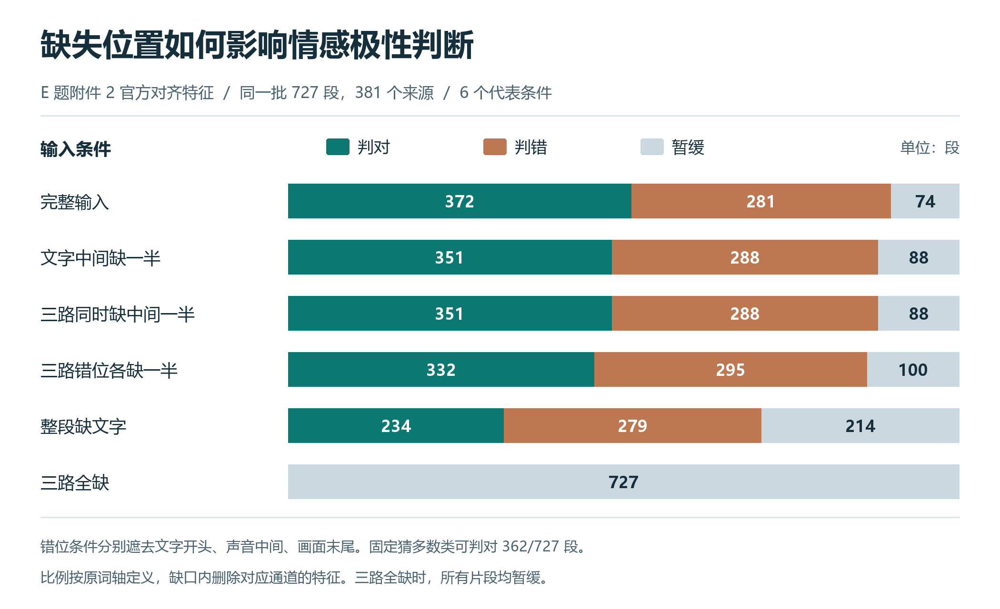
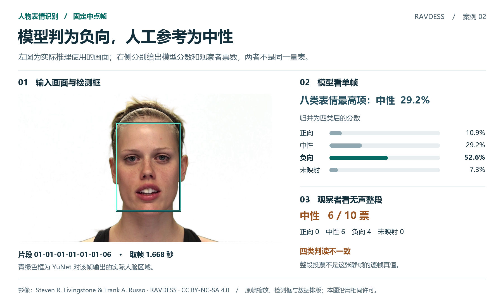
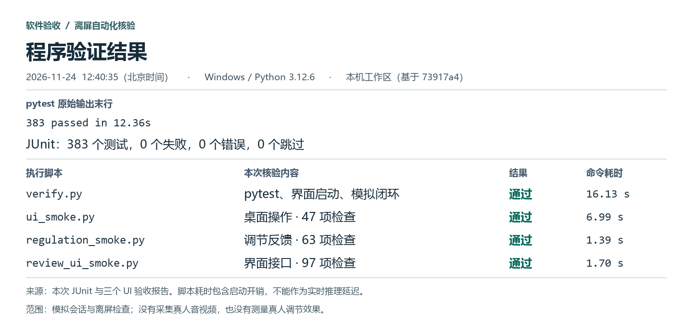

# 桌面情绪线索助手：项目进展与实验成果

**中文短片新增自适应权重。** 主对照 48 段中，自适应千问判对 27 段，同训练去千问判对 24 段，正向召回 6/14 对 5/14。补验 48 段分别判对 31 和 32 段。原来 9 段全漏的中性表达找回 4 段，原来 4 次文字与声画冲突的新增错误修复 3 次。固定权重千问在两组的总体准确率仍更高，桌面保留 v1 默认、v2 可选。[方法、指标、权重实例与逐路遮蔽](CHSIMS_ADAPTIVE.md) · [上一轮固定权重对照](CHSIMS_FOUNDATION.md)

桌面已增加气泡式多轮调节对话，以及实时和本地视频的同段分歧复核。模型推理期间也可执行明确的停止指令。可按普通会话体验一次性推荐与多轮助手，登记即时和延迟自评。[试用登记与两次会话对照](AI_ASSISTANT_STUDY.md#本轮多轮对话试用办法)

**已发布的分歧复核对照。** CH-SIMS 48 段原视频的关闭／开启复核结果为 20／21 段正确，三路加权投票为 22 段正确。千问将 6 段改对、5 段改错，保留为按需复核。开发用的 13 轮调节对话均匹配预期动作和处理来源。[中文视频实测与缺路条件](CHSIMS_CONFLICT.md) · [桌面截图与实验解读](MIDTERM_REPORT.md#中文视频中的线索分歧与多轮调节)

**千问发布评测。** 160 条中文人工标注样本走完正式桌面复核，159 条取得有效双维评分。愉悦度 MAE 从 1.1118 降至 0.7888，激活度的误差没有下降。新增 240 条英文官方测试评论和中英文短句等待时间测量，连同 13 类对白对照及整体流程图见[接入千问后的性能指标与整体流程](QWEN_BENCHMARK.md)。

**中文识别。** 文件页支持输入文字，中文短段具备离线对白类别和双维评分，并可在本机用 Qwen 复核。已用 CPED、Chinese EmoBank 和成对中文测试句，分别检查细类、维度和语境。[最新中文实验与论文依据](RESEARCH_RATIONALE_ZH.md)

**多维情绪识别。** 英文新增 28 类多标签与三维评分，中文新增双维估计，表情与语调分别展示模型前两类。公开测试、跨量表说明及真实桌面输出见[情绪量化实验](AFFECT_QUANTIFICATION.md)。

**11 月 27 日新增。** 本机大模型可以复核文字、给出活动候选，并在用户选择后保存建议采纳来源。新增的公开情感数据对照和调节功能验收见[情感助手研究验证](AI_ASSISTANT_STUDY.md)；下文原有各项实验沿用自己的数据和验证版本。

**实验数据更新　2026 年 11 月 25 日**　｜　**桌面演示补录　11 月 27 日**　｜　Windows、Python 3.12.6、CPU　｜　已验证的软件版本 `5baaa54`

桌面端可以实时观察表情和声音，也可以直接分析本地照片、视频、音频或 TXT。用户同意转写后，可按发言查看英文内容倾向、−3 至 +3 的表达强度，以及文字、声音、表情是否一致。是否开始调节、哪种活动合适、活动后有没有帮助，都由本人确认。

**目前可以演示从检测到复测的完整流程。** 识别性能已用真实音视频、人物帧和人工标注检验。调节部分已用模拟会话走通确认、活动、复测与保存。下一阶段将把这套流程带到接有外置摄像头的真实桌面环境，分别验证设备表现和用户反馈。

## 已完成的工作、适用场景与实测表现

| 场景 | 系统现在怎样处理 | 已验证到什么程度 |
| --- | --- | --- |
| 有人脸或声音，某一路暂时缺失 | 按时段对齐表情与声音，显示参与通道和分歧。静音时可保留合格画面，缺少合格人脸时可保留人声，两路都缺时暂缓声画判断。 | 在 62 段留出表演音视频上，默认质量加权融合判错 4 段，校准融合判错 1 段，四类 Macro-F1 从 0.9364 升至 0.9838。同批仅声学也判错 1 段。真实遮挡和现场噪声仍待外接设备测试。[声画识别对照](RECOGNITION_EXPERIMENT.md) |
| 手头只有照片、录好的视频或音频 | 从本地文件页导入，按画面或时段查看结果、暂缓原因，并导出 JSON。导入过程无需连接采集设备。 | 100 段真实视频关闭转写后，68 段取得两路线索、24 段仅声音、2 段仅画面、6 段两路均不可用。94 段有评分，其中 25 段的最高类别与整段人工语义标签一致。[真实上传实验](MISSING_MODALITIES.md) |
| 有英文发言、TXT 或转写漏词 | 英文文字可估计发言倾向和 −3 至 +3 的表达强度。短英文音视频复用首轮转写，可人工校对并单独查看校对后的分数。缺少可用英文文本时暂缓英文强度，中文提供语境提示。 | 727 段官方英文转写的 MAE 为 0.787、Pearson 为 0.492。正式文件入口的 43 段原视频中，42 段给分、1 段暂缓，**MAE 为 0.549，Pearson 为 0.094**。排序能力仍弱，自动结果标为试算。[真实视频配对实验](ASR_INTENSITY_STUDY.md) |
| 用户愿意调节、拒绝提示或中途感觉不适 | 用户可自行发起或确认提示，从八类活动中选择，反馈后换方法或结束。系统分开保存前后自评、可比的声画观察和自愿参加的延迟复测。 | 模拟流程已验证不适中止、换方法及复测保存。受控反例中，消除声画覆盖差异后，前后分数从表面的 0.70 → 0.60 变为 0.60 → 0.60。真人调节收益待配对会话验证。[调节流程](REGULATION_LOOP.md) · [复测对照](RELIABLE_LOOP.md) |

上一版千问文字复核发布通过 527 项回归测试。既有 CPU 实测中，单帧视觉推理 P95 为 44.9 ms，预切语音声学推理 P95 为 244.3 ms。从现场采集到界面显示的总延迟要由设备联调测量。[文字复核版验收](results/qwen-release-validation.json) · [声画模块计时](images/progress/cpu-latency.json)

## 一、本地文件检测与桌面操作

### 本地文件检测

[观看桌面操作演示（MP4）](images/progress/desktop-walkthrough.mp4)。先看本地视频的选择、实测结果与逐时段依据，再看英文转写校对及 JSON 导出。片尾切换到模拟调节会话。

选择“本地文件检测”即可导入文件，无需启动摄像头与麦克风。照片显示人脸框、原始表情与归并后的线索；视频按时间戳分析有效画面和人声。结果页可选择时段、检查参与通道、查看暂缓原因并导出 JSON。处理 E 题附件 1 的 100 段真实视频时，关闭转写后有 94 段取得声画分数；其中 25 段的最高分和整段人工语义标签一致。[本地文件实验](MISSING_MODALITIES.md) · [逐片结果](results/mosei-upload.json)

*图 1　导入 RAVDESS 演员 05 的公开 MP4，关闭转写。8/8 个采样画面合格，人声通过 0 段，因此整段采用视觉线索，正向得分 64.7%，8 个时段中有 1 个暂缓。左下角负向 85.3% 对应 0.00 秒的单帧，右侧 64.7% 对应整段时长加权结果。人物素材与改编图片许可见第四节。*

*图 2　附件 1 的一段逐发言实测。勾选“转写本次文件语音”后，0.000–5.399 秒发言的文本极性为正向 61.4%，表达强度为 +0.57，同期声画与文字的联合试算为正向 51.7%。同一文件在新版整段汇总中的自动强度为 +0.55。* [截图对应的逐发言输出](images/progress/file-intensity-example.json) · [新版整段输出核验](results/asr-file-ui.json)

### 实时观察、调节与历史

以下是运行中的桌面程序截图，使用模拟输入及隔离的示例档案。

*图 3　实时观察可以分别查看声画证据，控制主动询问、专注和勿扰，也可以自己发起调节。*

*图 4　此模拟会话选择了 1 分钟舒适呼吸。用户可反馈“目前合适”“没变化”或“不舒服”，随时换方法或结束，完成后可填写自评并选择稍后复测。*

*图 5　历史页可以筛选会话来源、查看详情和导出记录。此图的自评下降 2 分来自模拟脚本的 5 → 3，真人调节效果仍待配对实验。*

此前录制的 24.8 秒无声演示完整展示了“观察 → 确认 → 活动 → 复测 → 历史”。演示中，临时数据库保存了脚本输入的前测 5 分和后测 5 分，验证了零变化能够如实记录。[下载模拟闭环演示 MP4](images/progress/simulated-loop.mp4) · [调节流程](REGULATION_LOOP.md) · [真人交叉实验方案](CROSSOVER_STUDY.md)

## 二、英文发言内容与强度

原词模型按附件 2 官方划分拟合、选参数、测试，各为 3,395、728、727 段，视频来源互不重叠。新增的文件字符模型从训练集中剔除附件 1 的来源及重复文字，使用剩余 3,374 段及其合成扰动副本训练。强度的符号表示方向，绝对值表示程度。MAE 表示平均绝对误差，单位为强度分。Pearson 衡量预测与标注的线性关联。每行以能给出强度的样本计算指标及常数基线。

| 输入 | 强度有效 / 全部 | MAE ↓ | Pearson ↑ | 同批常数基线 MAE |
| --- | ---: | ---: | ---: | ---: |
| 附件 2，完整官方转写 | 727 / 727 | **0.787** | **0.492** | 0.885 |
| 附件 2，开头连续丢失一半词语 | 718 / 727 | 0.826 | 0.391 | 0.892 |
| 附件 1，旧版自动转写首次归档 | 42 / 43 | 0.578 | 0.038 | 0.619 |
| 附件 1，旧版按本次固定种子重新识别 | 42 / 43 | 0.574 | 0.031 | 0.619 |
| 附件 1，正式文件入口，新增词与字符评分 | 42 / 43 | **0.549** | **0.094** | 0.619 |
| 附件 1，对同一批 42 段使用官方转写 | 42 / 42 | 0.502 | 0.347 | 0.619 |

上图记录首次文件验收。附件 2 的 381 个测试来源按来源重抽，MAE 改善的 95% 区间为 0.062 至 0.134 分。附件 1 的 43 段原片来自另外检验的 19 个来源。新方法沿用首次自动转写，36 段使用词与字符评分，6 段沿用旧分数，1 段暂缓。相对同次旧方法，Pearson 差值的 95% 区间为 −0.053 至 +0.217，MAE 差值为 −0.056 至 +0.003 分，仍需新来源验证。[附件 2 强度验证](results/english-intensity.json) · [正式入口优化前后逐片结果](results/asr-file-end-to-end.json)

把各诊断方法都能评分的 41 段固定后，只改汇总使 Pearson 从 0.022 升至 0.047；只补回漏词后为 0.245；换全套官方文字为 0.346。两项使用官方稿的对照用于定位误差。用户也可在文件结果中校对英文转写，另看校对后的强度。[误差归因、候选选择和复现方法](ASR_INTENSITY_STUDY.md)

在同一批 43 段原片上，逐发言文本极性判对 19 段、给分 39 段；加入同期声画的联合候选判对 18 段、给分 34 段。三类 Macro-F1 从 0.309 升至 0.321，但准确率和覆盖率下降。固定猜正向可判对 27 段。开发阶段的预设启用条件未满足，因此保留文字默认判断，并提供联合试算与分歧供查看。[三路对照与决策依据](CONTENT_FUSION.md)

## 三、局部丢词与多路同时缺失

在相同的 727 段附件 2 测试样本上，用比赛预提取的对齐特征做了 48 组对照。每行的判对、判错和暂缓之和为 727。三路分别为文字、声音和画面，“错位”指分别在开头、中间和末尾删去相应部分。

| 对齐特征实验条件 | 极性判对 | 判错 | 暂缓 | 强度有效 | MAE ↓ | Pearson ↑ |
| --- | ---: | ---: | ---: | ---: | ---: | ---: |
| 完整输入 | 372 | 281 | 74 | 727 | 0.794 | 0.488 |
| 仅文字中间缺 50% | 351 | 288 | 88 | 727 | 0.807 | 0.447 |
| 三路同时在中间缺 50% | 351 | 288 | 88 | 727 | 0.808 | 0.447 |
| 三路错位各缺 50% | 332 | 295 | 100 | 727 | 0.824 | 0.394 |
| 整段无文字、保留声画 | 234 | 279 | 214 | 727 | 0.852 | 0.276 |
| 三路全缺 | 0 | 0 | 727 | 0 | — | — |

验证集选择了有有效文字时优先文字、文字不可用时用声画的策略。整段无文字时，比赛特征模型判对 234 段，低于多数类基线的 362 段。日常文件入口使用实际解码与转写，此时仍会展示可用的声画线索，并暂缓英文发言内容与强度。另用桌面文本模型测试完整官方转写，极性判对 383 段、暂缓 21 段；开头丢一半词语后，判对 331 段、暂缓 38 段。[48 组完整统计、桌面文本丢词对照及复算方法](ATTACHMENT2_GAPS_AND_INTENSITY.md)

## 四、声画识别与人物实拍

RAVDESS 实验共处理 24 位演员的 192 段同步音视频，每段参考类别来自 10 位观察者的视听评分。拟合、选阈值和测试各用不同的 8 位演员。64 段测试视频中，1 段人工评分平票、1 段缺少合格画面；下表四种方法比较同一批 62 段。类别是正向、中性、负向和未映射。[实验设计与标注](RECOGNITION_EXPERIMENT.md)

| 方法 | 四类 Macro-F1 ↑ | Brier 概率误差 ↓ | 62 段中判错 | 各自分数最有把握的 43 段中判错 |
| --- | ---: | ---: | ---: | ---: |
| 仅视觉 | 0.4447 | 0.6309 | 32 | 17 |
| 仅声学 | **0.9838** | **0.0444** | 1 | 0 |
| 默认质量加权融合 | 0.9364 | 0.1965 | 4 | 1 |
| 完整校准融合 | **0.9838** | 0.1520 | 1 | 0 |

校准融合相对默认融合的 Macro-F1 差值为 +0.0474，按演员配对重抽的 95% 区间为 [0.0000, 0.1089]。Brier 差值为 −0.0445，区间为 [−0.0882, −0.0034]。测试材料为英语表演语音，只有 8 位测试演员，也无法排除基础声学模型训练时接触过此语料。[冻结实验统计](results/ravdess-recognition.json)

另在相同 62 段上测试单路连续缺失，每段做 12 个配对条件。声音局部缺失的 372 次测量中，四类准确率由 57.80% 升至 82.26%；画面局部缺失的 372 次测量中，由 97.58% 略降至 97.04%。两类缺失产生了不同的结果。[按缺口位置和长度的统计](results/continuous-gaps.json)

**只看脸时，如何判断模型和人是否一致？** 对测试视频固定抽中点一帧，YuNet 定位人脸，EmotiEffLib 给出八类表情并归并为四类。人工参考来自 10 人对同一完整无声片段的评分。以下三例分别展示一致、分歧和取帧差异。

演员 05 的帧在 2.002 秒，模型“高兴”得分 58.0%，9/10 观察者把整段评为高兴。多帧视觉汇总仍以正向为最高。

演员 06 的帧在 1.668 秒，模型八类中性分数为 29.2%，合并五个负向类别后负向总分为 52.6%。对同一完整无声表演，观察者中 6 人选中性、4 人选负向。

演员 12 的帧在 1.835 秒，模型中性得分 47.6%，观察者的 10 票均归并到中性。整段多帧视觉结果的最高类别却是负向（48.6%）。全部可比较的单帧中，模型与人工一致 27/59；整段多帧为 30/61。可比较集合不同，且人工标签覆盖整段。[取帧、选例与票数](images/progress/face-cases.json)

RAVDESS 人物图片和本地视频页面中的 RAVDESS 画面取自 Steven R. Livingstone、Frank A. Russo（2018）的原始作品。截图、裁帧、人脸框及结果注释是本项目所作改编，相关图片沿用 CC BY-NC-SA 4.0 许可。[原始音视频与授权](https://zenodo.org/records/1188976) · [观察者评分](https://doi.org/10.1371/journal.pone.0196391.s008) · [CC BY-NC-SA 4.0](https://creativecommons.org/licenses/by-nc-sa/4.0/)

## 五、调节复测、程序验证与性能

受控实验固定视觉负向分数为 0.80、声学为 0.40。前测只有 15 秒同时覆盖声画，后测有 30 秒。直接比较会得到 0.70 → 0.60 的虚假改善；将双方可比通道权重固定后，前后均为 0.60。软件保留用户的独立自评、可选延迟复测及不可比较的原因。[复测逻辑与反馈](RELIABLE_LOOP.md)

**本轮验证。** 文件强度升级及转写校对接入后，综合验收记录 **405 项通过，0 失败、0 错误、0 跳过**。五项真实模型样例检查全部通过。另从 Qt 文件页导入两段真实 MP4，核对了自动结果、模拟校对和导出的 JSON。上一次长音频修复发布时的 384 项记录也已保留。[本轮验证摘要](results/asr-validation.json) · [真实文件页与导出核验](results/asr-file-ui.json) · [上次发布验证](images/progress/release-validation.json)

下图是 11 月 24 日较早的归档验收，记录了当轮 **383 项通过**。桌面工作流、调节流程、界面接口另分别通过 47、63、97 个脚本检查点，各组单独计数。[截图对应的 JUnit 和脚本摘要](images/progress/acceptance.json)

11 月 23 日，在 Ryzen 7 9700X 的 Windows CPU 环境预热后，从 8 位演员取 32 段材料。单帧视觉 P50/P95 为 40.7/44.9 ms，整段预切语音的声学 P50/P95 为 210.9/244.3 ms，输入语音时长中位数为 3.54 秒。计时不含设备采集、解码、现场语音切段、排队或 UI 刷新。[逐次耗时及配置](images/progress/cpu-latency.json)

## 六、下一阶段的设计与实测计划

### 1. 完善情绪调节设计

在已有八类活动上，细化“什么时候询问、为什么推荐这一项、用户反馈后下一步做什么”。例如，用户表示身体紧绷且只有一分钟时，可以选择舒适呼吸。过程中反馈“没变化”时可换方法，反馈“不舒服”时立即停止。用模拟会话逐项检查接受、拒绝、换法、中止和缺少后测，形成一份可复用的调节流程和记录样表。[现有调节设计](REGULATION_LOOP.md)

截至 11 月 25 日，只读核对开发机默认实验库，真人调节对照登记 **0 人、0 场、0 个完整配对**。下一步先固定基础与自适应两种策略。待外接设备调试通过后，由同一参与者按随机顺序各完成一场，在相近的日常任务中比较**每小时明确不想收到的提示数**，并记录提示接受率、活动完成率、即时及延迟自评变化、有效配对人数和缺失数。真人数据与模拟记录分别统计。[真人交叉实验方案](CROSSOVER_STUDY.md)

### 2. 接入外置摄像头，在真实环境测试和调试

在目标电脑接入 USB 摄像头和本人使用的麦克风。先用 `scripts/doctor.py` 枚举设备，再从 `start.cmd` 进入“实时观察 → 设备设置”，选择“真实设备采集”，刷新设备并在“摄像头”下拉列表选择外接摄像头。开始后用预览确认取景。先在普通会话排查设备，再开展上面的真人对照。[设备验收步骤](PHASE1.md)

| 实测项目 | 操作与记录 |
| --- | --- |
| 正常观察与缺路 | 从自然光、单人、正常发言开始，分别加入静音、遮脸、弱光和背景噪声。逐项记录实际参与通道、有效覆盖、暂缓原因及异常样例。 |
| 断连与恢复 | 暂停、恢复，分别拔插摄像头和麦克风。核对缺路提示、另一通道的表现、恢复后的时间戳。退出后用其他程序重新打开设备，检查资源释放。 |
| 完整会话与长测 | 从真实采集走到调节、复测、导出，核对导出的 `mode=real`、自评及时间段。随后连续运行 60 分钟，记录采集到显示的端到端延迟 P50/P95、丢帧或丢段、CPU 与内存占用。保留设备配置、复现步骤、修正及复测结果，形成联调记录。 |

### 3. 时间允许时再搭建硬件原型

前两项完成后，如仍有时间，再根据实测中的取景、收音和连接问题安排摄像头固定位置、麦克风布置、供电与线缆，搭建可重复演示的桌面原型。搭建后沿用相同的正常、缺路及长测场景，对照原电脑直连时的覆盖率与延迟，再决定是否保留这套布局。

后续算法验证还需要用新的英文视频来源复验强度排序，并用经授权、独立标注的中文材料评价发言内容与声画线索。[英文强度实验的适用边界](ASR_INTENSITY_STUDY.md)
