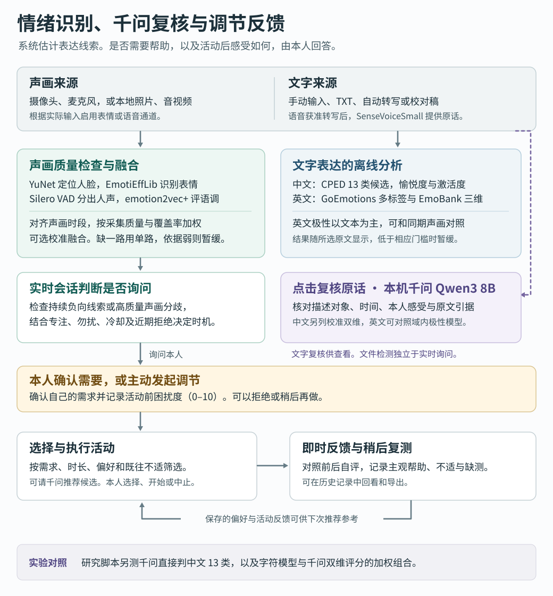

# 接入千问后，哪些情绪识别指标提高了？

本项目把 Qwen3 8B 接在用户主动选择的文字复核环节。以下逐项比较同一句原文在不同方法下的答案，记录判断错误和暂缓。中文愉悦度、英文发言倾向、中文对白类别分别有各自的标注与分母。整套助手的调节效果仍需真人反馈验证。

## 算法怎样从输入走到反馈



声画质量、时间对齐和可用通道决定能否给出观察线索。用户输入文字、上传 TXT，或允许音视频转写后，程序可独立估计文字表达。用户点击复核才会把所选原话送至本机 Ollama。模型引用的片段必须能在原话中找到。本人确认的需求、活动选择和前后自评另行记录。下列官方语料评价的是**表达**，其中没有针对本助手的真人调节结局。[代码入口](../emotion_assistant/research_text_review.py) · [真人对照方案](CROSSOVER_STUDY.md)

## 英文发言倾向｜GoEmotions

采用 Google Research 官方训练及测试拆分与倾向映射。测试集 5,427 条中有 4,539 条可唯一映射到正、中、负。下面的准确率以整组选定的句子为分母，宏 F1 给三类相同权重，覆盖率是有输出的比例。“原模型”指本项目原有英文极性模型，“域内参照”指使用 GoEmotions 官方训练集拟合、随程序发布的 TF-IDF 逻辑回归。[官方数据与标注](https://github.com/google-research/google-research/tree/7951440944924ac61b6e2f9a2a3c715834005c40/goemotions)

**每类 60 条的独立复验。** 以下四种方法都读取同一批 180 条评论，未计入更早的 60 条先导样本。

| 方法 | 判对 / 判错 / 暂缓 | 整组准确率 ↑ | 宏 F1 ↑ | 覆盖率 ↑ |
| --- | ---: | ---: | ---: | ---: |
| 原英文模型 | 76 / 98 / 6 | 42.22% | 0.4162 | 96.67% |
| 域内参照，直接取首选 | 116 / 64 / 0 | 64.44% | 0.6455 | 100% |
| 域内参照，采用桌面的词汇覆盖门槛 | 114 / 62 / 4 | 63.33% | 0.6424 | 97.78% |
| Qwen 语义复核 | 110 / 63 / 7 | 61.11% | 0.6178 | 96.11% |

Qwen 相对原模型多判对 34 条，准确率提升 **18.89 个百分点**。两种方法分别独自判对 56 条和 22 条，双侧精确 McNemar 检验 p=0.000149。对比域内参照直接取首选，Qwen 少判对 6 条，p=0.561。实际桌面对两者均能判定的分歧保留原话供核对。测试集内与训练文本完全相同的复验评论有 1 条，下一组抽样进一步剔除了重复文本。[逐项结果与耗时](GOEMOTIONS_EVALUATION.md) · [180 条逐项决定](results/goemotions-replication-decisions.json) · [域内参照与一致性](results/goemotions-linear.json)

**本次新测的 240 条评论。** 排除前两轮用过的 240 个 ID、与训练或开发语料重复的文本、以及测试集内重复文本后，在剩余 4,197 条中按固定哈希取 240 条，不设类别配额。实际选中负向 66 条、中性 80 条、正向 94 条。未调整已有权重、提示词和输出门槛。

| 方法 | 判对 / 判错 / 暂缓 | 整组准确率 ↑ | 宏 F1 ↑ | 覆盖率 ↑ | 负向 / 中性 / 正向判对数 |
| --- | ---: | ---: | ---: | ---: | ---: |
| 原英文模型 | 107 / 127 / 6 | 44.58% | 0.4126 | 97.50% | 26 / 15 / 66 |
| 域内参照，桌面门槛与直接取首选在本组相同 | 172 / 68 / 0 | **71.67%** | **0.7119** | 100% | 44 / 58 / 70 |
| Qwen 语义复核 | 138 / 96 / 6 | 57.50% | 0.5781 | 97.50% | **54** / 35 / 49 |

| 同一批 240 条上的补充指标 | 原英文模型 | 域内参照 | Qwen |
| --- | ---: | ---: | ---: |
| 宏平均精确率 ↑ | 0.4271 | 0.7175 | 0.6073 |
| 宏平均召回率 ↑ | 0.4279 | 0.7121 | 0.5923 |
| 已给判断的样本中答对的比例 ↑ | 45.73% | 71.67% | 58.97% |

千问相对原模型多判对 **31 条**，准确率高 **12.92 个百分点**（双侧精确 p=0.00573）。但相对随程序提供的域内参照，它少判对 **34 条**，低 **14.17 个百分点**（p=0.00111）。千问在负向评论上优于域内参照，中性和正向分别少判对 23 条和 21 条。这是保留两种判断、让用户在有分歧时核对原文的依据。此处各项检验报告未经多重比较校正的 p 值。[240 条逐项判断、完整混淆矩阵和配对计数](results/goemotions-release.json)

## 中文愉悦度与激活度｜Chinese EmoBank CVAS

使用作者发布的 1–9 分中文读者标注语料。语料主要为繁体，划分由项目按文本哈希固定。字符岭回归使用 1,975 句训练；192 句用于校准，另选 160 句确认。离线模型对 160 句均能给分，直接运行千问双维评分器得到 159 个有逐字依据的有效输出。表内每个格子都使用同一批 159 句。**MAE 衡量与人评相差多少分，越小越好；Pearson 衡量高低是否随人评变化，越大越好。** [语料论文与使用条件](https://www.mis.yzu.edu.tw/nlplab/resources/chinese-emobank_download.html)

| 方法 | 愉悦度 MAE ↓ | 愉悦度 Pearson ↑ | 激活度 MAE ↓ | 激活度 Pearson ↑ |
| --- | ---: | ---: | ---: | ---: |
| 本地字符模型 | 1.1118 | 0.3426 | 0.9570 | 0.3469 |
| 校准后的 Qwen 评分器 | **0.7884** | 0.7673 | 0.9852 | 0.2347 |
| 校准集上拟合的加权组合，仅实验 | 0.8291 | **0.7731** | **0.9546** | **0.3601** |

千问的愉悦度 MAE 下降 **0.3234 分**，按句配对自助抽样 5,000 次得到的 95% 区间为 **0.2100 至 0.4330**。激活度 MAE 增加 0.0282 分，按“误差减少”计的区间为 −0.1036 至 0.0436。加权组合的激活度 MAE 仅减少 0.0024 分，区间同样跨零。系统保留离线读数并把千问结果单列，实验组合没有进入默认决策。[两维误差、覆盖率与区间](results/chinese-dimension-hybrid.json)

**正式桌面复核入口。** 对同一批 160 句，另外实际运行桌面按钮调用的 `review_with_reference`，重新做语义复核、逐字引文校验、中文维度预测和校准。语义复核 160/160 通过，双维评分 159/160 有效（99.38%），1 句因依据不足暂缓。下面是双方均能给分的 159 句。两次运行使用相同样本，结果不能作为两批独立证据累计。

| 1–9 分量表 | 离线模型 MAE ↓ | 桌面千问 MAE ↓ | 离线模型 Pearson ↑ | 桌面千问 Pearson ↑ | MAE 减少值及 95% 区间 |
| --- | ---: | ---: | ---: | ---: | --- |
| 愉悦度 | 1.1118 | **0.7888** | 0.3426 | **0.7651** | **0.3230**（0.2099 至 0.4327） |
| 激活度 | **0.9570** | 0.9852 | **0.3469** | 0.2347 | −0.0282（−0.1036 至 0.0436） |

159 句中，有 158 句的两维分数与单独评分器那次运行完全相同，暂缓的也是同一句。若作一项回放，在千问暂缓的那一句沿用界面已有的离线分，则全 160 句的愉悦度 MAE 从 1.1101 降至 0.7892，激活度 MAE 从 0.9515 增至 0.9795。应用实际并列展示来源，用户自行决定如何解读。正式复核单客户端串行完成，共 1,380.6 秒。此前一次仅 2 句的并发试跑与另一批推理争用本机服务，第二阶段均触发超时；此试跑与正式 160 句分开记录。[桌面入口计数、误差与配对区间](results/chinese-desktop-review.json)

## 中文 13 类表达｜CPED

CPED 官方训练、开发、测试分别来自互不重叠的 26、5、9 部剧。我们从官方测试集按 13 类各取 10 条，先剔除和训练或开发集重合的句子及测试内重复，再冻结样本。三种方法都只读本句，模型看不到剧名、角色和参考标签。[作者数据及论文](https://github.com/scutcyr/CPED)

| 同批 130 句的方法 | 判对 / 判错 / 暂缓 | 整组准确率 ↑ | 已判准确率 | 宏 F1 ↑ | 覆盖率 |
| --- | ---: | ---: | ---: | ---: | ---: |
| 离线字符模型，桌面门槛 | 6 / 16 / 108 | 4.62% | 27.27% | 0.0551 | 16.92% |
| 离线字符模型，合格输入直接取首选 | 19 / 109 / 2 | 14.62% | 14.84% | 0.1410 | 98.46% |
| 千问根据单句选 13 类，仅实验 | 26 / 103 / 1 | 20.00% | 20.16% | 0.1582 | 99.23% |

千问比直接取首选多判对 7 条，双方独自判对 14 条和 7 条，p=0.189。千问有 **82/130** 次选择中性，实际只有 10 条。相对桌面门槛多给答案，并未带来更高的已判准确率。**这个实验缺乏让千问接管 13 类判断的证据**，应用仍将具体类别作为可暂缓的离线候选。在完整测试集 27,438 句上，桌面模型判对 1,154、判错 1,992、暂缓 24,292，已判准确率 36.68%、覆盖率 11.47%。千问的 130 句试验不能外推为全测试集成绩。[130 句逐类指标](results/cped-qwen-paired.json) · [全测试集离线指标](results/cped-chinese-emotions.json)

## 点击复核要等多久

在同一台 Windows 电脑上，离线文字模型和 Ollama Q4_K_M 均已预热，千问使用显存。英文、中文各取 12 个按哈希选中的不同原句，逐句先测离线结果，再测用户主动复核的额外耗时。中英文交替执行，期间无其他本项目推理任务；暂缓也计入耗时。P50 是中位数，P90 是第 90 百分位。

| 输入 | 离线文字分析 P50 / P90 | 点击千问复核的额外耗时 P50 / P90 | 完成情况 |
| --- | ---: | ---: | --- |
| 英文 | 0.34 / 0.42 毫秒 | 5.13 / 5.65 秒 | 12/12 完成语义复核 |
| 中文 | 0.31 / 0.40 毫秒 | 5.06 / 5.31 秒 | 12/12 完成语义复核，其中 11/12 取得双维评分 |

这组数据描述短文本在该机器上调用识别函数的等待成本。模型加载、录音转写、界面绘制和使用者阅读时间另计；12 句的 P90 也不用于承诺其他机器的响应时间。结合质量对照，目前桌面先展示离线结果，再让用户决定是否花几秒查看原文复核。[耗时、硬件加速状态与样本说明](results/official-text-latency.json)

## 其余指标与解释范围

| 任务和分母 | 当前已验证的结果 | 影响指标的改动 |
| --- | --- | --- |
| GoEmotions 英文多标签，全部 5,427 条 | 宏 F1 0.4475、微 F1 0.5292、覆盖率 96.52%；标签全集完全正确 1,680 条，统一阈值为 1,779 条 | 逐类阈值，未做千问多标签配对。[逐类结果](results/goemotions-fine-emotions.json) |
| 英文 EmoBank 三维，测试 1,000 句中可评的 958 句 | 愉悦度、激活度、掌控感 MAE 分别为 0.2071、0.1746、0.1502，Pearson 为 0.5438、0.3913、0.3015 | 直接从文字回归三个维度。[同句对照](results/emobank-vad.json) |
| RAVDESS 声画四类，双方有效且人工参考唯一的 62 段 | 默认质量加权 58/62，完整校准 61/62；宏 F1 从 0.9364 到 0.9838 | 声画校准。千问不读取人脸、波形或这两路的分数。[留出演员实测](results/ravdess-recognition.json) |
| 英文视频文件自动转写强度，43 段中共同给分的 42 段 | −3 至 +3 量表，正式文件入口 MAE 0.549、Pearson 0.094 | 自动转写后的整段估计，未证明引入千问会提高该指标。[文件入口实测](results/asr-file-end-to-end.json) |

以上识别结果与用户的活动采纳率、即时或稍后困扰度变化分别统计。公开语料的词句可能出现在大模型预训练数据中，无法核实。正式桌面提供手动复核，实际收益还取决于用户选择哪些句子；报告中的按句配对结果没有测量真人使用中的净收益。[语料与现场使用的差异](RESEARCH_RATIONALE_ZH.md) · [活动与反馈测试](AI_ASSISTANT_STUDY.md)

## 怎样复核这些数字

本次 Windows 发布验收运行了 527 项回归测试，全部通过。桌面主流程、调节反馈和界面功能检查分别通过 47、63、97 项。上述检查验证软件行为，识别性能以各公开语料的人工参考为准。[发布验收记录](results/qwen-release-validation.json)

使用项目的 Python 3.12 环境。在项目根目录运行。GoEmotions 的决策文件含官方 ID、类别和模型判断，可在取得公开数据后重新评分。中文 CVAS 按作者的学术研究条件使用，原始句子保留在本机。中文 `--offline` 复算需先在本机完成一次实际推理，或使用同一数据和模型版本下已有的研究缓存。[英文数据准备与实机推理](GOEMOTIONS_EVALUATION.md) · [中文数据准备与实机推理](RESEARCH_RATIONALE_ZH.md#如何复现中文对照)

```powershell
.\.venv\Scripts\python.exe scripts/evaluate_goemotions_release.py --download --replay docs/results/goemotions-release.json
.\.venv\Scripts\python.exe scripts/evaluate_chinese_dimension_hybrid.py --offline --verify-bundled
.\.venv\Scripts\python.exe scripts/evaluate_chinese_emotion_review.py --offline
.\.venv\Scripts\python.exe scripts/evaluate_chinese_desktop_review.py
.\.venv\Scripts\python.exe scripts/benchmark_text_review_latency.py
```

倒数第二条通过桌面使用的函数调用本机千问；重算同一次推理留下的缓存，可追加 `--offline`。测等待时间时先结束其他推理任务，保留桌面复核的实际模型参数。源文件、模型与抽样指纹随各项结果提供。
