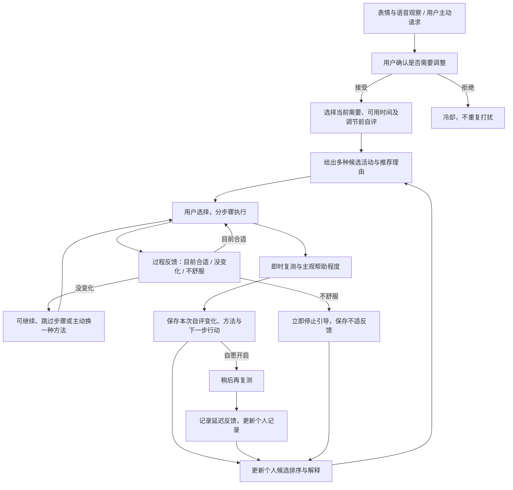

# 情绪调节闭环升级

这次升级把原有的“前自评—活动倒计时—后自评”扩展为可以解释、可以纠正、能够保留反馈的个人调节流程。它仍然是单机桌面原型，使用已有 Python 独立环境和本地数据库。

## 使用流程



“没有变化”不会被解释成失败，也不会让系统自动加大强度；用户可以继续观察或主动换方法。更换方法会结束并保留上一段的记录，再进入确认流程，不能把两种方法的结果混在一起。

## 活动的多样性

| 活动类型 | 交互重点 | 适用需要由用户选择 |
| --- | --- | --- |
| 短时休息 | 暂离当前任务、恢复时检查感受 | 精力不足、想暂停 |
| 舒适呼吸 | 可选视觉节奏，自然呼吸，不憋气、不强迫跟随 | 身体紧绷 |
| 感官注意 | 分步骤关注眼前、触感与声音 | 注意力困在烦恼中 |
| 任务拆解 | 写下卡点、已尝试方法与一个可执行动作 | 任务卡住 |
| 给想法命名 | 觉察“我正在想到什么”，再回到当前活动 | 反复想问题 |
| 友善自我对话 | 以温和、具体的语言回应自己 | 苛责自己、想获得支持 |
| 价值微行动 | 选择此刻重视的方向与一个小动作 | 想重新找到行动方向 |
| 桌面舒适调整 | 在舒适范围内调整坐姿或轻微活动，随时跳过 | 久坐、身体紧绷 |

活动内容是为桌面场景编写的短时引导，不要求用户完成所有步骤。适用方向只是候选匹配依据，系统不会根据脸部或语音输出替用户决定其需要。

## 推荐怎样利用反馈

候选排序同时参考当前需要、可用时间、用户明确偏好和个人已完成活动的反馈。每个候选保留理由、有效反馈样本数及可用的自评变化信息。

数据少时显示“反馈不足”，依靠当前需要匹配；不会把一次下降写成“最佳方法”。历史统计只使用同一档案、同一真实/模拟模式的记录，重复记录去重，未完成活动和缺少有效前后自评不会成为平均改善数据。不适反馈优先影响候选可用性，不能被正向的数值变化抵消。

历史项按 `n / (n + 3)` 收缩，其中 `n` 是实际参与排序的独立活动反馈数；样本少时，历史对排序的影响较小。前三个可用候选优先覆盖不同活动类别，避免列表被同一类方法占满。用户主动设置的偏好属于个人档案设置，模式隔离针对活动历史和效果统计。

收益样本使用有即时或延迟有效反馈的独立活动并集；先在每次活动内以 0.7／0.3 配对即时与延迟，再跨活动平均。同需求历史优先，跨需求只作低权重参考；换方法链不归因到最后一种方法，但保留不适。明确主观帮助反馈在缺少数值后测时仍可统计；来源不明的记录保持未核实。工程权重不代表因果疗效，完整说明见 [补丁集成记录](REVIEW_INTEGRATION.md)。

推荐分数是可解释的规则排序值，不是情绪判断正确率、治疗成功率或强化学习模型的输出。模型观察与用户自评分别存储；只有满足新鲜度和模态可比条件的前后模型观察，才可作为辅助信息。

## 即时反馈与延迟反馈

即时复测记录调节后困扰度和“有帮助／无明显帮助／更不舒服／无法评价”。`调节前自评 − 调节后自评` 只表示这次自评的变化。缺少后测时保留空值并标为无法评价；如果用户表示更不舒服，即使数值下降，也优先显示不适。

延迟复测由用户主动开启，先保存约定时间，再在应用内提供待复测入口。待办写入本地记录，关闭再打开后可以继续。没有回答、跳过或缺少有效评分均不会被当作持续改善。它不创建外部提醒或自动化，也不会在应用关闭时继续采集。

## 可用于课程展示的应用创新

- **从识别到可纠正的闭环**：双模态线索只是请求确认的依据，用户需求、过程感受和后测都能改变后续步骤。
- **从固定活动到可解释的个人选择**：方法、理由和反馈样本数一起呈现，历史不足时明确保留不确定性。
- **从一次打分到连续反馈链**：保留步骤推进、换方法、不适中止、即时复测和可选延迟复测，便于回看每次选择。
- **从推荐结果到可追溯依据**：活动记录保存当时的需要、候选理由和反馈；后续结果可导出核对。

这些是本项目的应用系统设计与工程实现，不声称首次提出新算法。软件流程跑通也不能替代真人有效性实验。

## 内容依据与验证边界

感官注意、觉察想法、友善回应和价值行动等原则参考 WHO 的 [Doing What Matters in Times of Stress](https://www.who.int/publications/i/item/9789240003927/)。呼吸活动遵循 NHS 的[舒适、不强迫的呼吸原则](https://www.nhs.uk/mental-health/self-help/guides-tools-and-activities/breathing-exercises-for-stress/)。本项目的短时交互不是这两份材料的完整方案，也不把其研究证据视为本软件已获得的效果。

独立验收脚本 `scripts/regulation_smoke.py` 使用明确标记的模拟输入与测试数据库，不打开摄像头或麦克风。它检查数据流、用户选择、异常分支和持久化，不测量真实调节效果；结果与截图集中保存在 `reports/regulation/`。

在项目目录内使用已有虚拟环境运行：

```powershell
.\.venv\Scripts\python.exe -m pytest -q
.\.venv\Scripts\python.exe scripts\regulation_smoke.py
.\.venv\Scripts\python.exe scripts\ui_smoke.py
.\.venv\Scripts\python.exe scripts\ui_review.py --output-dir reports\regulation\layout
```

闭环验收通过界面完成三段预设记录：先选择“给想法命名”，记录过程感受、即时评分和重启后的延迟评分；再为“舒适呼吸”提交不适并立即中止；最后为“价值微行动”保留缺失后测。它同时检查异步推荐不会覆盖明确选择、主动偏好可保存、重复复测不会重复写入、模拟历史不进入真实模式统计。

延迟验收使用明确标记的测试时钟加速，不把几分钟的等待假装成真人长期观察。`result.json` 保存实际执行结果，导出的两份会话 JSON 可核对三段活动、过程反馈和延迟反馈。六张截图覆盖推荐、步骤引导和个人反馈的 1280px / 1040px 桌面布局；原生应用的最小宽度仍为 1040px。

本次软件验收中，闭环脚本 **63 项检查通过**，原有 UI 冒烟脚本 **46 项检查通过**，布局脚本的 **12 个桌面状态均无横向溢出**。指导态下，“结束练习，开始复测”和“不舒服，停止”在 1280×900 与 1040×760 两种尺寸均完整位于滚动视口内；检查使用 `mapTo` 后的按钮矩形与 `scroll.viewport().rect()` 比较，具体坐标写入 `result.json` 的 `guided_controls`。

历史渲染回归额外核对：即时数值下降但用户反馈更不舒服时优先显示“报告不适”；已完成的延迟反馈使用“稍后自评”摘要，详情保留原即时数值和稍后状态。矛盾反馈使用独立的渲染输入，检查后恢复数据库中的真实测试会话，不新增伪造的持久化活动。
