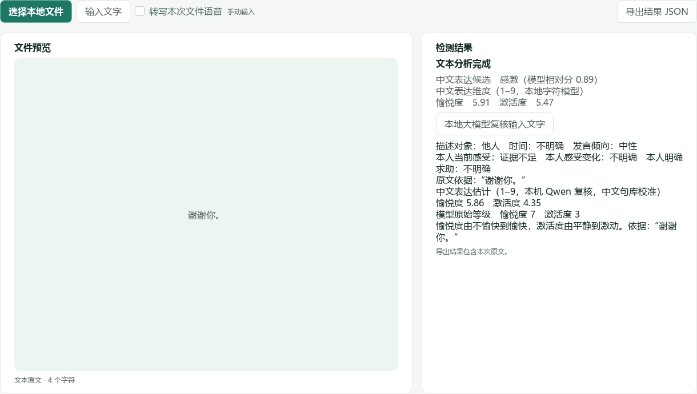

# 为什么研究一款能识别中文、由本人确认的情绪助手

“她说她昨天特别难过，我现在倒是松了一口气。”这句话同时出现两个人、两个时点、两种感受。给整句打一个负分，会丢掉对用户最有用的信息。项目据此提出两个可以分别检验的问题：加入语言模型，能否更准确地描述中文表达？让用户核对表达、确认需求并选择活动，能否让支持更有帮助、更少打扰？前者可以用人工标注语料检验，后者需要本人参加对照研究。

## 中文表达可以怎样测量

对“是哪类情绪”，Chen 等发布的 **CPED** 提供 13 种中文对话情绪类别，包含感激、放松、担心等容易被正负标签合并的表达。原始材料来自 40 部电视剧，涉及 392 位说话人。助手用这些标签学习单句表达，同时允许在证据弱时暂缓。演员在给定情境下的表达提供了训练参照，应用到日常对话还需另外检验。[Chen 等，CPED 原始论文，2022 年预印本](https://arxiv.org/abs/2205.14727)

Lee、Li 与 Yu 在 2022 年发表的 **Chinese EmoBank** 用人工评分分别测量中文表达的愉悦度与激活度，两项均为 1–9 分。例如，安宁和兴奋都可能令人愉悦，激活程度却不同。2026 年 ROCLING 组织者把相同问题移到新移民中文叙事中，开发集和测试集合计 1,300 篇，最佳系统的愉悦度与激活度 Pearson 分别为 0.8971 和 0.4376。项目因此逐维报告误差和相关性，也单独检验换一种中文来源后效果是否仍然成立。赛题成绩适用于该赛题的材料和划分。[Chinese EmoBank 期刊论文](https://doi.org/10.1145/3489141) · [Lin 等，ROCLING 2026 评测论文](https://aclanthology.org/2026.rocling-main.45/)

在视频里，文字的含义、语气和表情也可能不一致。Yu 等在 **CH-SIMS** 为 2,281 个中文视频片段分别标注文字、声音、画面以及三者合看的情感。这个设计为助手保留每一路依据提供了理由。对本项目的检验应先让各路输出与同一路人工标注比较，再检验融合结果；本人此刻的感受另由本人确认。[Yu 等，ACL 2020](https://aclanthology.org/2020.acl-main.343/)

## 大模型值得用在哪一层

Li 与 Lin 在 ROCLING 2025 提取大模型的中文语境向量并配合回归，集成系统在 1,541 篇医生反思文本上取得愉悦度和激活度 Pearson 0.805 和 0.608。这个结果支持检验语境表示能否补充字词线索。研究使用的是向量和回归，本项目则要求本地 Qwen 复核具体原话、区分表达对象和时点，二者的效果需要各自验证。Sabour 等用 400 道中英文人工设计题测试情绪理解与应用，参测大模型与普通人之间仍有明显差距。这也解释了为何界面同时保留原话、暂缓和用户纠正。[Li 与 Lin，ROCLING 2025](https://aclanthology.org/2025.rocling-main.44/) · [Sabour 等，ACL 2024](https://aclanthology.org/2024.acl-long.326/)

项目可验证的贡献是把语境收益拆开测。对同一句话，字符模型可以提供一组无需大模型的参照分；Qwen 可以额外回答“谁在表达、何时发生、哪段话提供依据”。前一项用本机中文模型与 Qwen 在同一批人工评分上的 MAE、Pearson 和有效输出比例检验；后一项须逐字段核对人工答案。逐字引文便于检查归因，引用位置正确也可能理解错主语或否定。在此前冻结的 8 个中英文语义用例中，6 个用例的所有预定字段均符合预期，但涉及求助或拒绝的 4 例只答对 2 例。因此系统把用户亲自选择的帮助需求作为活动入口。[独立语义用例和错误明细](results/semantic-review-challenge.json) · [文字量化实验](AFFECT_QUANTIFICATION.md)

## 本项目在中文上测到了什么

下表记录双维评分器的独立运行。对同一批 160 句另跑正式桌面两阶段入口后，159 句产生有效评分。愉悦度 MAE 为 0.7888、Pearson 为 0.7651，激活度 MAE 为 0.9852、Pearson 为 0.2347。[桌面入口与单独评分器对照](QWEN_BENCHMARK.md)

**一、从同一句中文估计愉悦度与激活度。** 采用 Chinese EmoBank 的人工读者评分（1–9）。字符模型用 1,975 句训练，模型参数在训练数据内选择。沿用原有 192 句校准组，另取 160 句确认，和此前试验的先导组、确认组均无交叠。字符模型有效 160 句，Qwen 有逐字依据的有效评分为 159 句，下面的误差和相关性比较同一批 159 句。均方意义下拟合的混合权重只在校准组选择。最终版统一采用 OpenCC 固定字符表代替操作系统字表，记录保留了看到初始运行后做过这次可移植性修订的事实。原始语料主要采用繁体字，本次维度成绩不能外推到所有简体日常对话。[划分、覆盖及配对误差区间](results/chinese-dimension-hybrid.json)

| 方法 | 愉悦度 MAE ↓ | 愉悦度 Pearson ↑ | 激活度 MAE ↓ | 激活度 Pearson ↑ |
| --- | ---: | ---: | ---: | ---: |
| 离线字符岭回归 | 1.1118 | 0.3426 | 0.9570 | 0.3469 |
| 本机 Qwen3 8B，按开发数据校准 | **0.7884** | 0.7673 | 0.9852 | 0.2347 |
| 两者按维度加权的实验方案 | 0.8291 | **0.7731** | **0.9546** | **0.3601** |

在这组中文标注上，Qwen 的愉悦度平均绝对误差减少 **0.3234 分**，按句配对重采样的 95% 区间为 **0.2100 至 0.4330**。这是接入大模型最直接的实测理由。激活度上 Qwen 的误差反而更大。实验加权相对字符模型减少的 0.0024 分，区间从 −0.0089 到 0.0132，尚无可靠增益。界面先展示离线读数，点击复核后另列大模型的评分和引文，便于核对分歧。[同批中文对照](results/chinese-dimension-hybrid.json)

**二、从中文对白识别具体表达。** CPED 的官方训练、开发、测试集分别来自 26、5、9 部不同的剧，测试集共 27,438 条。模型只读本句，按开发集选定门槛后，判对 **1,154** 条、判错 **1,992** 条、暂缓 **24,292** 条。覆盖率 **11.47%**，已判样本正确率 **36.68%**。在所有样本上，去掉信心门槛的分类宏 F1 为 0.1466，带门槛为 0.0564，始终预测训练集多数类为 0.0347。门槛使系统能在少数有明确线索的句子上给候选，却漏掉大量表达。比如“谢谢你”和“謝謝你”均得到“感激”，模型相对分约 0.89。这个分值描述类别间的相对支持度，标签也只代表对白表达。[逐类错误、暂缓与覆盖](results/cped-chinese-emotions.json)

我们还问了一个直接影响产品选择的问题：让大模型也从这 13 类里挑一个，会不会更好？从官方测试集取每类 10 句，先剔除训练及开发中出现过的句子和测试内重复，冻结 130 条的哈希清单。用同一批原话，离线直接取首选判对 19、判错 109、暂缓 2；桌面门控判对 6、判错 16、暂缓 108；实验性 Qwen 分类判对 26、判错 103、暂缓 1。Qwen 有 **82/130** 次选中性，这一均衡样本实际只有 10 条中性。与离线取首选相比，双方独自判对 14 与 7 条，双侧精确配对检验 p=0.189。因此，直接让大模型挑 13 类保留在研究脚本中。日常复核使用有依据的维度评分和原话分析。[冻结样本与配对检验](results/cped-qwen-paired.json)

**三、大模型能否区分“本人现在难过”和“室友说她难过”。** 另设计 12 对共 24 条简体中文句子，推理前固定预期答案。原规则把描述对象答对 19/24、时间答对 19/24，两项同时正确 14/24。使用原版语义复核，Qwen 分别答对 **20/24、22/24**，同时正确 **18/24**。对本人此刻感受的正、中、负或证据不足，Qwen 答对 19/24。求助字段只有 3/24 完全符合预期，两个显式请求均识别到，两个明确拒绝均漏掉，大部分普通陈述被答为“不明确”。这组由项目开发者构造的句子用于定位错误，不能当作自然人群准确率。系统只根据用户亲自点击来采纳活动。[逐句输入、冻结答案与实际输出](results/chinese-context-pairs.json)

**普通话文件验收。** 在桌面选择 SenseVoice 发布方的普通话录音，关闭转写得到 0 条文字，开启后得到一段“开放时间早上9点至下午5点。”，与发布方演示文本一致。离线分类最高为中性 0.431，低于门槛 0.45，界面暂缓。Qwen 对原话的语义解读为中性事实陈述，本人当前感受证据不足。整段、按时段查看和 JSON 导出均已检查。这是一条文件流程验收，未测量自然对话中的语音识别正确率。[真实录音与桌面导出](results/mandarin-file-recognition.json)

**手动输入验收。** 在「本地文件检测 → 输入文字」输入“谢谢你。”，离线模型的最高候选是感激，点击复核后还可查看两项大模型维度评分、本人感受依据及原句。这个例子也展示了两种任务的差别：Qwen 给整句发言倾向标了中性，离线模型把表达类别判为感激。界面让使用者核对两种解读。[实际桌面 JSON 导出](results/chinese-typed-entry.json)



## 调节效果为什么必须看反馈

Liu 等的 **ESConv** 给支持策略做标注，并在对话中收集求助者对回答的反馈。Sharma 等在 300 名线上同伴支持者参与的非临床随机试验中发现，给支持者即时 AI 反馈，其回复的共情评分总体相对提高 19.6%。两项工作分别支持记录“采用了哪种策略”和“人如何使用 AI 建议”。后一项测量的是支持者回复的共情程度，无法据此推算本助手能让使用者的困扰下降多少。[Liu 等，ACL 2021](https://aclanthology.org/2021.acl-long.269/) · [Sharma 等，Nature Machine Intelligence 2023](https://www.nature.com/articles/s42256-022-00593-2)

本助手已能先征求本人意见，再给出合格活动，记录采纳、改选、中止、不适和活动后的自评。要验证这种设计是否更有帮助，可让同一位自愿参加者按随机顺序体验常规推荐与 AI 推荐，两种条件提供相同活动、时长和拒绝选项。事先选定主要指标，例如活动前至固定复测时点的困扰度变化；同时报告漏填复测、拒绝和不适，并按参加者比较两种条件的差异。公开语料支持的是识别能力，只有这一步才能回答调节对本人是否有益。[已有活动与反馈验证](AI_ASSISTANT_STUDY.md)

## 如何复现中文对照

在项目根目录运行。日常离线识别使用随项目提供的模型。重做研究时，按数据作者的使用条件取得 CPED、Chinese EmoBank CVAS 与录音样例。原文和模型响应缓存留在本机。以下脚本默认将统计写入 `reports/`。

```powershell
.\.venv\Scripts\python.exe scripts/evaluate_chinese_emotions.py --download
.\scripts\start_text_review.ps1
.\.venv\Scripts\python.exe scripts/evaluate_chinese_affect.py --download
.\.venv\Scripts\python.exe scripts/evaluate_chinese_dimension_hybrid.py --verify-bundled
.\.venv\Scripts\python.exe scripts/evaluate_chinese_emotion_review.py
.\.venv\Scripts\python.exe scripts/evaluate_chinese_context.py
.\.venv\Scripts\python.exe scripts/verify_mandarin_file.py --with-ollama
```

普通话验收使用项目原有 `.runtime/test_assets/sensevoice_zh.mp3`，也可用 `--sample` 指向同一发布方样例。已经保存过真实 Qwen 结果时，维度对照和 13 类配对脚本都支持 `--offline` 重新计算指标。[官方录音与文件哈希](results/mandarin-file-recognition.json)
